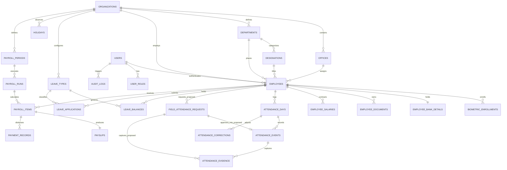

# Database Architecture, Schema & Entity Relationship Diagram (ERD)

**System Designation:** HRMS-Core-V1 Database Architecture  
**Engine:** PostgreSQL 15+ (via Supabase)  
**Schema Pattern:** Multi-Tenant Ready Normalized Relational Schema with Row-Level Security (RLS) & Immutable Audit Ledgers  
**Document Version:** 1.7  
**PRD Reference:** PRD v1.9 Baseline (Incorporating Approved DEC-01 Paid Lunch, DEC-02, DEC-09/DEC-13 Auth Broker, DEC-14 Selfie Ceiling, DEC-15, and Proposed `PO-ATT-GEOFENCE-50M` / `PO-ATT-FIELD-SALES` Attendance Revisions; See Section 9 for Implemented `00001`–`00003` vs Proposed Future Migrations)  

---

## 1. Architectural Principles

1. **Multi-Tenant Foundation from Day 1:** Every tenant-bound table contains an `organization_id` foreign key. For the initial 10-person office, a default organization (`ORG001`) is seeded, ensuring zero schema refactoring when scaling to multiple clients or entities.
2. **Strict Financial Data Types (Paise Accounting):** All monetary figures (`base_monthly_salary`, `earned_salary`, `allowances`, `deductions`, `net_salary`) are modeled as `BIGINT` representing integer paise (1 INR = 100 paise). This completely eliminates IEEE-754 binary floating-point rounding errors.
3. **Derived Rate Reporting & Exact Rational Arithmetic:** Derived daily, hourly, and minute rates may be stored as `NUMERIC(14, 6)` for fractional reporting and display. However, `NUMERIC(14, 6)` is fractional decimal precision, not exact rational arithmetic, and must not be the authoritative calculation source. Authoritative gross earned salary is computed directly using exact rational numerator and denominator arithmetic: $\text{segment\_earnings\_paise} = \frac{\text{payable\_minutes} \times \text{salary\_reference\_paise}}{\text{calendar\_days} \times 480}$. Unrounded segment earnings are summed across effective-date segments and rounded once to integer paise.
4. **Immutable Event Sinks:** Attendance events (`attendance_events`) and audit records (`audit_logs`) are append-only. Corrections and adjustments are stored in dedicated child tables (`attendance_corrections`), preserving the original raw timestamps.
5. **Row Level Security (RLS):** Policies enforce least-privilege data access at the database engine layer. Employees are physically restricted from querying rows outside their own `user_id`.

---

## 2. Entity Relationship Diagram (ERD)



---

## 3. Production PostgreSQL DDL Schema

```sql
-- ============================================================================
-- HRMS DATABASE INITIALIZATION SCRIPT (POSTGRESQL 15+)
-- ============================================================================

CREATE EXTENSION IF NOT EXISTS "uuid-ossp";
CREATE EXTENSION IF NOT EXISTS "pgcrypto";

-- ----------------------------------------------------------------------------
-- ENUMS
-- ----------------------------------------------------------------------------
CREATE TYPE user_role_enum AS ENUM ('SUPER_ADMIN', 'ADMIN', 'EMPLOYEE');
CREATE TYPE gender_enum AS ENUM ('MALE', 'FEMALE', 'OTHER');
CREATE TYPE employment_status_enum AS ENUM ('PROBATION', 'CONFIRMED', 'NOTICE_PERIOD', 'TERMINATED', 'RESIGNED');
CREATE TYPE punch_type_enum AS ENUM ('CHECK_IN', 'CHECK_OUT');
CREATE TYPE verification_status_enum AS ENUM ('VERIFIED', 'PENDING_REVIEW', 'REJECTED');
CREATE TYPE attendance_day_status_enum AS ENUM ('PRESENT', 'ABSENT', 'HALF_DAY_NOT_USED', 'ON_LEAVE', 'WEEKLY_OFF', 'PUBLIC_HOLIDAY');
CREATE TYPE leave_status_enum AS ENUM ('PENDING', 'APPROVED', 'REJECTED', 'CANCELLED');
CREATE TYPE payroll_batch_status_enum AS ENUM ('DRAFT', 'SUBMITTED_FOR_APPROVAL', 'APPROVED', 'REJECTED', 'PROCESSED');
CREATE TYPE payment_status_enum AS ENUM ('PENDING', 'PAID', 'FAILED');
CREATE TYPE payment_mode_enum AS ENUM ('NEFT', 'RTGS', 'IMPS', 'CHEQUE', 'CASH');

-- ----------------------------------------------------------------------------
-- 1. ORGANIZATIONS & OFFICES
-- ----------------------------------------------------------------------------
CREATE TABLE organizations (
    id UUID PRIMARY KEY DEFAULT gen_random_uuid(),
    organization_code VARCHAR(20) NOT NULL UNIQUE, -- DEC-13 uppercase tri-partite anchor
    name VARCHAR(255) NOT NULL,
    legal_name VARCHAR(255) NOT NULL,
    registration_number VARCHAR(100),
    contact_phone VARCHAR(20) NOT NULL,
    contact_email VARCHAR(255) NOT NULL,
    address TEXT NOT NULL,
    logo_url TEXT,
    selfie_retention_days INTEGER NOT NULL CHECK (selfie_retention_days BETWEEN 1 AND 30), -- DEC-14: Explicit config mandatory; zero unapproved default
    is_active BOOLEAN NOT NULL DEFAULT TRUE,
    created_at TIMESTAMPTZ NOT NULL DEFAULT NOW(),
    updated_at TIMESTAMPTZ NOT NULL DEFAULT NOW()
);

CREATE TABLE offices (
    id UUID PRIMARY KEY DEFAULT uuid_generate_v4(),
    organization_id UUID NOT NULL REFERENCES organizations(id) ON DELETE RESTRICT,
    name VARCHAR(150) NOT NULL,
    address TEXT NOT NULL,
    latitude NUMERIC(10, 7) NOT NULL,
    longitude NUMERIC(10, 7) NOT NULL,
    -- Baseline was 100m; PROPOSED PO-ATT-GEOFENCE-50M sets standard radius to 50m pending formal PO approval:
    geofence_radius_meters INTEGER NOT NULL DEFAULT 100 CHECK (geofence_radius_meters >= 10),
    shift_start_time TIME NOT NULL DEFAULT '10:00:00',
    shift_end_time TIME NOT NULL DEFAULT '18:00:00',
    lunch_start_time TIME NOT NULL DEFAULT '13:00:00',
    lunch_end_time TIME NOT NULL DEFAULT '14:00:00',
    grace_period_mins INTEGER NOT NULL DEFAULT 10,
    is_active BOOLEAN NOT NULL DEFAULT TRUE,
    created_at TIMESTAMPTZ NOT NULL DEFAULT NOW(),
    updated_at TIMESTAMPTZ NOT NULL DEFAULT NOW(),
    CONSTRAINT uq_offices_org_id UNIQUE (organization_id, id)
);

CREATE TABLE departments (
    id UUID PRIMARY KEY DEFAULT uuid_generate_v4(),
    organization_id UUID NOT NULL REFERENCES organizations(id) ON DELETE RESTRICT,
    name VARCHAR(100) NOT NULL,
    -- PROPOSED PHASE 2 (PO-ATT-FIELD-SALES): Enables Field Attendance Request exception strictly for Sales Team:
    allow_field_attendance BOOLEAN NOT NULL DEFAULT FALSE,
    is_active BOOLEAN NOT NULL DEFAULT TRUE,
    created_at TIMESTAMPTZ NOT NULL DEFAULT NOW(),
    updated_at TIMESTAMPTZ NOT NULL DEFAULT NOW(),
    UNIQUE(organization_id, name),
    CONSTRAINT uq_departments_org_id UNIQUE (organization_id, id)
);

CREATE TABLE designations (
    id UUID PRIMARY KEY DEFAULT uuid_generate_v4(),
    department_id UUID NOT NULL REFERENCES departments(id) ON DELETE RESTRICT,
    title VARCHAR(100) NOT NULL,
    is_active BOOLEAN NOT NULL DEFAULT TRUE,
    created_at TIMESTAMPTZ NOT NULL DEFAULT NOW(),
    updated_at TIMESTAMPTZ NOT NULL DEFAULT NOW(),
    UNIQUE(department_id, title)
);

-- ----------------------------------------------------------------------------
-- 2. USERS, ROLES & EMPLOYEES
-- (Existing foundation implemented in Migrations 00002 & 00003; proposed Auth
--  Broker extensions flagged clearly for future Migration 00004 in Section 9.)
-- ----------------------------------------------------------------------------
CREATE TABLE users (
    id UUID PRIMARY KEY REFERENCES auth.users(id) ON DELETE CASCADE, -- DEC-09 strict 1:1 mapping; no default UUID generation
    organization_id UUID NOT NULL REFERENCES organizations(id) ON DELETE RESTRICT,
    phone_number VARCHAR(15) NOT NULL, -- Tenant-scoped uniqueness below (never globally unique)
    -- Zero password_hash column: Supabase Auth auth.users is the exclusive password store (DEC-09)
    is_active BOOLEAN NOT NULL DEFAULT TRUE,
    must_change_password BOOLEAN NOT NULL DEFAULT TRUE,
    created_at TIMESTAMPTZ NOT NULL DEFAULT NOW(),
    updated_at TIMESTAMPTZ NOT NULL DEFAULT NOW(),
    -- [PROPOSED FUTURE MIGRATION 00004 — NOT YET IN LIVE DB]:
    -- synthetic_email VARCHAR(255) UNIQUE NOT NULL, (PO-01 Approved Scheme 3: <immutable_uuid>@auth.hrms.internal; PO-01..PO-07 & Activation Policy approved; live SMS awaiting DEC-10)
    -- activated_at TIMESTAMPTZ,
    -- phone_verified_at TIMESTAMPTZ, -- Proposed under PO-03: tracks verified registered Indian mobile eligibility for self-service OTP recovery
    -- tokens_valid_after_epoch BIGINT NOT NULL DEFAULT 0,
    -- last_login_at TIMESTAMPTZ,
    CONSTRAINT uq_users_org_phone UNIQUE (organization_id, phone_number),
    CONSTRAINT uq_users_org_id UNIQUE (organization_id, id),
    CONSTRAINT chk_users_phone_format CHECK (phone_number ~ '^\+?[0-9]{10,15}$') -- Live Migration 00002 constraint; proposed Migration 00004 tightens to PO-02 Approved '^\+91[6-9][0-9]{9}$'
);

CREATE TABLE user_roles (
    id UUID PRIMARY KEY DEFAULT gen_random_uuid(),
    organization_id UUID NOT NULL REFERENCES organizations(id) ON DELETE RESTRICT,
    user_id UUID NOT NULL,
    role user_role_enum NOT NULL,
    assigned_by UUID,
    assigned_at TIMESTAMPTZ NOT NULL DEFAULT NOW(),
    CONSTRAINT fk_user_roles_org_user FOREIGN KEY (organization_id, user_id) REFERENCES users(organization_id, id) ON DELETE CASCADE,
    CONSTRAINT fk_user_roles_org_assigned_by FOREIGN KEY (organization_id, assigned_by) REFERENCES users(organization_id, id) ON DELETE SET NULL (assigned_by),
    CONSTRAINT uq_user_roles_org_user_role UNIQUE (organization_id, user_id, role)
);

CREATE SEQUENCE emp_code_seq START WITH 1 INCREMENT BY 1;

CREATE TABLE employees (
    id UUID PRIMARY KEY DEFAULT uuid_generate_v4(),
    organization_id UUID NOT NULL REFERENCES organizations(id) ON DELETE RESTRICT,
    user_id UUID UNIQUE NOT NULL REFERENCES users(id) ON DELETE RESTRICT,
    office_id UUID NOT NULL REFERENCES offices(id) ON DELETE RESTRICT,
    department_id UUID NOT NULL REFERENCES departments(id) ON DELETE RESTRICT,
    designation_id UUID NOT NULL REFERENCES designations(id) ON DELETE RESTRICT,
    employee_code VARCHAR(20) UNIQUE NOT NULL,
    first_name VARCHAR(100) NOT NULL,
    last_name VARCHAR(100) NOT NULL,
    date_of_birth DATE NOT NULL,
    gender gender_enum NOT NULL,
    profile_photo_url TEXT,
    email VARCHAR(255),
    residential_address TEXT NOT NULL,
    joining_date DATE NOT NULL,
    employment_status employment_status_enum NOT NULL DEFAULT 'CONFIRMED',
    exit_date DATE,
    exit_reason TEXT,
    emergency_contact_name VARCHAR(150),
    emergency_contact_relation VARCHAR(50),
    -- ... existing employee fields ...
    emergency_contact_phone VARCHAR(20),
    created_at TIMESTAMPTZ NOT NULL DEFAULT NOW(),
    updated_at TIMESTAMPTZ NOT NULL DEFAULT NOW(),
    CONSTRAINT uq_employees_org_id UNIQUE (organization_id, id)
);

CREATE TABLE employee_bank_details (
    id UUID PRIMARY KEY DEFAULT uuid_generate_v4(),
    employee_id UUID UNIQUE NOT NULL REFERENCES employees(id) ON DELETE CASCADE,
    account_holder_name VARCHAR(200) NOT NULL,
    account_number_encrypted TEXT NOT NULL,
    account_number_last4 VARCHAR(4) NOT NULL,
    ifsc_code VARCHAR(20) NOT NULL,
    bank_name VARCHAR(150) NOT NULL,
    created_at TIMESTAMPTZ NOT NULL DEFAULT NOW(),
    updated_at TIMESTAMPTZ NOT NULL DEFAULT NOW()
);

CREATE TABLE employee_documents (
    id UUID PRIMARY KEY DEFAULT uuid_generate_v4(),
    employee_id UUID NOT NULL REFERENCES employees(id) ON DELETE CASCADE,
    document_type VARCHAR(50) NOT NULL,
    document_name VARCHAR(255) NOT NULL,
    storage_path TEXT NOT NULL,
    mime_type VARCHAR(100) NOT NULL,
    created_at TIMESTAMPTZ NOT NULL DEFAULT NOW()
);

-- ----------------------------------------------------------------------------
-- 3. BIOMETRICS & ENROLLMENT (SEPARATED FROM STATUTORY RECORD RETENTION)
-- ----------------------------------------------------------------------------
CREATE TABLE biometric_enrollments (
    id UUID PRIMARY KEY DEFAULT uuid_generate_v4(),
    employee_id UUID UNIQUE NOT NULL REFERENCES employees(id) ON DELETE CASCADE,
    reference_image_path TEXT NOT NULL,
    face_encoding_token TEXT,
    provider_name VARCHAR(50) NOT NULL DEFAULT 'MOCK',
    provider_subject_id VARCHAR(255),
    is_approved BOOLEAN NOT NULL DEFAULT FALSE,
    approved_by UUID REFERENCES users(id),
    approved_at TIMESTAMPTZ,
    consent_recorded_at TIMESTAMPTZ NOT NULL DEFAULT NOW(),
    retention_status VARCHAR(50) NOT NULL DEFAULT 'ACTIVE', -- 'ACTIVE', 'FLAGGED_FOR_PURGE', 'PURGED', 'LEGAL_HOLD'
    is_legal_hold BOOLEAN NOT NULL DEFAULT FALSE, -- Suspends automated purge crons and right-to-erasure workflows
    legal_hold_reason TEXT,
    legal_hold_placed_by UUID REFERENCES users(id),
    legal_hold_placed_at TIMESTAMPTZ,
    purged_at TIMESTAMPTZ,
    created_at TIMESTAMPTZ NOT NULL DEFAULT NOW(),
    updated_at TIMESTAMPTZ NOT NULL DEFAULT NOW()
);

-- ----------------------------------------------------------------------------
-- 4. SMART ATTENDANCE
-- ----------------------------------------------------------------------------
CREATE TABLE attendance_days (
    id UUID PRIMARY KEY DEFAULT uuid_generate_v4(),
    organization_id UUID NOT NULL REFERENCES organizations(id) ON DELETE RESTRICT,
    employee_id UUID NOT NULL REFERENCES employees(id) ON DELETE RESTRICT,
    office_id UUID NOT NULL REFERENCES offices(id) ON DELETE RESTRICT,
    attendance_date DATE NOT NULL,
    day_status attendance_day_status_enum NOT NULL DEFAULT 'PRESENT',
    is_late BOOLEAN NOT NULL DEFAULT FALSE,
    is_early_departure BOOLEAN NOT NULL DEFAULT FALSE,
    first_check_in_at TIMESTAMPTZ,
    last_check_out_at TIMESTAMPTZ,
    gross_elapsed_minutes INTEGER NOT NULL DEFAULT 0,
    lunch_deducted_minutes INTEGER NOT NULL DEFAULT 0, -- DEC-01 Approved: MAX(0, LEAST(out, 14:00) - GREATEST(in, 13:00))
    approved_post18_minutes INTEGER NOT NULL DEFAULT 0,
    net_payable_minutes INTEGER NOT NULL DEFAULT 0, -- Must remain strictly 0 if either punch is unpaired (missing check-in or missing check-out)
    requires_admin_review BOOLEAN NOT NULL DEFAULT FALSE, -- Set TRUE on incomplete check-in or exceptional unpaired check-out (admin/import/integrity origin)
    review_reason TEXT,
    reviewed_by UUID REFERENCES users(id),
    reviewed_at TIMESTAMPTZ,
    created_at TIMESTAMPTZ NOT NULL DEFAULT NOW(),
    updated_at TIMESTAMPTZ NOT NULL DEFAULT NOW(),
    UNIQUE(employee_id, attendance_date)
);

CREATE TABLE attendance_events (
    id UUID PRIMARY KEY DEFAULT uuid_generate_v4(),
    attendance_day_id UUID NOT NULL REFERENCES attendance_days(id) ON DELETE CASCADE,
    employee_id UUID NOT NULL REFERENCES employees(id) ON DELETE RESTRICT,
    event_type punch_type_enum NOT NULL,
    server_timestamp TIMESTAMPTZ NOT NULL DEFAULT NOW(),
    device_timestamp TIMESTAMPTZ NOT NULL,
    latitude NUMERIC(10, 7) NOT NULL,
    longitude NUMERIC(10, 7) NOT NULL,
    accuracy_meters NUMERIC(6, 2) NOT NULL,
    -- Baseline NUMERIC(8,2); PROPOSED Phase 2 §9.3 widens to NUMERIC(10,2) and adds is_field_attendance + field_attendance_request_id:
    distance_from_office_meters NUMERIC(8, 2) NOT NULL,
    is_within_geofence BOOLEAN NOT NULL,
    verification_status verification_status_enum NOT NULL DEFAULT 'VERIFIED',
    verification_attempt_count INTEGER NOT NULL DEFAULT 1,
    is_offline_sync BOOLEAN NOT NULL DEFAULT FALSE,
    is_manual_entry BOOLEAN NOT NULL DEFAULT FALSE,
    created_at TIMESTAMPTZ NOT NULL DEFAULT NOW(),
    -- DEC-02 ENFORCEMENT: Exactly one CHECK_IN and one CHECK_OUT per attendance day
    UNIQUE(attendance_day_id, event_type)
);

CREATE TABLE attendance_evidence (
    id UUID PRIMARY KEY DEFAULT uuid_generate_v4(),
    -- PROPOSED Phase 2 §9.3 adds organization_id, nullable attendance_event_id, and field_attendance_request_id so pending/rejected field selfies share private bucket + DEC-14 purge:
    attendance_event_id UUID NOT NULL REFERENCES attendance_events(id) ON DELETE CASCADE,
    captured_at TIMESTAMPTZ NOT NULL, -- Device capture timestamp (device_timestamp). Note: Retention-clock starting point between device capture time and trusted server receipt time is an unresolved policy/architecture clarification under DEC-14.
    selfie_storage_path TEXT, -- Retained for max 30 calendar days (DEC-14 Proposed); nullified upon automated purge
    audit_image_hash VARCHAR(64), -- SHA-256 cryptographic audit fingerprint; pseudonymous/potentially linkable data, NOT anonymous information or a substitute for original visual evidence
    liveness_score NUMERIC(5, 4),
    face_match_confidence NUMERIC(5, 4),
    provider_transaction_id VARCHAR(255),
    retention_status VARCHAR(50) NOT NULL DEFAULT 'ACTIVE', -- 'ACTIVE', 'FLAGGED_FOR_PURGE', 'PURGED', 'LEGAL_HOLD'
    is_legal_hold BOOLEAN NOT NULL DEFAULT FALSE, -- Suspends automated purge crons during dispute/investigation
    legal_hold_reason TEXT,
    legal_hold_placed_by UUID REFERENCES users(id),
    legal_hold_placed_at TIMESTAMPTZ,
    legal_hold_released_by UUID REFERENCES users(id),
    legal_hold_released_at TIMESTAMPTZ,
    purged_at TIMESTAMPTZ,
    created_at TIMESTAMPTZ NOT NULL DEFAULT NOW()
);

CREATE TABLE attendance_corrections (
    id UUID PRIMARY KEY DEFAULT uuid_generate_v4(),
    attendance_day_id UUID NOT NULL REFERENCES attendance_days(id) ON DELETE CASCADE,
    employee_id UUID NOT NULL REFERENCES employees(id) ON DELETE RESTRICT,
    action_type punch_type_enum NOT NULL,
    original_timestamp TIMESTAMPTZ,
    corrected_timestamp TIMESTAMPTZ NOT NULL,
    reason TEXT NOT NULL,
    previous_state JSONB,
    updated_state JSONB,
    created_by UUID NOT NULL REFERENCES users(id),
    created_at TIMESTAMPTZ NOT NULL DEFAULT NOW()
);

-- ----------------------------------------------------------------------------
-- 5. LEAVES & HOLIDAYS
-- ----------------------------------------------------------------------------
CREATE TABLE leave_types (
    id UUID PRIMARY KEY DEFAULT uuid_generate_v4(),
    organization_id UUID NOT NULL REFERENCES organizations(id) ON DELETE RESTRICT,
    code VARCHAR(10) NOT NULL, -- 'CL', 'SL', 'PL', 'LWP'
    name VARCHAR(100) NOT NULL,
    is_paid BOOLEAN NOT NULL DEFAULT FALSE, -- Current baseline: FALSE
    annual_quota NUMERIC(4, 1) NOT NULL DEFAULT 0.0,
    is_active BOOLEAN NOT NULL DEFAULT TRUE,
    created_at TIMESTAMPTZ NOT NULL DEFAULT NOW(),
    UNIQUE(organization_id, code)
);

CREATE TABLE leave_balances (
    id UUID PRIMARY KEY DEFAULT uuid_generate_v4(),
    employee_id UUID NOT NULL REFERENCES employees(id) ON DELETE CASCADE,
    leave_type_id UUID NOT NULL REFERENCES leave_types(id) ON DELETE RESTRICT,
    year INTEGER NOT NULL,
    allocated_days NUMERIC(4, 1) NOT NULL DEFAULT 0.0,
    used_days NUMERIC(4, 1) NOT NULL DEFAULT 0.0,
    available_days NUMERIC(4, 1) GENERATED ALWAYS AS (allocated_days - used_days) STORED,
    created_at TIMESTAMPTZ NOT NULL DEFAULT NOW(),
    updated_at TIMESTAMPTZ NOT NULL DEFAULT NOW(),
    UNIQUE(employee_id, leave_type_id, year)
);

CREATE TABLE leave_applications (
    id UUID PRIMARY KEY DEFAULT uuid_generate_v4(),
    employee_id UUID NOT NULL REFERENCES employees(id) ON DELETE RESTRICT,
    leave_type_id UUID NOT NULL REFERENCES leave_types(id) ON DELETE RESTRICT,
    start_date DATE NOT NULL,
    end_date DATE NOT NULL,
    total_days NUMERIC(4, 1) NOT NULL,
    reason TEXT NOT NULL,
    status leave_status_enum NOT NULL DEFAULT 'PENDING',
    reviewed_by UUID REFERENCES users(id),
    review_remarks TEXT,
    reviewed_at TIMESTAMPTZ,
    created_at TIMESTAMPTZ NOT NULL DEFAULT NOW(),
    updated_at TIMESTAMPTZ NOT NULL DEFAULT NOW()
);

CREATE TABLE holidays (
    id UUID PRIMARY KEY DEFAULT uuid_generate_v4(),
    organization_id UUID NOT NULL REFERENCES organizations(id) ON DELETE RESTRICT,
    holiday_date DATE NOT NULL,
    name VARCHAR(150) NOT NULL,
    is_paid BOOLEAN NOT NULL DEFAULT FALSE, -- Current baseline: FALSE
    created_at TIMESTAMPTZ NOT NULL DEFAULT NOW(),
    UNIQUE(organization_id, holiday_date)
);

-- ----------------------------------------------------------------------------
-- 6. PAYROLL ENGINE & PAYSLIPS
-- ----------------------------------------------------------------------------
CREATE TABLE employee_salaries (
    id UUID PRIMARY KEY DEFAULT uuid_generate_v4(),
    employee_id UUID NOT NULL REFERENCES employees(id) ON DELETE RESTRICT,
    monthly_salary_reference_paise BIGINT NOT NULL CHECK (monthly_salary_reference_paise >= 0),
    effective_from DATE NOT NULL,
    effective_to DATE,
    created_by UUID NOT NULL REFERENCES users(id),
    created_at TIMESTAMPTZ NOT NULL DEFAULT NOW()
);

CREATE TABLE payroll_periods (
    id UUID PRIMARY KEY DEFAULT uuid_generate_v4(),
    organization_id UUID NOT NULL REFERENCES organizations(id) ON DELETE RESTRICT,
    year INTEGER NOT NULL,
    month INTEGER NOT NULL CHECK (month BETWEEN 1 AND 12),
    start_date DATE NOT NULL,
    end_date DATE NOT NULL,
    scheduled_working_days INTEGER NOT NULL,
    standard_monthly_hours NUMERIC(6, 2) NOT NULL,
    standard_monthly_minutes INTEGER NOT NULL,
    is_closed BOOLEAN NOT NULL DEFAULT FALSE,
    created_at TIMESTAMPTZ NOT NULL DEFAULT NOW(),
    UNIQUE(organization_id, year, month)
);

CREATE TABLE payroll_runs (
    id UUID PRIMARY KEY DEFAULT uuid_generate_v4(),
    payroll_period_id UUID NOT NULL REFERENCES payroll_periods(id) ON DELETE RESTRICT,
    status payroll_batch_status_enum NOT NULL DEFAULT 'DRAFT',
    prepared_by UUID NOT NULL REFERENCES users(id),
    prepared_at TIMESTAMPTZ NOT NULL DEFAULT NOW(),
    approved_by UUID REFERENCES users(id),
    approved_at TIMESTAMPTZ,
    rejection_reason TEXT,
    total_gross_paise BIGINT NOT NULL DEFAULT 0,
    total_deductions_paise BIGINT NOT NULL DEFAULT 0,
    total_net_paise BIGINT NOT NULL DEFAULT 0,
    created_at TIMESTAMPTZ NOT NULL DEFAULT NOW(),
    updated_at TIMESTAMPTZ NOT NULL DEFAULT NOW()
);

CREATE TABLE payroll_items (
    id UUID PRIMARY KEY DEFAULT uuid_generate_v4(),
    payroll_run_id UUID NOT NULL REFERENCES payroll_runs(id) ON DELETE CASCADE,
    employee_id UUID NOT NULL REFERENCES employees(id) ON DELETE RESTRICT,
    monthly_salary_reference_paise BIGINT NOT NULL,
    standard_scheduled_minutes INTEGER NOT NULL,
    minute_rate_paise NUMERIC(14, 6) NOT NULL,
    approved_payable_minutes INTEGER NOT NULL,
    actual_worked_minutes INTEGER NOT NULL,
    unpaid_leave_minutes INTEGER NOT NULL DEFAULT 0,
    absent_minutes INTEGER NOT NULL DEFAULT 0,
    earned_salary_paise BIGINT NOT NULL,
    total_allowances_paise BIGINT NOT NULL DEFAULT 0,
    total_adjustments_paise BIGINT NOT NULL DEFAULT 0,
    total_deductions_paise BIGINT NOT NULL DEFAULT 0,
    net_salary_paise BIGINT NOT NULL,
    created_at TIMESTAMPTZ NOT NULL DEFAULT NOW(),
    UNIQUE(payroll_run_id, employee_id)
);

CREATE TABLE payslips (
    id UUID PRIMARY KEY DEFAULT uuid_generate_v4(),
    payroll_item_id UUID UNIQUE NOT NULL REFERENCES payroll_items(id) ON DELETE RESTRICT,
    employee_id UUID NOT NULL REFERENCES employees(id) ON DELETE RESTRICT,
    payslip_number VARCHAR(50) UNIQUE NOT NULL,
    pdf_storage_path TEXT,
    published_at TIMESTAMPTZ NOT NULL DEFAULT NOW(),
    created_at TIMESTAMPTZ NOT NULL DEFAULT NOW()
);

CREATE TABLE payment_records (
    id UUID PRIMARY KEY DEFAULT uuid_generate_v4(),
    payroll_item_id UUID NOT NULL REFERENCES payroll_items(id) ON DELETE RESTRICT,
    payment_status payment_status_enum NOT NULL DEFAULT 'PENDING',
    payment_mode payment_mode_enum,
    payment_date DATE,
    transaction_reference VARCHAR(100),
    amount_paid_paise BIGINT NOT NULL,
    remarks TEXT,
    created_by UUID NOT NULL REFERENCES users(id),
    created_at TIMESTAMPTZ NOT NULL DEFAULT NOW(),
    updated_at TIMESTAMPTZ NOT NULL DEFAULT NOW()
);

-- ----------------------------------------------------------------------------
-- 7. AUDIT LOGS & NOTIFICATIONS (IMMUTABLE APPEND-ONLY AUDIT TRAIL)
-- ----------------------------------------------------------------------------
CREATE TABLE audit_logs (
    id UUID PRIMARY KEY DEFAULT uuid_generate_v4(),
    organization_id UUID NOT NULL REFERENCES organizations(id) ON DELETE RESTRICT,
    actor_user_id UUID REFERENCES users(id) ON DELETE RESTRICT,
    actor_role VARCHAR(50) NOT NULL,
    action VARCHAR(50) NOT NULL, -- 'CREATE', 'UPDATE', 'DELETE', 'APPROVE', 'REJECT', 'REVERSE', 'PAYMENT_RECORD', 'EXPORT', 'OVERRIDE'
    target_table VARCHAR(100) NOT NULL, -- 'employees', 'attendance_corrections', 'leave_applications', 'employee_salaries', 'payroll_runs', etc.
    target_id UUID,
    payload_before JSONB,
    payload_after JSONB,
    reason TEXT,
    ip_address VARCHAR(50),
    user_agent TEXT,
    created_at TIMESTAMPTZ NOT NULL DEFAULT NOW()
);

-- Strict Immutability Rule: Defense-in-depth through Role Permissions & Trigger Protection
-- 1. Application-Role Permissions (Primary Defense):
-- The application connection role (hrms_app_user) is granted only INSERT and SELECT.
-- UPDATE, DELETE, and TRUNCATE are explicitly revoked from all non-migration roles.
REVOKE UPDATE, DELETE, TRUNCATE ON audit_logs FROM PUBLIC;
-- (Note: exact GRANT to hrms_app_user is detailed in Section 9 Database Roles & Security Grants)

-- 2. Trigger Protections (Defense-in-Depth):
-- Acts as a statement-level fail-safe aborting any execution that somehow bypassed role grants.
CREATE OR REPLACE FUNCTION trg_enforce_audit_immutability()
RETURNS TRIGGER AS $$
BEGIN
    RAISE EXCEPTION 'audit_logs table is strictly append-only. Modification and deletion are prohibited by security architecture (SQLSTATE 42501).'
        USING ERRCODE = 'insufficient_privilege';
END;
$$ LANGUAGE plpgsql;

CREATE TRIGGER trg_audit_logs_no_mutation
BEFORE UPDATE OR DELETE ON audit_logs
FOR EACH STATEMENT
EXECUTE FUNCTION trg_enforce_audit_immutability();

CREATE TABLE notifications (
    id UUID PRIMARY KEY DEFAULT uuid_generate_v4(),
    user_id UUID NOT NULL REFERENCES users(id) ON DELETE CASCADE,
    title VARCHAR(200) NOT NULL,
    message TEXT NOT NULL,
    link_url TEXT,
    is_read BOOLEAN NOT NULL DEFAULT FALSE,
    created_at TIMESTAMPTZ NOT NULL DEFAULT NOW()
);

-- ----------------------------------------------------------------------------
-- ORGANIZATION-SPECIFIC EMPLOYEE COUNTERS & DYNAMIC FORMATTING
-- ----------------------------------------------------------------------------
CREATE TABLE organization_employee_counters (
    organization_id UUID PRIMARY KEY REFERENCES organizations(id) ON DELETE RESTRICT,
    last_employee_number INTEGER NOT NULL DEFAULT 0,
    updated_at TIMESTAMPTZ NOT NULL DEFAULT NOW()
);

CREATE OR REPLACE FUNCTION generate_next_employee_code(p_organization_id UUID)
RETURNS VARCHAR(20) AS $$
DECLARE
    v_next_num INTEGER;
BEGIN
    -- Atomically lock and increment counter row for requesting tenant
    INSERT INTO organization_employee_counters (organization_id, last_employee_number)
    VALUES (p_organization_id, 1)
    ON CONFLICT (organization_id) DO UPDATE
    SET last_employee_number = organization_employee_counters.last_employee_number + 1,
        updated_at = NOW()
    RETURNING last_employee_number INTO v_next_num;

    -- Format code with FM000: EMP001...EMP999...EMP1000...EMP10000+ (Zero truncation)
    RETURN 'EMP' || TO_CHAR(v_next_num, 'FM000');
END;
$$ LANGUAGE plpgsql;

-- ----------------------------------------------------------------------------
-- INDEXES FOR PERFORMANCE
-- ----------------------------------------------------------------------------
CREATE INDEX idx_emp_org ON employees(organization_id);
CREATE INDEX idx_emp_user ON employees(user_id);
CREATE INDEX idx_att_day_emp_date ON attendance_days(employee_id, attendance_date);
CREATE INDEX idx_att_day_status ON attendance_days(day_status, attendance_date);
CREATE INDEX idx_att_event_day ON attendance_events(attendance_day_id);
CREATE INDEX idx_leave_app_emp ON leave_applications(employee_id, status);
CREATE INDEX idx_payroll_item_run ON payroll_items(payroll_run_id);
CREATE INDEX idx_payslip_emp ON payslips(employee_id);
CREATE INDEX idx_audit_table_date ON audit_logs(target_table, created_at);
CREATE INDEX idx_evidence_retention_purge ON attendance_evidence(retention_status, captured_at) 
    WHERE is_legal_hold = FALSE AND retention_status = 'ACTIVE';

-- ----------------------------------------------------------------------------
-- 8. AUTOMATED RETENTION PURGE ENGINE (DEC-14 PROPOSED: 30-DAY SELFIE PURGE)
-- ----------------------------------------------------------------------------
-- Scheduled worker identifies daily attendance selfies eligible for automated deletion:
-- Evaluated against configured retention ceiling (max 30 calendar days). Retention-clock starting point (device captured_at vs trusted server receipt created_at) is an unresolved policy/architecture clarification under DEC-14:
--
-- SELECT ae.id, ae.selfie_storage_path, ae.provider_transaction_id, o.id AS organization_id
-- FROM attendance_evidence ae
-- JOIN attendance_events aev ON ae.attendance_event_id = aev.id
-- JOIN attendance_days ad ON aev.attendance_day_id = ad.id
-- JOIN organizations o ON ad.organization_id = o.id
-- WHERE ae.retention_status = 'ACTIVE'
--   AND ae.is_legal_hold = FALSE
--   AND ae.selfie_storage_path IS NOT NULL
--   AND ae.captured_at < (NOW() - (o.selfie_retention_days || ' days')::INTERVAL);
--
-- Comprehensive Deletion Coverage Workflow:
-- 1. Primary Storage Purge:
--    Worker permanently deletes physical image object from private Supabase Storage bucket 'attendance-evidence'.
-- 2. Transient & Temporary Processing Copies:
--    Server-side RAM buffers and temporary upload streams (/tmp) are cleared immediately upon initial upload (0-second persistence post-upload).
-- 3. Applicable Backup Expiry Horizon:
--    Object storage and database backups expire in accordance with configured lifecycle policies (e.g. 7-day to 30-day WAL/snapshot horizon). Purged objects age out naturally without resurrection upon disaster recovery restore.
-- 4. Third-Party Biometric Provider Compliance:
--    If an external facial verification provider is utilized (DEC-03), verification requests must be processed ephemerally under contractual zero-retention SLAs, or an explicit deletion API call is dispatched using ae.provider_transaction_id.
-- 5. Database Evidence State Nullification:
--    UPDATE attendance_evidence
--    SET selfie_storage_path = NULL, retention_status = 'PURGED', purged_at = NOW()
--    WHERE id = :evidence_id;
-- 6. Audit Trail Logging Without Image Bytes:
--    INSERT INTO audit_logs (organization_id, actor_role, action, target_table, target_id, payload_before, payload_after, reason)
--    VALUES (:org_id, 'SYSTEM', 'RETENTION_PURGE', 'attendance_evidence', :evidence_id, 
--            jsonb_build_object('selfie_storage_path', :path, 'status', 'ACTIVE'),
--            jsonb_build_object('selfie_storage_path', NULL, 'status', 'PURGED'),
--            'Automated 30-day selfie retention lifecycle (DEC-14 Proposed)');
--    (Note: Deletion activity logs outcome and metadata strictly WITHOUT retaining image bytes or base64 data).
--
-- Evidentiary & Statutory Decoupling Safeguards:
-- - SHA-256 Linkability: audit_image_hash is a cryptographic integrity digest. Under data protection laws (DPDP Act 2023, GDPR), cryptographic hashes of biometric data remain pseudonymous, potentially linkable personal data, and must NOT be treated as anonymous information or as a legal/visual substitute for original photographic evidence.
-- - Separate Statutory Schedules: Attendance events, punch timestamps, payable minutes, wage registers, and payroll ledgers remain 100% intact according to their respective statutory schedules (Employment registers: Telangana Shops & Est. Act Form XXII [3 years]; Wage registers: Payment of Wages Act [3+ years]; Tax/PF: Income Tax / EPF Acts [5-7 years]; all marked for Indian legal counsel verification).

-- ----------------------------------------------------------------------------
-- ROW LEVEL SECURITY (RLS) POLICIES
-- ----------------------------------------------------------------------------
ALTER TABLE employees ENABLE ROW LEVEL SECURITY;
ALTER TABLE attendance_days ENABLE ROW LEVEL SECURITY;
ALTER TABLE attendance_events ENABLE ROW LEVEL SECURITY;
ALTER TABLE leave_applications ENABLE ROW LEVEL SECURITY;
ALTER TABLE payslips ENABLE ROW LEVEL SECURITY;

-- Helper function: get authenticated user ID
CREATE OR REPLACE FUNCTION auth_user_id() RETURNS UUID AS $$
    SELECT NULLIF(current_setting('app.current_user_id', true), '')::UUID;
$$ LANGUAGE sql STABLE;

-- Helper function: check if user has admin/super_admin role
CREATE OR REPLACE FUNCTION is_admin_or_super() RETURNS BOOLEAN AS $$
    SELECT EXISTS (
        SELECT 1 FROM user_roles ur
        WHERE ur.user_id = auth_user_id()
          AND ur.role IN ('SUPER_ADMIN', 'ADMIN')
    );
$$ LANGUAGE sql STABLE;

-- Employees: Employees can see own record; Admins see organization records
CREATE POLICY rls_emp_select ON employees FOR SELECT USING (
    is_admin_or_super() OR user_id = auth_user_id()
);

-- Attendance: Employees see own attendance; Admins see all
CREATE POLICY rls_att_select ON attendance_days FOR SELECT USING (
    is_admin_or_super() OR employee_id IN (
        SELECT id FROM employees WHERE user_id = auth_user_id()
    )
);

-- Payslips: Employees see own published payslips; Admins see all
CREATE POLICY rls_payslip_select ON payslips FOR SELECT USING (
    is_admin_or_super() OR employee_id IN (
        SELECT id FROM employees WHERE user_id = auth_user_id()
    )
);

-- ----------------------------------------------------------------------------
-- 9. DATABASE ROLES, PERMISSIONS & TENANT CONTEXT ARCHITECTURE
-- ----------------------------------------------------------------------------
-- Helper function: get trusted organization ID established transaction-locally by backend
CREATE OR REPLACE FUNCTION current_org_id() RETURNS UUID AS $$
    SELECT NULLIF(current_setting('app.current_org_id', true), '')::UUID;
$$ LANGUAGE sql STABLE;

-- Ensure FORCE ROW LEVEL SECURITY across tenant-scoped tables
-- NOTE: organizations intentionally uses ENABLE ROW LEVEL SECURITY WITHOUT FORCE RLS (Migration 00002)
-- so resolve_organization_by_code() (SECURITY DEFINER owned by postgres) can perform pre-auth lookup.
-- hrms_app_user lacks BYPASSRLS and does not own organizations, so it remains strictly bound by RLS.
ALTER TABLE organizations ENABLE ROW LEVEL SECURITY;
ALTER TABLE users FORCE ROW LEVEL SECURITY;
ALTER TABLE user_roles FORCE ROW LEVEL SECURITY;
ALTER TABLE account_provisioning_requests FORCE ROW LEVEL SECURITY;
ALTER TABLE account_provisioning_events FORCE ROW LEVEL SECURITY;
ALTER TABLE employees FORCE ROW LEVEL SECURITY;
ALTER TABLE attendance_days FORCE ROW LEVEL SECURITY;
ALTER TABLE attendance_events FORCE ROW LEVEL SECURITY;
ALTER TABLE leave_applications FORCE ROW LEVEL SECURITY;
ALTER TABLE payroll_runs FORCE ROW LEVEL SECURITY;
ALTER TABLE payroll_items FORCE ROW LEVEL SECURITY;
ALTER TABLE payslips FORCE ROW LEVEL SECURITY;
ALTER TABLE audit_logs FORCE ROW LEVEL SECURITY;

-- Tenant Isolation Policies: Require organization_id = current_org_id()
CREATE POLICY rls_org_isolation_employees ON employees
    FOR ALL USING (organization_id = current_org_id())
    WITH CHECK (organization_id = current_org_id());

CREATE POLICY rls_org_isolation_attendance_days ON attendance_days
    FOR ALL USING (organization_id = current_org_id())
    WITH CHECK (organization_id = current_org_id());

CREATE POLICY rls_org_isolation_payroll_runs ON payroll_runs
    FOR ALL USING (payroll_period_id IN (SELECT id FROM payroll_periods WHERE organization_id = current_org_id()))
    WITH CHECK (payroll_period_id IN (SELECT id FROM payroll_periods WHERE organization_id = current_org_id()));

CREATE POLICY rls_org_isolation_audit_logs ON audit_logs
    FOR SELECT USING (organization_id = current_org_id());

-- Runtime Role Grants: Least Privilege Connection Model (Aligned with Migrations 00001-00003)
-- Role hrms_app_user is the runtime connection role used by Express connection pool.
-- It strictly lacks BYPASSRLS, SUPERUSER, NOINHERIT, and raw identity/provisioning mutations.
DO $$
BEGIN
    IF NOT EXISTS (SELECT FROM pg_roles WHERE rolname = 'hrms_app_user') THEN
        CREATE ROLE hrms_app_user WITH LOGIN NOBYPASSRLS NOSUPERUSER NOCREATEDB NOCREATEROLE NOINHERIT;
    END IF;
END
$$;

GRANT USAGE ON SCHEMA public TO hrms_app_user;
GRANT SELECT ON organizations, users, user_roles, account_provisioning_requests, account_provisioning_events TO hrms_app_user;
REVOKE INSERT, UPDATE, DELETE, TRUNCATE ON organizations, users, user_roles, account_provisioning_requests, account_provisioning_events FROM hrms_app_user, PUBLIC;

-- Explicitly revoke destructive mutation permissions on audit_logs from application role
REVOKE UPDATE, DELETE, TRUNCATE ON audit_logs FROM hrms_app_user, PUBLIC;
GRANT INSERT, SELECT ON audit_logs TO hrms_app_user;
REVOKE TRUNCATE ON ALL TABLES IN SCHEMA public FROM hrms_app_user;
```

---

## 8. PROPOSED — ARCHITECTURE REVIEW REQUIRED: Schema Impact of Amended Payroll & Calendar Policies

> [!IMPORTANT]
> The following schema additions and structural refinements are **PROPOSED TECHNICAL DESIGNS** resulting from the Product Owner's confirmed Payroll Policy Amendment (Task ID: `HRMS-PO-PAYROLL-AMENDMENT-01`).
> 
> **STATUS:** `PROPOSED — ARCHITECTURE REVIEW REQUIRED`  
> **IMPLEMENTATION STATUS:** Zero migrations created; zero DDL executed; strictly uncommitted to database engine.

### 8.1 Proposed Adjustments to Core Tables

#### 1. `attendance_days` (Paid Lunch & Automatic Credits Representation)
To distinguish approved productive working time from paid lunch and automatic credits, the following column structure is proposed:
```sql
-- PROPOSED — ARCHITECTURE REVIEW REQUIRED
ALTER TABLE attendance_days 
    ADD COLUMN approved_actual_working_minutes INTEGER NOT NULL DEFAULT 0,
    ADD COLUMN paid_lunch_minutes INTEGER NOT NULL DEFAULT 0, -- 60m on scheduled working days with qualifying attendance (0m on full absence is proposed engineering default UNASSIGNED-PO-ABSENCE-LUNCH; partial attendance governed by UNASSIGNED-PO-LUNCH-ELIGIBILITY)
    ADD COLUMN is_sunday BOOLEAN NOT NULL DEFAULT FALSE,
    ADD COLUMN is_public_holiday BOOLEAN NOT NULL DEFAULT FALSE,
    ADD COLUMN automatic_credit_minutes INTEGER NOT NULL DEFAULT 0; -- 480m for Sunday / recognized holiday

-- Note: The column 'lunch_deducted_minutes' is marked DEPRECATED (retained for backward audit compatibility).
-- In the amended model: net_payable_minutes = approved_actual_working_minutes + paid_lunch_minutes + automatic_credit_minutes.
-- Gross earned salary is computed via accumulated formula across unrounded segments: Gross Paise = ROUND_HALF_UP(SUM(unrounded_segment_earnings)). For a single continuous salary: ROUND_HALF_UP((SUM(net_payable_minutes) * salary_paise) / (calendar_days * 480)). Net salary remains in exact 64-bit integer paise (DEC-05 Net Salary Rounding Rule open for display/settlement rounding).
```

#### 2. `holidays` (Default Paid Status)
Under the confirmed policy, recognized public holidays are automatically paid:
```sql
-- PROPOSED — ARCHITECTURE REVIEW REQUIRED
ALTER TABLE holidays 
    ALTER COLUMN is_paid SET DEFAULT TRUE;
```

#### 3. `payroll_periods` (Calendar-Day Representation & Candidate Key Export)
Under the calendar-day monthly distribution ($D_{\text{month}} \times 8.0\text{ hours}$):
```sql
-- PROPOSED — ARCHITECTURE REVIEW REQUIRED
ALTER TABLE payroll_periods 
    ADD COLUMN calendar_days INTEGER NOT NULL CHECK (calendar_days BETWEEN 28 AND 31),
    ADD COLUMN total_sundays INTEGER NOT NULL DEFAULT 0,
    ADD COLUMN total_public_holidays INTEGER NOT NULL DEFAULT 0,
    ADD COLUMN overlapping_sunday_holidays INTEGER NOT NULL DEFAULT 0;

-- 1. Intra-row date span consistency constraint:
-- Guarantees that calendar_days strictly equals the exact date interval between start_date and end_date
ALTER TABLE payroll_periods
    ADD CONSTRAINT chk_payroll_periods_calendar_days_exact
        CHECK (calendar_days = (end_date - start_date + 1));

-- 2. Export tenant-safe candidate superkey (organization_id, id, calendar_days) for child composite foreign keys:
ALTER TABLE payroll_periods
    ADD CONSTRAINT uq_payroll_periods_tenant_calendar
        UNIQUE (organization_id, id, calendar_days);

-- Note: standard_monthly_hours will equal (calendar_days * 8.0)
-- standard_monthly_minutes will equal (calendar_days * 480)
```

#### 4. `payroll_runs` (Calendar-Day Inheritance & Tenant-Safe Composite FK)
In the HRMS relational schema, individual calculation line items (`payroll_items`) reference their parent execution batch (`payroll_runs`), which in turn references the accounting period (`payroll_periods`). 

A standard SQL `CHECK` constraint is evaluated strictly within a single row and **cannot** query or compare columns across table boundaries in ANSI SQL or PostgreSQL (`cannot use subquery in check constraint`). Furthermore, relying solely on application middleware is vulnerable to ad-hoc database maintenance scripts, data fixes, or bulk migrations that bypass application validation layers.

To guarantee unbreakable, engine-level referential integrity and strict tenant isolation without procedural overhead, `payroll_runs` inherits `organization_id` and `calendar_days` from `payroll_periods` via a unified declarative composite foreign key:

```sql
-- PROPOSED — ARCHITECTURE REVIEW REQUIRED
ALTER TABLE payroll_runs
    ADD COLUMN organization_id UUID NOT NULL REFERENCES organizations(id) ON DELETE RESTRICT,
    ADD COLUMN calendar_days INTEGER NOT NULL CHECK (calendar_days BETWEEN 28 AND 31);

-- Declarative tenant-safe composite foreign key referencing payroll_periods(organization_id, id, calendar_days):
-- In a single atomic tuple check, physically prevents any payroll run from:
-- 1. Referencing a payroll period belonging to a different tenant (cross-tenant reference injection blocked)
-- 2. Referencing a payroll period with a mismatched calendar-day count (denominator divergence blocked)
ALTER TABLE payroll_runs
    ADD CONSTRAINT fk_payroll_runs_period_tenant_calendar
        FOREIGN KEY (organization_id, payroll_period_id, calendar_days)
        REFERENCES payroll_periods(organization_id, id, calendar_days)
        ON DELETE RESTRICT
        ON UPDATE RESTRICT;

-- Export tenant-safe candidate superkey (organization_id, id, calendar_days) for payroll_items child reference:
ALTER TABLE payroll_runs
    ADD CONSTRAINT uq_payroll_runs_tenant_calendar
        UNIQUE (organization_id, id, calendar_days);
```

#### 5. `payroll_items` (Auditable Rate Breakdown & Tenant-Safe Composite FK Enforcement)
To provide complete mathematical auditability of calendar-day rates and credit sources on payslips:
```sql
-- PROPOSED — ARCHITECTURE REVIEW REQUIRED
-- DATA-MODEL DISTINCTION & EXACT ARITHMETIC RULES:
-- 1. Monetary Amounts (e.g. earned_salary_paise, allowances_paise, deductions_paise, net_salary_paise):
--    Stored as 64-bit integer paise (BIGINT) with non-negative constraints where applicable.
-- 2. Derived Rates for Reporting (daily_rate_paise, hourly_rate_paise, minute_rate_paise):
--    Stored as NUMERIC(14, 6) for fractional reporting and payslip display. NUMERIC(14, 6) is fractional
--    decimal precision, NOT exact rational arithmetic, and must NOT be used as the authoritative calculation source.
-- 3. Authoritative Earnings Calculation:
--    Must use exact rational numerator/denominator arithmetic:
--    segment_earnings_paise = (payable_minutes * salary_reference_paise) / (calendar_days * 480).
--    Unrounded segment earnings are summed across DEC-15 segments and rounded once to integer paise (ROUND_HALF_UP).
-- 4. Calendar-Days Denominator Declarative Integrity Guarantee:
--    Unconditional defaults (such as DEFAULT 30) are strictly prohibited because payroll months contain 28, 29, 30, or 31 days.
--    Cross-table CHECK constraints are syntactically and semantically impossible in SQL.
--    Referential integrity is guaranteed at the database engine level via declarative composite foreign key referencing payroll_runs(organization_id, id, calendar_days).
ALTER TABLE payroll_items
    ADD COLUMN organization_id UUID NOT NULL REFERENCES organizations(id) ON DELETE RESTRICT,
    ADD COLUMN calendar_days INTEGER NOT NULL CHECK (calendar_days BETWEEN 28 AND 31),
    ADD COLUMN daily_rate_paise NUMERIC(14, 6) NOT NULL DEFAULT 0,
    ADD COLUMN hourly_rate_paise NUMERIC(14, 6) NOT NULL DEFAULT 0,
    ADD COLUMN minute_rate_paise NUMERIC(14, 6) NOT NULL DEFAULT 0,
    ADD COLUMN approved_actual_worked_minutes INTEGER NOT NULL DEFAULT 0,
    ADD COLUMN paid_lunch_minutes INTEGER NOT NULL DEFAULT 0,
    ADD COLUMN paid_sunday_minutes INTEGER NOT NULL DEFAULT 0,
    ADD COLUMN paid_holiday_minutes INTEGER NOT NULL DEFAULT 0;

-- Declarative tenant-safe composite foreign key to payroll_runs:
-- Enforces at the database engine level that no individual line item can ever be inserted or updated with:
-- 1. A tenant identifier differing from the parent run (cross-tenant injection rejected)
-- 2. A calendar_days value differing from its parent run and accounting period (denominator divergence rejected)
ALTER TABLE payroll_items
    ADD CONSTRAINT fk_payroll_items_run_tenant_calendar
        FOREIGN KEY (organization_id, payroll_run_id, calendar_days)
        REFERENCES payroll_runs(organization_id, id, calendar_days)
        ON DELETE RESTRICT
        ON UPDATE RESTRICT;

-- Declarative tenant-safe foreign key to employees:
-- Guarantees that the employee belongs to the identical tenant as the payroll run and line item
ALTER TABLE payroll_items
    ADD CONSTRAINT fk_payroll_items_org_emp
        FOREIGN KEY (organization_id, employee_id)
        REFERENCES employees(organization_id, id)
        ON DELETE RESTRICT
        ON UPDATE RESTRICT;
```

##### Architectural Comparison of Calendar-Day Integrity Mechanisms & Normalization Analysis:

> [!NOTE]
> **Relational Normalization vs. Financial Ledger Snapshot Trade-off:**
> In strict relational normalization theory (Third Normal Form / 3NF), `calendar_days` is a functional property of the accounting period (`payroll_periods`), determined by `start_date` and `end_date`. Storing `calendar_days` on `payroll_runs` and `payroll_items` introduces transitive functional dependencies (`id -> run_id -> period_id -> calendar_days`), which constitutes **Intentional Controlled Denormalization (Financial Snapshot Pattern)**. It is **not** 3NF normalization.
>
> - **Pure 3NF Relational Derivation (via Dynamic SQL Joins):** Storing `calendar_days` strictly on `payroll_periods` and deriving it via `JOIN payroll_runs ON ... JOIN payroll_periods ON ...` satisfies pure 3NF with zero column redundancy. However, in financial payroll systems, line items represent historical accounting records. Dynamic derivation creates a vulnerability where past calculations could retrospectively alter if period date spans were ever edited, adds join overhead to high-frequency payslip queries, and prevents standalone row-level auditing.
> - **Intentional Controlled Denormalization with Composite FK Enforcement (Selected):** By snapshotting `calendar_days` directly onto `payroll_runs` and `payroll_items` and binding it via **chained declarative composite foreign keys** (`FOREIGN KEY (organization_id, run_id, calendar_days)`), PostgreSQL physically prevents the update/insertion anomalies of unconstrained denormalization. This provides self-contained financial snapshot immutability while guaranteeing engine-level mathematical consistency with the accounting period.

##### Critical Architectural Distinction: Consistency vs. Immutability Boundary:

> [!IMPORTANT]
> **Referential Consistency $\neq$ Financial Immutability:**
> Composite foreign keys guarantee **referential and tenant consistency at the moment of DML**, but do **NOT** automatically make financial records immutable:
> 
> 1. **Date Shifts with Preserved Denominators:** A composite foreign key does not prevent an update to `payroll_periods.start_date` and `end_date` if the net date span remains unchanged. For example, shifting a 28-day February period from `2026-02-01..2026-02-28` to `2026-02-02..2026-03-01` retains `calendar_days = 28`. Because the composite key `(organization_id, id, 28)` remains identical, the composite foreign key check will **not** block this date mutation, even though it would corrupt the period's historical attendance baseline.
> 2. **Reassignment Across Identical-Length Periods:** A composite foreign key does not prevent reassigning an existing `payroll_runs` row to a different `payroll_periods` row belonging to the same tenant that happens to have the identical calendar-day count (e.g. reassigning a draft run from February 2025 [28d] to February 2026 [28d]).
> 
> **Required Financial Immutability Governance (PROPOSED — ARCHITECTURE REVIEW REQUIRED):**
> Financial immutability is a state-machine and lifecycle governance boundary, distinct from referential integrity:
> - **Closed Period Immutability:** When `payroll_periods.is_closed = TRUE` (or when active child runs exist), `start_date`, `end_date`, `month`, `year`, and `calendar_days` must be physically locked against updates.
> - **Finalized Ledger Immutability:** When `payroll_runs.status IN ('APPROVED', 'PROCESSED')`, the batch and all constituent `payroll_items` are financially immutable under an approved internal policy. Corrections require formal contra-entry adjustments (`employee_payroll_adjustments`).
> - **Enforcement Mechanisms:** These lifecycle immutability boundaries require dedicated engine-level mechanisms (e.g., procedural immutability triggers `trg_prevent_payroll_period_mutation` and `trg_prevent_payroll_run_mutation`, or least-privilege role revokes). These mechanisms are **PROPOSED TECHNICAL DESIGNS REQUIRING FORMAL ARCHITECTURAL APPROVAL** prior to Phase B implementation. State-machine locks, permission restrictions, and controlled reversal/correction workflows remain proposed pending approval; no claim is made that any such policy or mechanism has already been approved.

| Mechanism Evaluated | How It Enforces Integrity | Failure Mode / Limitations | Architectural Verdict |
| :--- | :--- | :--- | :--- |
| **Option A: Chained Declarative Composite Foreign Keys (Selected)** | `payroll_periods(org, id, cal_days)` $\leftarrow$ `payroll_runs(org, period_id, cal_days)` $\leftarrow$ `payroll_items(org, run_id, cal_days)` | None. 100% ANSI/PostgreSQL declarative constraint. Enforced natively in C by PostgreSQL engine on every INSERT/UPDATE. | **SELECTED ARCHITECTURE.** Enforces atomic tenant isolation and denominator consistency simultaneously. Eliminates anomaly risks of denormalization. Zero procedural runtime overhead. |
| **Option B: Direct Denormalized Foreign Key on `payroll_items`** | `payroll_items` adds `payroll_period_id` column and composite FK to `payroll_periods(org, id, cal_days)` | Introduces relational diamond dependency (`items -> runs -> periods` AND `items -> periods`). Requires additional constraint to ensure `items.payroll_period_id = runs.payroll_period_id`, otherwise item can reference Period A while run references Period B. | **REJECTED.** Creates redundant denormalization and potential relational desynchronization. |
| **Option C: Procedural Trigger Enforcement (`BEFORE INSERT/UPDATE`)** | PL/pgSQL function queries `payroll_runs` and `payroll_periods` to validate `NEW.calendar_days` | Can be disabled (`ALTER TABLE ... DISABLE TRIGGER`) or bypassed under `session_replication_role = replica`. Executes procedural queries row-by-row on batch inserts (high overhead for large headcounts). Opaque to query planners and ERD tools. | **REJECTED AS SOLE ENFORCEMENT.** Unnecessary in production since compilation service supplies non-null values explicitly. Retained strictly as optional non-production administrative convenience. |

##### Optional Ergonomic Helper Trigger Analysis:
Because `payroll_items.calendar_days` is `INTEGER NOT NULL`, the application-tier payroll compiler (`POST /api/v1/payroll/compile-batch`) is the authoritative writer and explicitly supplies `calendar_days` in batch insert payloads. A procedural trigger is **neither necessary nor recommended for production deployment** due to the per-row execution overhead during bulk payroll compilation.

If deployed in non-production environments strictly as a convenience helper for manual administrative testing, it must be strictly tenant-scoped and must explicitly raise an exception if the parent record is missing or belongs to a different tenant:

```sql
-- OPTIONAL NON-PRODUCTION CONVENIENCE TRIGGER (PROPOSED — ARCHITECTURE REVIEW REQUIRED):
-- WARNING: Not recommended for production. Declarative composite foreign key remains the sole authoritative integrity boundary.
CREATE OR REPLACE FUNCTION trg_fn_payroll_items_auto_calendar_days()
RETURNS TRIGGER AS $$
BEGIN
    IF NEW.calendar_days IS NULL THEN
        -- Strictly tenant-scoped lookup prevents cross-tenant data leakage
        SELECT calendar_days INTO NEW.calendar_days
        FROM payroll_runs
        WHERE id = NEW.payroll_run_id AND organization_id = NEW.organization_id;

        IF NEW.calendar_days IS NULL THEN
            RAISE EXCEPTION 'Parent payroll_run % not found for organization % (SQLSTATE 23503)',
                NEW.payroll_run_id, NEW.organization_id
                USING ERRCODE = 'foreign_key_violation';
        END IF;
    END IF;
    RETURN NEW;
END;
$$ LANGUAGE plpgsql;

CREATE TRIGGER trg_payroll_items_auto_calendar_days
BEFORE INSERT ON payroll_items
FOR EACH ROW
EXECUTE FUNCTION trg_fn_payroll_items_auto_calendar_days();
```

#### 6. `employee_salaries` (DEC-15 Effective Date Uniqueness)
To guarantee deterministic effective-date proration and prevent overlapping rate histories:
```sql
-- PROPOSED — ARCHITECTURE REVIEW REQUIRED
ALTER TABLE employee_salaries
    ADD CONSTRAINT uq_employee_salaries_effective UNIQUE (employee_id, effective_from);
```

---

## 9. Phase B Implementation Boundary: Implemented Schema (`00001`–`00003`) vs Proposed Future Migration `00004` (Authentication Broker)

> [!CAUTION]
> **Live Database State Distinction (Tasks 2.2B.1–2.2B.9 Consistency Audit):**
> Only the objects in **Section 9.1** currently exist in the local Supabase database (`supabase/migrations/20261109000001`–`00003`). All Authentication Broker extensions in **Section 9.2** (`public.users.synthetic_email` [approved under `PO-01` Scheme 3], canonical Indian-only phone check `+91XXXXXXXXXX` [approved under `PO-02`], `public.users.phone_verified_at` & `public.password_reset_otps` [proposed to enforce approved `PO-03` OTP recovery], `account_activation_tokens`, `user_sessions` & `revoked_sessions` [approved under `PO-07`], `account_provisioning_requests.synthetic_email`, and pre-auth/broker functions) are **PROPOSED FUTURE MIGRATION `00004` DESIGNS** (`PO-01`–`PO-07` & Initial Account Activation Policy approved; live SMS dispatch awaiting `DEC-10`, plus operational OTP parameter tuning & lost-mobile Admin fallback finalization). None of the Section 9.2 structures exist in the live database yet.

### 9.1 Currently Implemented Live Database Objects (`supabase/migrations/00001`–`00003`)
- **Roles:** `hrms_schema_owner` (`NOLOGIN`, `NOINHERIT`), `hrms_app_user` (`LOGIN`, `NOBYPASSRLS`, `NOSUPERUSER`, `NOINHERIT`; strictly `SELECT`-only on foundation tables).
- **Enum Types:** `user_role_enum` (`'SUPER_ADMIN'`, `'ADMIN'`, `'EMPLOYEE'`), `provisioning_status_enum` (`'SUBMITTED'`, `'APPROVED'`, `'REJECTED'`, `'PROCESSING'`, `'COMPLETED'`, `'FAILED'`, `'CANCELLED'`).
- **Tables:**
  - `organizations` (`organization_code`, explicit `selfie_retention_days BETWEEN 1 AND 30` with zero default; `ENABLE RLS` **without** `FORCE RLS`).
  - `users` (`id PK REFERENCES auth.users(id) ON DELETE CASCADE`, `organization_id`, `phone_number`, `uq_users_org_phone`, `uq_users_org_id`, `is_active`, `must_change_password`, `FORCE RLS`).
  - `user_roles` (`fk_user_roles_org_user ON DELETE CASCADE`, `fk_user_roles_org_assigned_by ON DELETE SET NULL (assigned_by)`, `uq_user_roles_org_user_role`, `FORCE RLS`).
  - `account_provisioning_requests` (`chk_prov_maker_checker_distinct`, `uq_prov_org_idempotency`, `uq_prov_org_id`, `auth_user_id`, `user_id`, `retry_count`, `locked_until`, `FORCE RLS`).
  - `account_provisioning_events` (immutable append-only trigger `trg_no_update_delete_prov_events`, `ON DELETE RESTRICT` on `fk_prov_event_org_req` and `fk_prov_event_org_actor`, `FORCE RLS`).
- **Functions:** `current_org_id()`, `auth_user_id()`, `resolve_organization_by_code(TEXT)`, `is_admin_or_super()`, `is_super_admin()`.

### 9.2 Proposed Future Migration `00004`: Authentication Broker Structures *(NOT YET IMPLEMENTED — `PO-01`–`PO-07` & Initial Account Activation Policy Approved; Live SMS Dispatch Pending `DEC-10`)*

#### A. Extensions to `public.users`
```sql
-- PROPOSED FUTURE MIGRATION 00004 (PO-01..PO-07 & ACTIVATION POLICY APPROVED; LIVE SMS DISPATCH PENDING DEC-10)
ALTER TABLE public.users
    ADD COLUMN synthetic_email VARCHAR(255), -- Populated at provisioning with immutable UUID <immutable_uuid>@auth.hrms.internal (PO-01 Approved Scheme 3; remains stable when phone_number changes; never exposed externally); enforce UNIQUE NOT NULL post-backfill
    ADD COLUMN activated_at TIMESTAMPTZ,     -- NULL until employee completes activation & sets private password
    ADD COLUMN phone_verified_at TIMESTAMPTZ, -- Populated at initial two-factor activation (Admin link/QR + SMS OTP); NULL blocks self-service OTP recovery; cleared if mobile changes pending re-verification
    ADD COLUMN activation_lock_state VARCHAR(30) NOT NULL DEFAULT 'NONE' CHECK (activation_lock_state IN ('NONE', 'IN_FLIGHT', 'QUARANTINED_MANUAL_RECOVERY')), -- User-scoped lock per auth_user_id preventing cross-token GoTrue races
    ADD COLUMN activation_lock_op_id UUID,    -- Operation ID bound to user-level IN_FLIGHT / QUARANTINED operation
    ADD COLUMN activation_lock_started_at TIMESTAMPTZ,
    ADD COLUMN tokens_valid_after_epoch BIGINT NOT NULL DEFAULT 0, -- Integer-second revocation boundary paired with revoked_sessions for multi-device global logout
    ADD COLUMN last_login_at TIMESTAMPTZ,
    ADD CONSTRAINT uq_users_synthetic_email UNIQUE (synthetic_email);

-- Approved PO-02 Indian-only E.164 standardization (2026-11-10):
-- Update chk_users_phone_format -> CHECK (phone_number ~ '^\+91[6-9][0-9]{9}$')
-- Store canonical +91XXXXXXXXXX only (spaces/hyphens stripped; 9876543210, 919876543210, +919876543210 normalized server-side; reject international/trunk-0/landlines/short codes). Preserve uq_users_org_phone and immutable PO-01 synthetic_email across phone updates.
```
- **Password-Setup & Phone-Verification Semantics (`activated_at`, `phone_verified_at` & Existing `must_change_password`):**
  - At provisioning completion: `activated_at IS NULL`, `phone_verified_at IS NULL`, and `must_change_password = TRUE`. Employee cannot log in or request self-service recovery OTPs yet.
  - Upon self-chosen password activation (`POST /api/v1/auth/activate` via approved two-factor Admin link/QR code + Mobile OTP verification): sets `activated_at = NOW()`, `phone_verified_at = NOW()` (confirming mobile possession), and `must_change_password = FALSE`.
  - Under approved `PO-03`, `request-otp` dispatches an OTP **only** when `o.is_active = TRUE AND u.is_active = TRUE AND u.activated_at IS NOT NULL AND u.phone_verified_at IS NOT NULL` (how an Admin-mediated lost-mobile update restores `phone_verified_at` remains part of the unfinalized operational fallback workflow).
  - If an activated user (`activated_at IS NOT NULL`) is subsequently flagged for forced password rotation (compliance/security event), `must_change_password = TRUE` triggers the `403 MUST_CHANGE_PASSWORD` route gate until rotation succeeds.

#### B. Extensions to `public.account_provisioning_requests`
```sql
-- PROPOSED FUTURE MIGRATION 00004 (PO-01 SCHEME 3 & PO-02 APPROVED)
ALTER TABLE public.account_provisioning_requests
    ADD COLUMN synthetic_email VARCHAR(255); -- Populated with <immutable_uuid>@auth.hrms.internal and committed PRIOR to calling GoTrue createUser for crash-safe retries

-- Prevent concurrent active provisioning requests for identical mobile number within a tenant:
-- Approved PO-02: Enforce canonical Indian-only E.164 CHECK (phone_number ~ '^\+91[6-9][0-9]{9}$') on phone_number; normalize server-side before duplicate checks & storage
CREATE UNIQUE INDEX uq_prov_active_phone
    ON public.account_provisioning_requests (organization_id, phone_number)
    WHERE status IN ('SUBMITTED', 'APPROVED', 'PROCESSING');
```

#### C. Proposed Table: `public.account_activation_tokens` *(High-Entropy Single-Use Onboarding Activation Link / QR Store & Optional Lost-Mobile Fallback)*
```sql
-- PROPOSED FUTURE MIGRATION 00004 (ONBOARDING ACTIVATION APPROVED VIA ADMIN LINK / QR CODE + MOBILE OTP VERIFICATION; DEC-10 GATEWAY OPEN)
CREATE TYPE token_purpose_enum AS ENUM ('ACTIVATION', 'PASSWORD_RESET');
CREATE TYPE token_status_enum AS ENUM ('ACTIVE', 'COMMITTING', 'CONSUMED', 'INVALIDATED');

CREATE TABLE public.account_activation_tokens (
    id UUID PRIMARY KEY DEFAULT gen_random_uuid(),
    organization_id UUID NOT NULL REFERENCES public.organizations(id) ON DELETE RESTRICT,
    user_id UUID NOT NULL,
    purpose token_purpose_enum NOT NULL,
    status token_status_enum NOT NULL DEFAULT 'ACTIVE',
    -- High-entropy 256-bit opaque token stored strictly as SHA-256 hex digest (64 chars):
    -- Generated via crypto.randomBytes(32).toString('base64url'); rendered in activation URL fragment (#token=...) & QR code for out-of-band delivery.
    -- Never logged, persisted in browser analytics, or exposed in telemetry.
    -- Approved PO-03 low-entropy SMS OTP numeric codes MUST NOT use this table or unkeyed SHA-256;
    -- see Section 9.2.C2 (public.password_reset_otps) for keyed HMAC-SHA256 challenge storage.
    token_hash CHAR(64) NOT NULL,
    created_by UUID NOT NULL,
    expires_at TIMESTAMPTZ NOT NULL, -- Default +24h from creation
    committing_op_id UUID,           -- Single-flight operation UUID sent atomically with password to GoTrue app_metadata.hrms_activation_op_id (never rely on updated_at)
    committing_started_at TIMESTAMPTZ,-- Timestamp when single-flight COMMITTING started; used by recovery worker observation window (no takeover or reset on expiry alone)
    used_at TIMESTAMPTZ,
    invalidated_at TIMESTAMPTZ,
    invalidated_reason VARCHAR(50),  -- 'REISSUED_BY_ADMIN' | 'MAX_ATTEMPTS_EXCEEDED' | 'PROVISIONING_CANCELLED' | 'EXPIRED' | 'UNCERTAIN_PROVIDER_OUTCOME'
    failed_attempts INTEGER NOT NULL DEFAULT 0 CHECK (failed_attempts >= 0),
    max_attempts INTEGER NOT NULL DEFAULT 5 CHECK (max_attempts BETWEEN 1 AND 10),
    created_at TIMESTAMPTZ NOT NULL DEFAULT NOW(),

    CONSTRAINT uq_act_tokens_hash UNIQUE (token_hash),
    CONSTRAINT fk_act_tokens_org_user FOREIGN KEY (organization_id, user_id)
        REFERENCES public.users(organization_id, id) ON DELETE CASCADE,
    CONSTRAINT fk_act_tokens_org_creator FOREIGN KEY (organization_id, created_by)
        REFERENCES public.users(organization_id, id) ON DELETE RESTRICT,
    CONSTRAINT chk_act_tokens_expiry CHECK (expires_at > created_at)
);

-- Fast active lookup index; enforces at most ONE unconsumed valid token per (user, purpose) concurrently:
CREATE UNIQUE INDEX uq_act_tokens_active_user_purpose
    ON public.account_activation_tokens (organization_id, user_id, purpose)
    WHERE used_at IS NULL AND invalidated_at IS NULL;

CREATE INDEX idx_act_tokens_cleanup ON public.account_activation_tokens (expires_at);

ALTER TABLE public.account_activation_tokens ENABLE ROW LEVEL SECURITY;
ALTER TABLE public.account_activation_tokens FORCE ROW LEVEL SECURITY;
-- Zero direct INSERT/UPDATE/DELETE/SELECT grants to hrms_app_user; mediated strictly via SECURITY DEFINER broker routines.
-- Reissue rule: Admin reissue (POST /api/v1/admin/users/:userId/reissue-activation) sets invalidated_at = NOW(), invalidated_reason = 'REISSUED_BY_ADMIN'.
-- Scheduled cleanup rule: purge records where COALESCE(used_at, invalidated_at, expires_at) < NOW() - INTERVAL '30 days'.
```

#### C2. Proposed Table: `public.password_reset_otps` *(Keyed-HMAC Mobile OTP Challenge Store — `PO-03` Approved; NOT YET IN LIVE DB)*
```sql
-- PROPOSED FUTURE MIGRATION 00004 (PO-03 APPROVED POLICY — NOT YET APPLIED; CONCRETE TTL/CAP DEFAULTS & DEC-10 SMS PROVIDER OPEN)
CREATE TABLE public.password_reset_otps (
    id UUID PRIMARY KEY DEFAULT gen_random_uuid(),
    organization_id UUID NOT NULL REFERENCES public.organizations(id) ON DELETE RESTRICT,
    user_id UUID NOT NULL,
    -- Snapshot of verified canonical +91XXXXXXXXXX mobile at challenge creation; confirm re-verifies parity with public.users.phone_number:
    phone_number VARCHAR(15) NOT NULL CHECK (phone_number ~ '^\+91[6-9][0-9]{9}$'),
    -- Server-computed HMAC-SHA256(OTP_HMAC_PEPPER, purpose || ':' || organization_id || ':' || user_id || ':' || id || ':' || raw_otp).
    -- OTP_HMAC_PEPPER lives strictly in Express runtime secret manager (never stored in PostgreSQL; prevents offline 10^6 brute-force on DB dumps).
    otp_hmac CHAR(64) NOT NULL,
    purpose VARCHAR(30) NOT NULL DEFAULT 'PASSWORD_RESET_OTP' CHECK (purpose IN ('PASSWORD_RESET_OTP', 'ACTIVATION_OTP')),
    delivery_status VARCHAR(20) NOT NULL DEFAULT 'PENDING' CHECK (delivery_status IN ('PENDING', 'SENT', 'FAILED')),
    expires_at TIMESTAMPTZ NOT NULL,        -- Proposed default e.g. NOW() + INTERVAL '5 minutes'
    resend_available_at TIMESTAMPTZ NOT NULL,-- Proposed cooldown e.g. NOW() + INTERVAL '60 seconds'
    used_at TIMESTAMPTZ,                     -- Atomically set under FOR UPDATE BEFORE calling GoTrue updateUserById (single-use / anti-replay)
    sessions_revoked_at TIMESTAMPTZ,         -- Single-use guard set atomically by otp_revoke_all_user_sessions() (Task 2.2B.9C)
    invalidated_at TIMESTAMPTZ,
    invalidated_reason VARCHAR(50),          -- 'SUPERSEDED_BY_RESEND' | 'MAX_ATTEMPTS_EXCEEDED' | 'DISPATCH_FAILED' | 'PHONE_CHANGED' | 'ADMIN_REVOKED'
    failed_attempts INTEGER NOT NULL DEFAULT 0 CHECK (failed_attempts >= 0),
    max_attempts INTEGER NOT NULL DEFAULT 5 CHECK (max_attempts BETWEEN 3 AND 5),
    request_ip_hash CHAR(64),                -- Keyed hash of caller IP for abuse correlation without unnecessary raw PII exposure
    created_at TIMESTAMPTZ NOT NULL DEFAULT NOW(),

    CONSTRAINT fk_pwd_reset_otp_org_user FOREIGN KEY (organization_id, user_id)
        REFERENCES public.users(organization_id, id) ON DELETE CASCADE,
    CONSTRAINT chk_pwd_reset_otp_expiry CHECK (expires_at > created_at AND expires_at <= created_at + INTERVAL '15 minutes')
);

-- At most ONE unconsumed/non-invalidated OTP challenge active per employee per purpose at any moment:
CREATE UNIQUE INDEX uq_pwd_reset_otp_active_user_purpose
    ON public.password_reset_otps (organization_id, user_id, purpose)
    WHERE used_at IS NULL AND invalidated_at IS NULL;

CREATE INDEX idx_pwd_reset_otps_cleanup ON public.password_reset_otps (expires_at);
CREATE INDEX idx_pwd_reset_otps_org_user_recent ON public.password_reset_otps (organization_id, user_id, created_at DESC);

ALTER TABLE public.password_reset_otps ENABLE ROW LEVEL SECURITY;
ALTER TABLE public.password_reset_otps FORCE ROW LEVEL SECURITY;
-- Zero direct INSERT/UPDATE/DELETE/SELECT grants to hrms_app_user or hrms_auth_lookup_owner.
-- Mediated strictly via narrow SECURITY DEFINER hrms_internal procedures executed inside short (<5ms) transactions.
-- Scheduled cleanup rule: purge records where COALESCE(used_at, invalidated_at, expires_at) < NOW() - INTERVAL '30 days'.
```

#### D0. Proposed Table: `public.user_sessions` *(Concurrent Device Session Registry — `PO-07` Approved; NOT YET IN LIVE DB)*
```sql
-- PROPOSED FUTURE MIGRATION 00004 (PO-07 APPROVED CONCURRENT DEVICE SESSION POLICY)
-- Distinct from GoTrue auth.sessions / auth.refresh_tokens (credential authority);
-- stores privacy-safe visibility metadata, keyed refresh-token HMAC digests (NEVER plaintext tokens),
-- and Express broker revocation state with zero fixed initial device limit per employee.
CREATE TABLE public.user_sessions (
    id UUID PRIMARY KEY DEFAULT gen_random_uuid(),
    organization_id UUID NOT NULL REFERENCES public.organizations(id) ON DELETE RESTRICT,
    user_id UUID NOT NULL,
    gotrue_session_id UUID NOT NULL UNIQUE, -- Verified GoTrue JWT 'session_id' UUID claim
    -- Server-computed HMAC-SHA256(SESSION_TOKEN_HMAC_KEY, rawRefreshToken); key strictly in Express runtime secrets:
    refresh_token_hmac CHAR(64) NOT NULL,
    prev_refresh_token_hmac CHAR(64), -- Prior digest retained briefly for concurrent-refresh grace serialization
    prev_rotated_at TIMESTAMPTZ,
    device_summary VARCHAR(200),      -- Parsed non-sensitive browser/OS description (e.g. 'Chrome 141 · Android')
    approx_ip VARCHAR(64),            -- Masked network prefix only (e.g. /24 IPv4 or /48 IPv6)
    last_activity_at TIMESTAMPTZ NOT NULL DEFAULT NOW(),
    expires_at TIMESTAMPTZ NOT NULL,
    revoked_at TIMESTAMPTZ,
    revoked_reason VARCHAR(50),       -- 'USER_REVOKED_SESSION' | 'USER_GLOBAL_LOGOUT' | 'PASSWORD_CHANGE' | 'ADMIN_REVOKED_ALL' | 'ACCOUNT_DEACTIVATED' | 'REFRESH_REUSE_DETECTED'
    revoked_by_user_id UUID,          -- Populated on employee/admin revocation; NULL for system reuse triggers
    created_at TIMESTAMPTZ NOT NULL DEFAULT NOW(),

    CONSTRAINT fk_user_sessions_org_user FOREIGN KEY (organization_id, user_id)
        REFERENCES public.users(organization_id, id) ON DELETE CASCADE,
    CONSTRAINT fk_user_sessions_org_revoker FOREIGN KEY (organization_id, revoked_by_user_id)
        REFERENCES public.users(organization_id, id) ON DELETE SET NULL (revoked_by_user_id),
    CONSTRAINT chk_user_sessions_expiry CHECK (expires_at > created_at)
);

CREATE INDEX idx_user_sessions_active_user
    ON public.user_sessions (organization_id, user_id, last_activity_at DESC)
    WHERE revoked_at IS NULL;
CREATE INDEX idx_user_sessions_rt_hmac ON public.user_sessions (refresh_token_hmac);
CREATE INDEX idx_user_sessions_prev_rt_hmac
    ON public.user_sessions (prev_refresh_token_hmac)
    WHERE prev_refresh_token_hmac IS NOT NULL;
CREATE INDEX idx_user_sessions_cleanup ON public.user_sessions (expires_at);

ALTER TABLE public.user_sessions ENABLE ROW LEVEL SECURITY;
ALTER TABLE public.user_sessions FORCE ROW LEVEL SECURITY;

-- Strict fail-closed tenant RLS preserved for NOBYPASSRLS hrms_session_manager (ZERO BYPASSRLS in session boundary):
CREATE POLICY rls_user_sessions_tenant ON public.user_sessions
    FOR ALL
    USING (organization_id = public.current_org_id())
    WITH CHECK (organization_id = public.current_org_id());

-- Narrow pre-tenant exact keyed-HMAC SELECT policy used ONLY inside hrms_internal.lookup_session_by_refresh_hmac():
CREATE POLICY rls_user_sessions_rt_hmac_lookup ON public.user_sessions
    FOR SELECT
    TO hrms_session_manager
    USING (
        NULLIF(pg_catalog.current_setting('app.session_rt_hmac_lookup', true), '') IS NOT NULL
        AND (
            refresh_token_hmac = pg_catalog.current_setting('app.session_rt_hmac_lookup', true)
            OR prev_refresh_token_hmac = pg_catalog.current_setting('app.session_rt_hmac_lookup', true)
        )
    );

-- Zero direct privileges to frontend roles, hrms_app_user, or hrms_auth_lookup_owner:
REVOKE ALL ON public.user_sessions FROM PUBLIC, anon, authenticated, hrms_app_user, hrms_auth_lookup_owner;
-- Zero arbitrary device cap constraints; multiple simultaneous sessions per user allowed under PO-07.
-- Scheduled cleanup rule (per-tenant under current_org_id()): purge records where COALESCE(revoked_at, expires_at) < NOW() - INTERVAL '30 days'.
```

#### D. Proposed Table: `public.revoked_sessions` *(Short-Lived GoTrue JWT `session_id` Blocklist — `PO-07` Approved)*
```sql
-- PROPOSED FUTURE MIGRATION 00004 (PO-07 APPROVED)
CREATE TABLE public.revoked_sessions (
    session_id UUID PRIMARY KEY, -- Verified GoTrue JWT 'session_id' claim
    organization_id UUID NOT NULL REFERENCES public.organizations(id) ON DELETE RESTRICT,
    user_id UUID NOT NULL,
    revoked_reason VARCHAR(50) NOT NULL, -- 'USER_REVOKED_SESSION', 'USER_GLOBAL_LOGOUT', 'PASSWORD_CHANGE', 'ADMIN_REVOKED_ALL', 'ACCOUNT_DEACTIVATED', 'REFRESH_REUSE_DETECTED'
    revoked_at TIMESTAMPTZ NOT NULL DEFAULT NOW(),
    expires_at TIMESTAMPTZ NOT NULL, -- Set to JWT exp (+ skew buffer) so entries expire naturally

    CONSTRAINT fk_revoked_sessions_org_user FOREIGN KEY (organization_id, user_id)
        REFERENCES public.users(organization_id, id) ON DELETE CASCADE
);

CREATE INDEX idx_revoked_sessions_user ON public.revoked_sessions (user_id, revoked_at DESC);
CREATE INDEX idx_revoked_sessions_expires_at ON public.revoked_sessions (expires_at);

ALTER TABLE public.revoked_sessions ENABLE ROW LEVEL SECURITY;
ALTER TABLE public.revoked_sessions FORCE ROW LEVEL SECURITY;

CREATE POLICY rls_revoked_sessions_tenant ON public.revoked_sessions
    FOR ALL
    USING (organization_id = public.current_org_id())
    WITH CHECK (organization_id = public.current_org_id());

REVOKE ALL ON public.revoked_sessions FROM PUBLIC, anon, authenticated, hrms_app_user, hrms_auth_lookup_owner;
-- Scheduled cleanup rule (per-tenant under current_org_id()): DELETE FROM public.revoked_sessions WHERE expires_at < NOW().
```

#### D2. Proposed Cryptographic Context Tables (`hrms_internal` — Task 2.2B.9C; Owned Exclusively by `hrms_context_verifier`)
```sql
-- PROPOSED FUTURE MIGRATION 00004 (TASK 2.2B.9C CRYPTOGRAPHIC TX CONTEXT VERIFICATION)
-- Owned exclusively by hrms_context_verifier (NOLOGIN NOBYPASSRLS).
-- Zero SELECT/INSERT/UPDATE/DELETE privileges for PUBLIC, anon, authenticated, service_role,
-- hrms_app_user, hrms_auth_lookup_owner, or hrms_session_manager.
CREATE TABLE hrms_internal.context_signing_keys (
    key_id VARCHAR(32) PRIMARY KEY CHECK (key_id ~ '^[a-z0-9_-]{3,32}$'),
    -- 256-bit CSPRNG secret key shared with Express TX_CONTEXT_HMAC_KEY (never stored in Postgres GUCs or public schema).
    -- Note: If Task 2.2C hosted pre-flight confirms pgsodium Ed25519 availability, replace secret_key with
    -- verifying_public_key BYTEA (32-byte Ed25519 public key) so DB dumps contain zero signing secret.
    secret_key BYTEA NOT NULL CHECK (pg_catalog.octet_length(secret_key) = 32),
    status VARCHAR(20) NOT NULL CHECK (status IN ('ACTIVE', 'VERIFY_ONLY', 'REVOKED')),
    created_at TIMESTAMPTZ NOT NULL DEFAULT NOW(),
    rotated_at TIMESTAMPTZ,
    expires_at TIMESTAMPTZ
);

-- Zero-downtime rotation guarantees at most one ACTIVE key while permitting transitional VERIFY_ONLY keys:
CREATE UNIQUE INDEX uq_one_active_ctx_signing_key
    ON hrms_internal.context_signing_keys (status)
    WHERE status = 'ACTIVE';

CREATE TABLE hrms_internal.tx_context_challenges (
    challenge_nonce UUID PRIMARY KEY DEFAULT gen_random_uuid(),
    tx_xid TEXT NOT NULL CHECK (tx_xid ~ '^[0-9]{1,20}$'), -- pg_current_xact_id()::TEXT (64-bit xid8)
    expires_at TIMESTAMPTZ NOT NULL,                          -- Short TTL (NOW() + INTERVAL '15 seconds')
    consumed_at TIMESTAMPTZ                                   -- Atomically set once inside assert_verified_tx_context()
);

CREATE INDEX idx_tx_context_challenges_cleanup ON hrms_internal.tx_context_challenges (expires_at);

REVOKE ALL ON hrms_internal.context_signing_keys, hrms_internal.tx_context_challenges
    FROM PUBLIC, anon, authenticated, service_role, hrms_app_user, hrms_auth_lookup_owner, hrms_session_manager;
GRANT SELECT ON hrms_internal.context_signing_keys TO hrms_context_verifier;
GRANT SELECT, INSERT, UPDATE, DELETE ON hrms_internal.tx_context_challenges TO hrms_context_verifier;
-- Scheduled & opportunistic cleanup rule: purge consumed or expired challenges where expires_at < NOW() - INTERVAL '5 minutes'.
```

#### E. Proposed Pre-Auth, Context-Verification & Broker `SECURITY DEFINER` Functions *(`PO-01`–`PO-07`, Initial Activation & Task `2.2B.9C` Approved; Live SMS Dispatch Pending `DEC-10`)*
1. **Boundary 1 — `hrms_auth_lookup_owner` *(Strictly Restricted to Pre-Auth Identity & Tenant Resolution — Zero Session Table or Signing Key Access)*:**
   - **Private Schema & Least-Privilege Role (Distinct from `hrms_schema_owner`, `hrms_session_manager`, and `hrms_context_verifier`):** Lives in non-PostgREST internal schema `hrms_internal` (outside `supabase/config.toml` `api.schemas = ["public", "graphql_public"]`, `REVOKE ALL FROM PUBLIC, anon, authenticated, service_role; GRANT USAGE TO hrms_app_user`). Existing `hrms_schema_owner` (Migration `00001`, `NOBYPASSRLS`) stays `NOBYPASSRLS`; proposed Migration `00004` creates dedicated single-purpose role **`hrms_auth_lookup_owner`** (`WITH NOLOGIN NOSUPERUSER NOCREATEDB NOCREATEROLE NOINHERIT BYPASSRLS`), granted strictly **column-level `SELECT` only** on `public.organizations (id, is_active)` and `public.users (id, organization_id, phone_number, synthetic_email, is_active, activated_at, phone_verified_at)`. **Strictly `REVOKE ALL` on `public.user_sessions`, `public.revoked_sessions`, `public.user_roles`, `hrms_internal.context_signing_keys`, `hrms_internal.tx_context_challenges`, `employees`, `payroll_*`, `account_provisioning_*`, `account_activation_tokens`, `password_reset_otps`, `audit_logs`, and `auth.*`.** Its `BYPASSRLS` privilege MUST NEVER be expanded for session management.
   - **Functions Owned (`STABLE`, `SECURITY DEFINER`, `SET search_path = pg_catalog, public`, Schema-Qualified, `REVOKE ALL FROM PUBLIC, anon, authenticated, service_role; GRANT EXECUTE TO hrms_app_user`):**
     - `hrms_internal.resolve_login_identity(p_organization_id UUID, p_phone_number TEXT)` -> `(user_id UUID, synthetic_email VARCHAR(255))` (0 rows for missing/inactive org, missing/inactive user, or `activated_at IS NULL`).
     - `hrms_internal.resolve_recovery_identity(p_organization_id UUID, p_phone_number TEXT)` -> `(user_id UUID)` (omits `synthetic_email`; requires `u.phone_verified_at IS NOT NULL`).
     - `hrms_internal.resolve_auth_user_tenant(p_auth_user_id UUID)` -> `(user_id UUID, organization_id UUID, org_is_active BOOLEAN, user_is_active BOOLEAN, is_activated BOOLEAN)` *(Step 1 of `resolveTenantContext`, reading strictly those already-granted columns on `public.users` and `public.organizations` with zero session-table access so Express can bind `SET LOCAL app.current_org_id` AND `SET LOCAL app.current_user_id` post-JWT verification before Step 2).*
   - **Hosted Supabase Compatibility Fallback:** If Task 2.2C pre-flight confirms hosted `supautils` blocks creating a custom `BYPASSRLS` role, fall back to Tier 2 (`hrms_auth_lookup_owner WITH NOBYPASSRLS` + narrow internal-GUC RLS policies) or Tier 3 (`postgres` with explicit risk log), never altering `hrms_session_manager` or `hrms_context_verifier` (`NOBYPASSRLS`). *(Full blast-radius analysis in [`docs/09_AUTHENTICATION_BROKER_ARCHITECTURE.md`](file:///Users/mac/Desktop/HRMS/docs/09_AUTHENTICATION_BROKER_ARCHITECTURE.md) §§ 3.2–3.3.)*

2. **Boundary 2A — `hrms_context_verifier` *(Dedicated Cryptographic Transaction Context Verification Role: `NOLOGIN`, `NOBYPASSRLS` — Task 2.2B.9C)*:**
   - **Dedicated Role & Key Isolation:** `CREATE ROLE hrms_context_verifier WITH NOLOGIN NOSUPERUSER NOCREATEDB NOCREATEROLE NOINHERIT NOBYPASSRLS;` owning strictly `hrms_internal.context_signing_keys` and `hrms_internal.tx_context_challenges` (zero access for `hrms_app_user`, `hrms_auth_lookup_owner`, or `hrms_session_manager`, and zero access to employee/payroll tables). Signing secrets MUST NEVER be stored in PostgreSQL GUCs (`app.*` or `postgresql.conf`).
   - **Functions Owned (`VOLATILE SECURITY DEFINER`, `SET search_path = pg_catalog, public`, Constant-Time Verification):**
     - `hrms_internal.issue_tx_challenge()` -> `(tx_xid TEXT, challenge_nonce UUID)` *(Granted ONLY to `hrms_app_user`; executes inside Express's active `READ WRITE` primary transaction, assigns `pg_current_xact_id()::TEXT` (`xid8`), inserts 15-second challenge row, and opportunistically prunes stale challenges).*
     - `hrms_internal.assert_verified_tx_context(p_tx_proof TEXT, p_expected_op TEXT, p_expected_target_id TEXT)` -> `(verified_org_id UUID, verified_actor_user_id UUID, verified_session_id UUID)` *(Granted ONLY to `hrms_session_manager`; validates delimiter-safe canonical proof `v1:<key_id>:<tx_xid>:<challenge_nonce>:<org_id>:<actor_user_id>:<session_id>:<op>:<target_id>:<expires_at_unix>:<sig_hex>`, fetches non-revoked `'ACTIVE' | 'VERIFY_ONLY'` key, performs constant-time XOR HMAC-SHA256 verification via `pgcrypto`, checks TTL <= 15s & zero excessive future clock skew, verifies `pg_current_xact_id()::TEXT`, atomically consumes `challenge_nonce` via `UPDATE ... WHERE consumed_at IS NULL AND tx_xid = pg_current_xact_id()::TEXT AND expires_at > NOW()`, validates exact `op` / `target_id`, and enforces exact parity with `public.current_org_id()` and `public.auth_user_id()` — failing closed on any anomaly with `SQLSTATE 42501`).*
   - **Asymmetric Ed25519 Evaluation (`pgsodium`):** Task `2.2C` inspects hosted Supabase `pgsodium` (`crypto_sign_verify_detached`); if supported under `hrms_context_verifier`, Ed25519 verifying-only public keys are preferred over shared HMAC secrets to eliminate DB-snapshot key exposure. Note also `pg_current_xact_id()` + `consumed_at` writes require `READ WRITE` transactions on the primary PostgreSQL node (incompatible with `BEGIN READ ONLY` or read replicas).

3. **Boundary 2 — `hrms_session_manager` *(Dedicated Session Boundary: `NOLOGIN`, `NOBYPASSRLS`, `FORCE RLS` Preserved, Zero `p_actor_user_id`, Mandatory `p_tx_proof` — Tasks 2.2B.9A–C)*:**
   - **Dedicated `NOLOGIN NOBYPASSRLS` Role:** `CREATE ROLE hrms_session_manager WITH NOLOGIN NOSUPERUSER NOCREATEDB NOCREATEROLE NOINHERIT NOBYPASSRLS;` (with `GRANT hrms_session_manager TO postgres WITH SET TRUE, INHERIT FALSE;`, `GRANT USAGE, CREATE ON SCHEMA hrms_internal`, and `REVOKE ALL ON SCHEMA hrms_internal FROM PUBLIC, anon, authenticated, service_role`). **Does NOT hold `BYPASSRLS`**; both `public.user_sessions` and `public.revoked_sessions` enforce `ENABLE` + `FORCE ROW LEVEL SECURITY` (`organization_id = public.current_org_id()`).
   - **Minimum Table & Column Privileges (Zero Access to Unrelated Domains or Signing Keys):**
     - `public.organizations`: `SELECT (id, organization_code, name, is_active)`
     - `public.users`: `SELECT (id, organization_id, is_active, activated_at, must_change_password, tokens_valid_after_epoch)` + `UPDATE (tokens_valid_after_epoch)` ONLY *(excludes `synthetic_email`, `phone_number`, `activation_lock_*`)*
     - `public.user_roles`: `SELECT (user_id, organization_id, role)` ONLY *(zero DML; read-only for caller roles and Admin-vs-Super-Admin hierarchy checks)*
     - `public.password_reset_otps`: `SELECT (id, organization_id, user_id, purpose, used_at, sessions_revoked_at)` + `UPDATE (sessions_revoked_at)` ONLY *(strictly excludes `otp_hmac` and `phone_number`; enforces single-use atomic OTP revocation in `otp_revoke_all_user_sessions`)*
     - `public.user_sessions`: `SELECT, INSERT, DELETE` + `UPDATE (refresh_token_hmac, prev_refresh_token_hmac, prev_rotated_at, last_activity_at, expires_at, revoked_at, revoked_reason, revoked_by_user_id)`
     - `public.revoked_sessions`: `SELECT, INSERT, DELETE`
     - **Zero privileges (`REVOKE ALL`)** on `hrms_internal.context_signing_keys`, `hrms_internal.tx_context_challenges`, `employees`, `payroll_*`, `attendance_*`, `leave_*`, `employee_salaries`, `account_provisioning_*`, `account_activation_tokens`, `audit_logs`, `public.users.synthetic_email`, `public.users.phone_number`, `public.password_reset_otps.otp_hmac`, and `auth.*`.
   - **Hardening, Zero Caller `p_actor_user_id`, Mandatory `p_tx_proof` & Non-Trust of Raw GUCs:** All routines declare `SECURITY DEFINER`, `SET search_path = pg_catalog, public`, schema-qualified `public.*` references, `REVOKE ALL FROM PUBLIC, anon, authenticated, service_role`, and explicit `GRANT EXECUTE ... TO hrms_app_user` (zero frontend `anon`/`authenticated` access). **None accept caller-supplied `p_actor_user_id` AND all 11 require `p_tx_proof TEXT` verified as Step 1 via `hrms_internal.assert_verified_tx_context(p_tx_proof, expected_op, expected_target_id)`.** Because custom GUCs are caller-settable variables, spoofed `SET LOCAL` calls from raw `hrms_app_user` without `TX_CONTEXT_HMAC_KEY` fail closed with `SQLSTATE 42501` before any session or role lookup occurs. Each routine additionally re-verifies active org/user membership and `public.user_roles` (`ADMIN` blocked from `SUPER_ADMIN`).
   - **Functions Owned by `hrms_session_manager` (All 11 Bind `p_tx_proof`):**
     - `hrms_internal.verify_authenticated_session_and_roles(p_tx_proof TEXT, p_session_id UUID, p_jwt_iat BIGINT)` *(`op = 'VERIFY_SESSION'`, `target_id = p_session_id::TEXT`)*
     - `hrms_internal.lookup_session_by_refresh_hmac(p_tx_proof TEXT, p_rt_hmac CHAR(64))` *(`op = 'LOOKUP_REFRESH_HMAC'`, `target_id = p_rt_hmac`; sentinel zero UUIDs in pre-tenant context; narrow `NOBYPASSRLS` GUC equality policy)*
     - `hrms_internal.create_user_session(p_tx_proof TEXT, p_gotrue_session_id UUID, p_rt_hmac CHAR(64), p_device_summary VARCHAR, p_approx_ip VARCHAR, p_expires_at TIMESTAMPTZ)` *(`op = 'CREATE_SESSION'`, `target_id = p_gotrue_session_id::TEXT`)*
     - `hrms_internal.rotate_user_session(p_tx_proof TEXT, p_user_session_id UUID, p_expected_rt_hmac CHAR(64), p_new_rt_hmac CHAR(64), p_new_expires_at TIMESTAMPTZ)` *(`op = 'ROTATE_SESSION'`, `target_id = p_user_session_id::TEXT`)*
     - `hrms_internal.list_active_user_sessions(p_tx_proof TEXT, p_current_gotrue_session_id UUID)` *(`op = 'LIST_SESSIONS'`, `target_id = v_actor_id::TEXT`; omits all HMAC digests)*
     - `hrms_internal.revoke_user_session(p_tx_proof TEXT, p_user_session_id UUID, p_jwt_exp TIMESTAMPTZ)` *(`op = 'REVOKE_SESSION'`, `target_id = p_user_session_id::TEXT`)* & `hrms_internal.revoke_compromised_session_family(p_tx_proof TEXT, p_user_session_id UUID, p_jwt_exp TIMESTAMPTZ)` *(`op = 'REVOKE_COMPROMISED_FAMILY'`, `target_id = p_user_session_id::TEXT`)* *(strictly update ONLY the single matched `user_sessions` row + `revoked_sessions` row; NEVER advance `tokens_valid_after_epoch` or touch sibling sessions)*
     - `hrms_internal.revoke_own_all_sessions(p_tx_proof TEXT, p_reason_code VARCHAR, p_trigger_gotrue_session_id UUID, p_trigger_jwt_exp TIMESTAMPTZ)` *(`op = 'REVOKE_OWN_ALL'`, `target_id = v_actor_id::TEXT`)*
     - `hrms_internal.otp_revoke_all_user_sessions(p_tx_proof TEXT, p_otp_challenge_id UUID)` *(`op = 'OTP_REVOKE_ALL'`, `target_id = p_otp_challenge_id::TEXT` + atomic single-use `UPDATE public.password_reset_otps SET sessions_revoked_at = NOW() ... WHERE used_at >= NOW() - INTERVAL '60 seconds' AND sessions_revoked_at IS NULL`)*
     - `hrms_internal.admin_revoke_all_user_sessions(p_tx_proof TEXT, p_target_user_id UUID, p_reason_code VARCHAR)` *(`op = 'ADMIN_REVOKE_ALL'`, `target_id = p_target_user_id::TEXT`; blocks `ADMIN` targeting `SUPER_ADMIN`)*
     - `hrms_internal.purge_expired_sessions(p_tx_proof TEXT)` *(`op = 'PURGE_EXPIRED_SESSIONS'`, `target_id = v_org_id::TEXT`, sentinel `actor_user_id = 0` under `FORCE RLS`)*

3. **Boundary 3 — Controlled Onboarding, Activation & Provisioning Procedures:** `complete_account_activation(...)`, `reissue_account_activation(...)` *(blocked unless `users.activation_lock_state = 'NONE'`)*, `clear_activation_quarantine(...)` *(controlled `SUPER_ADMIN`/SRE unlock)*, `create_password_reset_otp(...)`, `lock_password_reset_otp(...)`, `consume_password_reset_otp(...)`, `record_password_reset_otp_failure(...)`, `initiate_password_reset(...)` *(only if Admin lost-mobile 256-bit fallback pathway is approved)*, `claim_next_provisioning_request(...)`, `complete_provisioning_request(...)`, `deactivate_user_account(...)` (`REVOKE ALL FROM PUBLIC, anon, authenticated, service_role; GRANT EXECUTE TO hrms_app_user;`, authored with equivalent dedicated `NOLOGIN NOBYPASSRLS` role separation and `SET search_path = pg_catalog, public` in Task 2.2C rather than blanket `postgres` ownership; OTP challenge procedures run strictly inside short local `<5ms` transactions before calling GoTrue).

---

### 9.3 Proposed Future Phase 2 Migration: Standard Office Geofence (50m) & Sales Team Field Attendance Exception *(NOT YET IN LIVE DB — PENDING PO APPROVAL)*

> [!IMPORTANT]
> **Schema Boundary Clarification:** Neither the Phase 1–2 baseline attendance tables (`offices`, `departments`, `employees`, `attendance_days`, `attendance_events`, `attendance_evidence`, `attendance_corrections` shown in Section 3) nor the **Sales Team Field Attendance Exception** additions below exist yet in live local Migrations `00001`–`00003` (Section 9.1 lists everything currently deployed). All structures below are **PROPOSED FUTURE PHASE 2 MIGRATION DESIGNS** pending `PO-ATT-GEOFENCE-50M` and `PO-ATT-FIELD-SALES` approval.

#### A. Office Geofence Policy Update (`PO-ATT-GEOFENCE-50M` Proposed)
```sql
-- PROPOSED FUTURE PHASE 2 MIGRATION (PENDING PO-ATT-GEOFENCE-50M APPROVAL)
-- Tightens default standard office geofence radius from legacy 100m to proposed 50m (accuracy <= 30m remains enforced at API/service tier).
ALTER TABLE public.offices
    ALTER COLUMN geofence_radius_meters SET DEFAULT 50;
```

#### B. Sales Team Eligibility Flag on `public.departments` (`PO-ATT-FIELD-SALES` Proposed)
```sql
-- PROPOSED FUTURE PHASE 2 MIGRATION (PENDING PO-ATT-FIELD-SALES APPROVAL)
-- Grants Field Attendance Request eligibility exclusively to active employees assigned to an organization's designated Sales department(s).
-- Reassignment to a non-Sales department automatically revokes eligibility without stale flags.
ALTER TABLE public.departments
    ADD COLUMN IF NOT EXISTS allow_field_attendance BOOLEAN NOT NULL DEFAULT FALSE;
```

#### C. New Tenant-Isolated Table: `public.field_attendance_requests`
```sql
-- PROPOSED FUTURE PHASE 2 MIGRATION (PENDING PO-ATT-FIELD-SALES APPROVAL)
CREATE TYPE field_attendance_status_enum AS ENUM ('PENDING_REVIEW', 'APPROVED', 'REJECTED');

CREATE TABLE public.field_attendance_requests (
    id UUID PRIMARY KEY DEFAULT gen_random_uuid(),
    organization_id UUID NOT NULL REFERENCES public.organizations(id) ON DELETE RESTRICT,
    employee_id UUID NOT NULL,
    office_id UUID NOT NULL,
    attendance_date DATE NOT NULL, -- Derived strictly server-side from server_timestamp in office timezone
    request_type punch_type_enum NOT NULL, -- 'CHECK_IN' or 'CHECK_OUT' (preserves DEC-02 <= 1 pair/day invariant)
    status field_attendance_status_enum NOT NULL DEFAULT 'PENDING_REVIEW',

    -- Mandatory Sales Activity & Location Explanation
    comment TEXT NOT NULL CHECK (char_length(btrim(comment)) BETWEEN 10 AND 1000),

    -- Actual Field GPS & Timing Telemetry (Never Falsified; Does Not Require <= 50m Office Geofence)
    server_timestamp TIMESTAMPTZ NOT NULL DEFAULT NOW(),
    device_timestamp TIMESTAMPTZ NOT NULL,
    latitude NUMERIC(10, 7) NOT NULL,
    longitude NUMERIC(10, 7) NOT NULL,
    accuracy_meters NUMERIC(6, 2) NOT NULL CHECK (accuracy_meters > 0 AND accuracy_meters <= 30.0),
    distance_from_office_meters NUMERIC(10, 2) NOT NULL CHECK (distance_from_office_meters >= 0),
    is_within_office_geofence BOOLEAN NOT NULL, -- Factually recorded (e.g., FALSE for outside-office punches)

    -- Mandatory Biometric Verification, 3-Attempt Tracking, Spoof Detection & Replay Controls
    -- If automated face verification fails all 3 attempts (or liveness fails), Verification Pending applies
    -- with biometric_verified = FALSE / is_liveness_verified = FALSE and ZERO payable attendance credit.
    is_liveness_verified BOOLEAN NOT NULL,
    biometric_verified BOOLEAN NOT NULL,
    verification_attempt_count INTEGER NOT NULL DEFAULT 1 CHECK (verification_attempt_count BETWEEN 1 AND 3),
    is_spoof_suspected BOOLEAN NOT NULL DEFAULT FALSE,
    spoof_flag_reason TEXT,
    idempotency_key VARCHAR(128),

    -- Admin Decision & Audit Metadata (NULL while PENDING_REVIEW; each CHECK_IN / CHECK_OUT independently reviewed)
    reviewed_by UUID,
    reviewed_at TIMESTAMPTZ,
    review_remarks TEXT,
    rejection_reason TEXT,
    resulting_attendance_event_id UUID REFERENCES public.attendance_events(id) ON DELETE RESTRICT,

    created_at TIMESTAMPTZ NOT NULL DEFAULT NOW(),
    updated_at TIMESTAMPTZ NOT NULL DEFAULT NOW(),

    -- Closed-Ring Tenant-Safe Composite Foreign Keys & Integrity Constraints
    CONSTRAINT fk_field_req_org_emp FOREIGN KEY (organization_id, employee_id)
        REFERENCES public.employees(organization_id, id) ON DELETE RESTRICT,
    CONSTRAINT fk_field_req_org_office FOREIGN KEY (organization_id, office_id)
        REFERENCES public.offices(organization_id, id) ON DELETE RESTRICT,
    CONSTRAINT fk_field_req_org_reviewer FOREIGN KEY (organization_id, reviewed_by)
        REFERENCES public.users(organization_id, id) ON DELETE RESTRICT,
    CONSTRAINT chk_field_req_rejection_reason CHECK (
        status <> 'REJECTED' OR (rejection_reason IS NOT NULL AND char_length(btrim(rejection_reason)) >= 10)
    ),
    -- Admin CANNOT approve a field request that failed liveness or face matching:
    CONSTRAINT chk_field_req_approve_requires_biometrics CHECK (
        status <> 'APPROVED' OR (is_liveness_verified = TRUE AND biometric_verified = TRUE)
    ),
    -- Approved request must link to exactly one created attendance_event; PENDING_REVIEW has zero event link:
    CONSTRAINT chk_field_req_review_metadata CHECK (
        (status = 'PENDING_REVIEW' AND reviewed_by IS NULL AND reviewed_at IS NULL AND resulting_attendance_event_id IS NULL)
        OR (status = 'APPROVED' AND reviewed_by IS NOT NULL AND reviewed_at IS NOT NULL AND resulting_attendance_event_id IS NOT NULL)
        OR (status = 'REJECTED' AND reviewed_by IS NOT NULL AND reviewed_at IS NOT NULL AND resulting_attendance_event_id IS NULL)
    )
);

-- Prevents duplicate pending requests or duplicate approvals for the same employee, date, and punch type:
CREATE UNIQUE INDEX uq_field_req_active_emp_day_type
    ON public.field_attendance_requests (organization_id, employee_id, attendance_date, request_type)
    WHERE status IN ('PENDING_REVIEW', 'APPROVED');

-- Enforces idempotent retries scoped by tenant + employee:
CREATE UNIQUE INDEX uq_field_req_idempotency
    ON public.field_attendance_requests (organization_id, employee_id, idempotency_key)
    WHERE idempotency_key IS NOT NULL;

CREATE INDEX idx_field_req_org_status_date
    ON public.field_attendance_requests (organization_id, status, attendance_date DESC);

ALTER TABLE public.field_attendance_requests ENABLE ROW LEVEL SECURITY;
ALTER TABLE public.field_attendance_requests FORCE ROW LEVEL SECURITY;

-- Tenant-scoped SELECT: Admins inspect org queue; Sales employee inspects own requests only.
CREATE POLICY rls_field_req_select ON public.field_attendance_requests
    FOR SELECT USING (
        organization_id = current_org_id()
        AND (
            is_admin_or_super()
            OR employee_id IN (SELECT id FROM public.employees WHERE user_id = auth_user_id())
        )
    );
-- Direct INSERT/UPDATE/DELETE revoked from hrms_app_user on raw table when mediated via SECURITY DEFINER / transactional service checks;
-- submission validates departments.allow_field_attendance = TRUE, DEC-02 CHECK_IN/CHECK_OUT ordering & conflicts against attendance_events;
-- approval verifies is_liveness_verified = TRUE AND biometric_verified = TRUE (zero credit on failed biometrics without Admin-supervised verification),
-- acquires FOR SHARE on payroll_periods, FOR UPDATE on attendance_days + field_attendance_requests, creates 1 immutable attendance_events row,
-- and uses strictly the existing attendance_days / payroll engine (zero separate calculation or payroll mechanism).
```

#### D. Reconciliation Extensions on `public.attendance_events`, `public.attendance_days` & `public.attendance_evidence`
```sql
-- PROPOSED FUTURE PHASE 2 MIGRATION (PENDING PO-ATT-FIELD-SALES APPROVAL)
-- 1. Preserve immutable attendance_events while linking approved field attendance requests:
ALTER TABLE public.attendance_events
    ALTER COLUMN distance_from_office_meters TYPE NUMERIC(10, 2), -- Supports distant regional customer sites > 999 km
    ADD COLUMN IF NOT EXISTS is_field_attendance BOOLEAN NOT NULL DEFAULT FALSE,
    ADD COLUMN IF NOT EXISTS field_attendance_request_id UUID UNIQUE REFERENCES public.field_attendance_requests(id) ON DELETE RESTRICT,
    ADD CONSTRAINT chk_att_event_field_ref CHECK (
        is_field_attendance = FALSE OR field_attendance_request_id IS NOT NULL
    );
-- Existing UNIQUE(attendance_day_id, event_type) remains strictly enforced: zero duplicate punches or duplicate credit.

-- 2. Surface field-exception participation cleanly without duplicating payroll/minute fields:
ALTER TABLE public.attendance_days
    ADD COLUMN IF NOT EXISTS has_field_attendance_exception BOOLEAN NOT NULL DEFAULT FALSE;

-- 3. Share private bucket 'attendance-evidence' + DEC-14 30-day retention & legal-hold protection for field selfies:
ALTER TABLE public.attendance_evidence
    ADD COLUMN IF NOT EXISTS organization_id UUID NOT NULL REFERENCES public.organizations(id) ON DELETE RESTRICT,
    ALTER COLUMN attendance_event_id DROP NOT NULL,
    ADD COLUMN IF NOT EXISTS field_attendance_request_id UUID REFERENCES public.field_attendance_requests(id) ON DELETE CASCADE,
    ADD CONSTRAINT chk_att_evidence_parent CHECK (
        attendance_event_id IS NOT NULL OR field_attendance_request_id IS NOT NULL
    );
-- Private bucket object key: {organization_id}/{employee_id}/{attendance_date}/{evidence_uuid}.jpg (no public URLs ever created/stored).
-- On Admin APPROVE: transaction links existing attendance_evidence row to the newly created attendance_events.id.
-- On Admin REJECT or expiration: attendance_event_id stays NULL; existing DEC-14 purge job and is_legal_hold still cover the evidence row.
```


