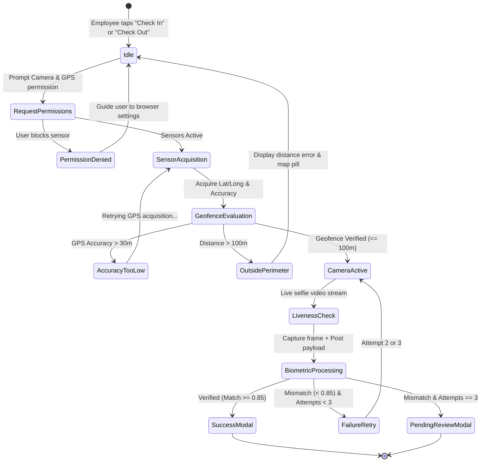

# UI/UX Architecture & Workflow Specifications

**System Designation:** HRMS Frontend Architecture  
**Component Framework:** React 18+ with TypeScript, Tailwind CSS, shadcn/ui, and Lucide React Icons  
**Data Visualization:** Recharts  
**Form Handling & Validation:** React Hook Form + Zod  
**Target Viewports:** Mobile PWA (360px - 480px width) & Responsive Desktop Admin Console (1280px - 1920px width)  
**Document Version:** 1.5  
**PRD Reference:** PRD v1.6 Baseline (Section 3, 7, 8, 12, 13, 14, 16; Incorporating Approved DEC-01 & Refined DEC-02 with Unpaired Punch Policy)  

---

## 1. Design System & Interaction Principles

### 1.1 Visual Identity & Tokens
- **Design Tokens:** Clean enterprise dashboard aesthetic using shadcn/ui neutral theme.
  - Primary Brand: Slate / Deep Navy (`#0f172a` / `#1e293b`)
  - Accent / Primary Action: Indigo (`#4f46e5` / `#6366f1`)
  - Semantic Success: Emerald (`#10b981`)
  - Semantic Warning / Pending: Amber (`#f59e0b`)
  - Semantic Error / Danger: Rose (`#f43f5e`)
  - Background Neutral: Light gray (`#f8fafc`) with pure white card surfaces (`#ffffff`)
- **Typography:** Inter or system sans-serif font stack. Strict hierarchy: 11px micro-copy, 13px captions, 14px body, 16px section headers, 24px-30px metric indicators.

### 1.2 Layout Topography
```
+-----------------------------------------------------------------------------------------+
| TOP NAV: Org Logo | Active Office Selector | Notifications Bell | User Avatar & Role    |
+-------------------+---------------------------------------------------------------------+
| SIDEBAR NAV       | MAIN VIEWPORT (Page Content Area)                                    |
| • Dashboard       | +-----------------------------------------------------------------+ |
| • Employees       | | Breadcrumbs / Page Title Header & Quick Actions Bar             | |
| • Smart Attendance| +-----------------------------------------------------------------+ |
|   - Daily Register| | KPI Metric Cards Grid (Total, Present, Late, Pending Reviews)   | |
|   - Review Queue  | +-----------------------------------------------------------------+ |
| • Leave Mgt       | | Primary Content Area (Data Tables, Recharts, Interactive Forms)  | |
| • Payroll Engine  | |                                                                 | |
| • Reports & Export| |                                                                 | |
| • Settings & Audit| +-----------------------------------------------------------------+ |
+-------------------+---------------------------------------------------------------------+
```

---

## 2. Smart Attendance Modal & Workflow (Mobile-First PWA)

The attendance interaction is the highest-frequency daily workflow in the system. It must execute reliably within $\le 5\text{ seconds}$ on mobile viewports.

### 2.1 State-Driven Modal Progression


### 2.2 Screen-by-Screen Attendance UI Spec

#### Screen A: Sensor & Geolocation Acquisition
- **Radar Visualizer:** Pulsing radar animation indicating GPS coordinate acquisition.
- **Accuracy Badge:** Real-time feedback pill:
  - *Green Pill:* `GPS Accuracy: 12m (Excellent)`
  - *Amber Pill:* `GPS Accuracy: 38m (Weak - acquiring satellite lock...)`
- **Geofence Proximity Indicator:** Distance counter: `You are 24m from Office (Inside Perimeter)`.

#### Screen B: Live Biometric Capture
- **Camera Viewport:** Centered circular/oval portrait viewfinder with a green/amber edge boundary.
- **Anti-Spoofing Challenge Prompt:** Dynamic instruction banner at top: `"Blink your eyes to verify liveness"` or `"Hold device steady at eye level"`.
- **Capture Shutter:** Auto-triggers upon liveness detection or manual capture tap.

#### Screen C: Verification Outcome
- **Check-In Success State:** High-contrast checkmark, recorded check-in time (`10:04 AM`), status badge (`Present`), and greeting.
- **Check-Out Success State:**
  - Recorded check-out time (`6:05 PM`).
  - Transparent duration ledger card:
    - *Gross Elapsed Time:* `8h 5m (485 mins)`
    - *Approved Actual Working Time:* `7h 0m (420 mins)`
    - *Paid Lunch Credit:* `1h 0m (60 mins)` *(Amended DEC-01 Paid Lunch Policy)*
    - *Net Payable Time:* `8h 0m (480 mins)`
    - *Pending Post-18:00 Extended Time:* `5 mins (Awaiting Admin approval at 1.0x rate)`
- **Fail State (< 3 attempts):** Amber card: `"Face did not match approved reference. Attempt 1 of 3 failed. Please remove glasses or improve lighting and retry."`
- **Fallback State (3 attempts exhausted):** Blue info card: `"Verification threshold reached. Your punch has been submitted for Admin Review with your selfie evidence. You do not need to punch again."`

---

## 3. Admin Panel UI/UX Specifications

### 3.1 Admin Dashboard (`/admin/dashboard`)
1. **Live Workforce Pulse Grid:**
   - Active Headcount (e.g., `10 Employees`)
   - Present Today (e.g., `8 Present`)
   - Late Arrivals (e.g., `2 Late`)
   - On Leave / Absent (e.g., `0 Leave / 0 Absent`)
2. **Action Required Queue (High Priority Banner):**
   - Direct alert pills: `2 Attendance Exceptions Pending Review`, `1 Leave Application Awaiting Approval`.
3. **Monthly Working Hours Distribution Chart:**
   - Recharts bar chart showing daily aggregated payable hours vs. standard scheduled hours line ($70\text{ hours/day}$ for 10 staff).

### 3.2 Attendance Exception Review & Correction Console (`/admin/attendance/reviews`)
- **Split-View Verification Review Interface:**
  - Left Panel: Approved reference photo from employee profile with enrollment metadata.
  - Right Panel: Submitted selfie captured during the failed punch attempt, complete with timestamp, reported GPS coordinates, distance ($12\text{m}$), and reported accuracy.
- **Admin Attendance Correction Workflow Modal (DEC-02 Approved):**
  - Dedicated modal for correcting missed check-ins, missed check-outs, accidental early departures, or invalid timestamps.
  - Form Fields:
    1. Employee Code & Name (Read-only reference).
    2. Attendance Date (Date picker, default selected date).
    3. Action Type Selector (`CHECK_IN` or `CHECK_OUT`).
    4. Original Stored Value (Read-only timestamp display; shows `None` if missing).
    5. New Corrected Value (Time picker input).
    6. **Mandatory Correction Reason** (Multiline textarea; minimum 10 characters required; `[Save Correction]` button remains disabled until valid reason is entered).
  - Chronological History Drawer: Lists previous corrections on this record, displaying `Previous Value`, `Updated Value`, `Admin User ID / Name`, and `Correction Timestamp`.
  - Non-destructive guarantee: A banner confirms that raw biometric evidence and GPS coordinates remain unaltered in the audit repository.

---
  - `[Approve Punch]` Button: Sets event to `VERIFIED`, updates payable hours ledger.
  - `[Reject Punch]` Button: Rejects attempt, flags day as `ABSENT/UNVERIFIED`.
  - Mandatory justification text box required prior to confirming decision.

### 3.3 Payroll Preparation & Execution View (`/admin/payroll`)
- **Month Selector & Baseline Summary Card:**
  - Displays selected month (e.g., `November 2026`), eligible scheduled working days (`25 days`), standard scheduled hours (`175.0 hrs`).
- **Interactive Payroll Reconciliation Table:**
  - Columns: Employee Code, Name, Base Monthly Reference, Standard Hours, Derived Hourly Rate, Approved Worked Hours, Unpaid Leave Hours, Gross Earned, Allowances/Deductions, Net Salary.
  - Zero-pay clarity badges: Highlights that CL/SL/PL days contribute 0 hours.
- **Batch Actions:**
  - `[Re-calculate Hours]`
  - `[Submit for Super Admin Approval]` (Transitions state to `SUBMITTED_FOR_APPROVAL`).

---

## 4. Super Admin Governance UI Specifications

### 4.1 Payroll Final Approval Console (`/super-admin/payroll/approvals`)
- **Executive Review Banner:**
  - Total Gross Expenditure (e.g., `₹2,48,500.00`)
  - Total Deductions / Adjustments
  - Total Net Disbursable Amount
- **Comparison Drawer:** Side-by-side variance analysis comparing current month's payable hours and payroll against previous month.
- **Dual-Action Sign-Off:**
  - `[Approve & Authorize Payslips]` (Triggers cryptographic timestamp, freezes payroll batch, generates payslips).
  - `[Reject Batch]` (Requires mandatory rejection remarks; returns batch to Admin in `DRAFT` status).

### 4.2 Audit & Security Trail Inspector (`/super-admin/audit`)
- Real-time datatable tracking all mutations to:
  - Base salary adjustments
  - Manual missing punches and attendance corrections
  - Leave overrides
  - Biometric reference re-enrollments
- Search filters: Actor, Employee, Date Range, Action Type (`INSERT`, `UPDATE`, `DELETE`).

---

## 5. Employee Portal UI/UX (Mobile PWA)

### 5.1 Home Dashboard (`/employee/dashboard`)
1. **Today's Attendance Status Card (DEC-02 Three-State Flow):**
   - **State 1 — Pre-Check-In:**
     - Status: `Not Checked In Today`
     - Subtext: `Official shift begins at 10:00 AM (10-min grace period)`.
     - Primary Action: Prominent floating button `[Check In]`.
   - **State 2 — Active Working Session:**
     - Status: `Checked In at 10:04 AM (Present)`
     - Dynamic elapsed working timer showing duration since check-in.
     - Primary Action: Prominent floating button `[Check Out]`.
   - **State 3 — Attendance Completed for Today:**
     - Status: `Attendance Completed for Today (Shift Closed)`
     - Duration Ledger Summary:
       - Check-In: `10:04 AM` | Check-Out: `6:05 PM`
       - Gross Elapsed: `8h 1m (481 mins)`
       - Approved Actual Work: `7h 0m (420 mins)`
       - Paid Lunch Credit: `1h 0m (60 mins)` *(Amended DEC-01)*
       - Net Approved Payable Hours: `8h 0m (480 mins)`
     - **No Check-In or Check-Out button is rendered.**
     - Informational Subtext: *"You have completed your single daily attendance session under DEC-02. If you need a punch correction, please contact your HR Admin."*
   - **Zero Employee Self-Service Corrections & No Unpaired Check-Out UI:**
     - The employee portal contains **no buttons, links, or dialogs** to create, alter, or self-correct attendance records.
     - In State 1 (Pre-Check-In), only `[Check In]` is exposed. Attempting a check-out without prior check-in is rejected by the API (`CHECK_OUT_WITHOUT_CHECK_IN`) and shows a warning dialog instructing the user to check in first. No employee workflow exists to submit or record an unpaired check-out. All corrections require Admin processing.
2. **Working Hours & Salary Progress Ring:**
   - Radial progress ring showing Approved Monthly Hours logged (e.g., `184.0 / 240.0 hrs`).
   - Real-time Estimated Earned Salary pill:
     > *"Estimated Earned Salary: ₹19,166.67 (Based on 184 approved hours under calendar-day monthly distribution. Final salary subject to month-end Super Admin approval)."*
3. **Leave Quota Quick View:**
   - Balance cards: `CL: 4.0 remaining`, `SL: 3.5 remaining`, `PL: 10.0 remaining`.
   - Subtext banner: *"Note: Approved leave days contribute 0 payable hours under current policy."*
4. **My Approved Payslips Tab:**
   - Chronological list of monthly payslips with one-tap `[Download PDF]` button.
