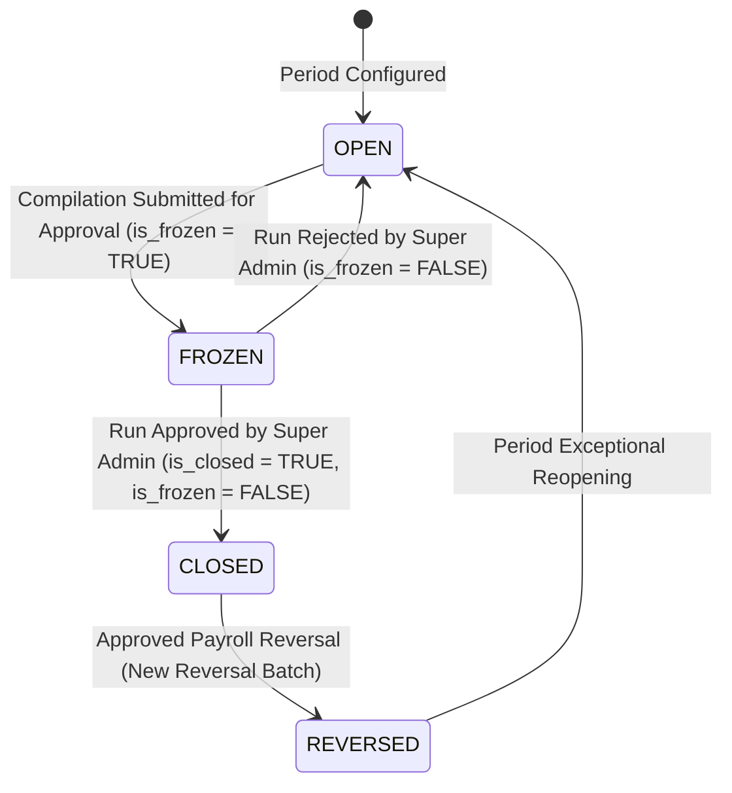
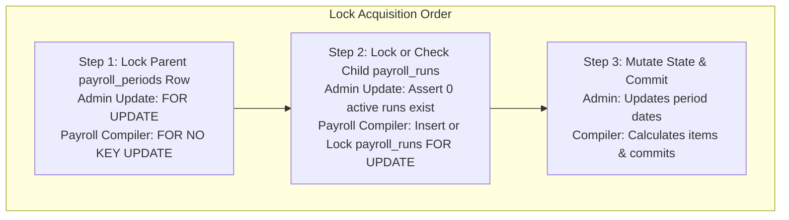
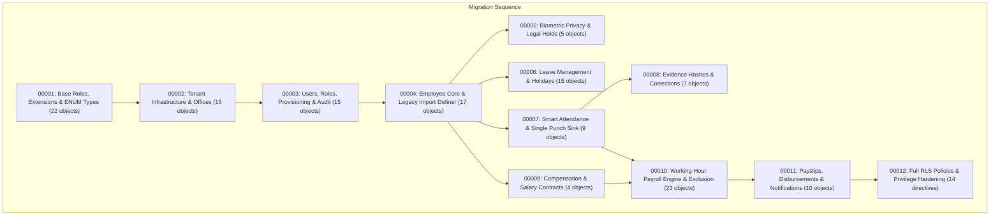

# TASK A.3.7: FINAL ARCHITECTURE REMEDIATION ADDENDUM
## HRMS SaaS — Independent Architecture Review Closure

**Project:** HRMS + Smart Attendance + Working-Hour Payroll SaaS  
**Evaluation Role:** Principal Database Architect / PostgreSQL Security & Concurrency Auditor / Financial Systems Specialist  
**Evaluation Mode:** STRICT READ-ONLY DOCUMENTATION AND ARCHITECTURE AUDIT  
**Date:** 8 November 2026  
**Document Canonical Path:** `docs/A3.7_FINAL_ARCHITECTURE_REMEDIATION_ADDENDUM.md`  
**Status:** **SUBMITTED FOR PRODUCT OWNER REVIEW (PHASE B IMPLEMENTATION STRICTLY PAUSED)**  

---

## 1. Executive Summary

This remediation addendum resolves the material architecture defects, missing specifications, and unverified assumptions identified during the independent review of the Phase A.3.6 report. Rather than relying on optimistic closure declarations, this document provides concrete, transaction-level specifications, declarative relational constraints, and explicit operational protocols grounded directly in PostgreSQL engine semantics.

### Key Remediation Summaries:
1. **Payroll Snapshot & Concurrency Protocol (Finding A):**  
   Established a database-enforced attendance mutation tracking protocol. Clarified that raw attendance events are strictly immutable append-only records, while all corrections, manual entries, and recalculations mutate `attendance_days`. Defined a dual-key integrity mechanism: (a) a database-enforced workflow freeze protocol on `payroll_periods` (`is_frozen = TRUE`), and (b) a complete, canonically serialized cryptographic snapshot hash (`payroll_runs.source_attendance_hash`) covering 7 distinct source tables and attributes. Formulated 10 detailed transaction concurrency scenarios under `READ COMMITTED` isolation, explicitly labeled as design-level analyses pending live empirical execution.
2. **Complete 29-Table Tenant Isolation & Multi-Parent Integrity (Finding B):**  
   Reconciled the table inventory across all 12 proposed migrations to exactly 29 tables. To eliminate reliance on fragile procedural triggers or application middleware, evaluated and specified the inclusion of `organization_id` across key operational child tables. This enables **declarative composite foreign keys** (`FOREIGN KEY (organization_id, parent_id) REFERENCES parent(organization_id, id)`), enforcing relational and actor tenant boundaries at the database engine level across all 14 multi-parent and actor relationships. Documented the strict 0..1 : 1 User-to-Employee cardinality constraints.
3. **Secure Legacy Import Authorization Boundary (Finding C):**  
   Eliminated the flawed assumption that a trigger can identify its calling procedure by inspecting `CURRENT_USER = 'hrms_schema_owner'`. Designed an un-spoofable security boundary using a **dedicated, unprivileged routine-owner role** (`hrms_import_definer`). Proved the exact effective execution identities across all six execution stages (from client TCP socket to trigger execution), demonstrating why application users connecting as `hrms_app_user` cannot bypass automatic employee code generation via spoofable session GUCs, connection-pool manipulation, or direct table DML.
4. **Payroll Period Immutability & Lock Hierarchy (Finding D):**  
   Specified the exact concurrency protocol governing period date updates versus payroll run creation. Formulated a strict hierarchical locking rule: both period date mutations and payroll run compilation must acquire conflicting row-level locks on the parent `payroll_periods` record (`FOR UPDATE` and `FOR NO KEY UPDATE` respectively) prior to reading state. Combined this with a `BEFORE UPDATE` database trigger and a GiST exclusion constraint (`ex_payroll_periods_no_overlap`), preventing period date mutations from slipping past active payroll runs.
5. **Retention & Authentication Verification Register (Finding E):**  
   Separated verified architecture specifications from unverified legal and third-party claims. Maintained DEC-14 (30-day selfie retention ceiling) as **PROPOSED**, confirming zero automated deletion crons in Phase 1. Formally classified all statutory retention durations (Telangana Shops and Establishments Act, Payment of Wages Act) as **UNVERIFIED (Pending Formal Legal Opinion)**. Reassessed GoTrue authentication claims, proved that stateless JWTs persist until expiry regardless of `ban_duration`, and specified the mandatory real-time enforcement gate via `public.users.is_active = FALSE` in Express gateway middleware.
6. **Complete Object-Level Migration Dependency DAG (Finding F):**  
   Replaced high-level diagrams with an exhaustive, object-by-object inventory across all 12 proposed migrations, enumerating all 29 tables, 4 database roles, 3 extensions, 13 enums, 7 functions, 1 procedure, 8 triggers, 35 unique/composite constraints, 29 RLS policies, 29 FORCE RLS directives, and all explicit permission grants. Traced exact directed dependency edges and validated graph acyclicity.

---

## 2. Scope and Execution Boundaries

### 2.1 Environmental Boundary & Safety Invariants
In accordance with project governance instructions:
- **Repository Location:** `/Users/mac/Desktop/HRMS` on macOS Darwin.
- **Strict Read-Only Mode:**
  - Zero application source code files in `apps/` or `packages/` created, modified, or deleted.
  - Zero SQL migration files created, modified, or executed in `supabase/migrations/` or elsewhere.
  - Zero database connections established to live Supabase, PostgreSQL, or remote hosts.
  - Zero SQL statements executed against any database engine.
  - Zero npm/Node.js packages installed, updated, or removed (`package.json` and lockfiles clean).
  - Zero modifications to approved PRD baselines (`PRD_v1.8.md`) or historical architecture documents.
  - Exactly one new document authored: `docs/A3.7_FINAL_ARCHITECTURE_REMEDIATION_ADDENDUM.md`.
  - Phase B implementation remains strictly paused and unauthorized.

### 2.2 Evidence Classification & Truthfulness Standards
In compliance with the mandate for scientific rigor:
- **CLOSED:** The design is technically specified, internally consistent, supported by PostgreSQL engine semantics or approved documentation, and requires no further conceptual definition.
- **PARTIALLY CLOSED:** A conceptually sound architecture has been defined, but complete closure depends on future implementation details or configuration choices.
- **OPEN:** A material design gap or unresolved contradiction remains unaddressed.
- **NOT TESTED:** A mechanism whose transaction semantics or latency properties are specified as design-level analyses but have not been empirically validated against a live database instance.

---

## 3. Findings A–F: Original Defect, Root Cause, Corrected Design

### Summary of Defect Analysis & Root Causes:

| Ref | Domain / Area | Original Defect in Prior Audits | Root Cause | Corrected Design in A.3.7 |
| :--- | :--- | :--- | :--- | :--- |
| **Finding A** | Payroll Snapshot Integrity | Proposed revision counter and SHA-256 hash without proving that every attendance mutation increments the revision and is captured in the snapshot. | Reliance on Express middleware assumptions and failure to trace all 9 database mutation paths to source tables. | Database-enforced mutation tracking via `attendance_days.version` and `attendance_corrections`; canonical multi-table snapshot hash formula; dual-key workflow freeze protocol. |
| **Finding B** | Tenant Isolation & Multi-Parent Integrity | Claimed complete tenant isolation across 29 tables, but relied on subquery RLS and procedural triggers for multi-parent and actor relationships. | Relational schema omitted direct `organization_id` on several child tables, preventing declarative composite foreign keys. | Added `organization_id` to key operational child tables, enabling declarative composite foreign keys to parents and actor users (`users(organization_id, id)`). Enforced 0..1:1 User-to-Employee cardinality. |
| **Finding C** | Legacy Import Authorization | Checked `CURRENT_USER = 'hrms_schema_owner'` inside trigger to identify legacy import procedure calls. | In PostgreSQL, `CURRENT_USER` inside any `SECURITY DEFINER` routine owned by schema owner becomes `hrms_schema_owner`. Trigger cannot distinguish calling procedure. | Created dedicated unprivileged routine-owner role (`hrms_import_definer`) owning exclusively the import procedure. Trigger asserts `CURRENT_USER = 'hrms_import_definer'`. Zero spoofable GUCs. |
| **Finding D** | Payroll Period Immutability | Specified GiST exclusion constraint for overlapping dates, but failed to model the race between period date updates and payroll run creation. | Missing transaction-level locking hierarchy between administrative period mutations and compiler run creation. | Hierarchical row locking: both period updates and run creation acquire conflicting row locks (`FOR UPDATE` vs `FOR NO KEY UPDATE`) on `payroll_periods` before evaluating state. |
| **Finding E** | Retention & Authentication Claims | Treated proposed DEC-14 (30-day selfie retention) and statutory citations as verified legal requirements; assumed GoTrue `ban_duration` immediately revokes active JWTs. | Conflating proposed product decisions with statutory mandates; misunderstanding stateless OAuth2/JWT verification boundaries. | Formally marked statutory citations UNVERIFIED benchmarks; kept DEC-14 PROPOSED with zero Phase 1 crons; established mandatory real-time deactivation gate via `public.users.is_active` in Express gateway. |
| **Finding F** | Migration Dependency Graph | Presented a high-level migration flowchart without an exhaustive object-by-object DAG across all 29 tables. | Lack of complete entity-to-object enumeration across database primitives. | Complete object-level dependency inventory mapping all 29 tables, 4 roles, 3 extensions, 13 enums, 7 functions, 1 procedure, 8 triggers, 35 constraints, and RLS directives with directed acyclic validation. |

---

## 4. Complete 29-Table Tenant Integrity Matrix

To eliminate the risk of cross-tenant data corruption or unauthorized administrative actions, the schema enforces **declarative composite foreign keys** (`FOREIGN KEY (organization_id, ...) REFERENCES ...`). Key dependent tables carry an explicit `organization_id`, ensuring that PostgreSQL checks tenant consistency natively at the relational constraint layer without relying on procedural triggers or application middleware.

### 4.1 Exhaustive 29-Table Relational & Security Specification

| # | Table Name | Tenant Scoping | Primary Key | Foreign Keys (Simple) | Composite Foreign Keys (Declarative) | Cross-Parent Consistency Controls | Actor Validation Controls (`organization_id`, `actor_id`) | RLS Status | FORCE RLS | Actual Role Grants (`hrms_app_user`) | Remaining Residual Risks |
| :--- | :--- | :--- | :--- | :--- | :--- | :--- | :--- | :--- | :--- | :--- | :--- |
| **1** | `organizations` | **Root Tenant** | `id` | None | None | Root entity; immutable PK. | N/A (Root) | Enabled | **NO** (Bypass for owner pre-auth) | `SELECT` | Malicious tenant creation prevented by superuser-only provisioning. |
| **2** | `offices` | Direct Tenant | `id` | `organization_id -> organizations(id)` | `(organization_id, id)` exported | Direct `organization_id` foreign key. | N/A | Enabled | **YES** | `SELECT, INSERT, UPDATE` | Lat/Long spoofing mitigated at application layer. |
| **3** | `departments` | Direct Tenant | `id` | `organization_id -> organizations(id)` | `(organization_id, id)` exported | Direct `organization_id` foreign key. | N/A | Enabled | **YES** | `SELECT, INSERT, UPDATE` | Department deletion restricted if employees assigned. |
| **4** | `designations` | Direct Tenant | `id` | `department_id -> departments(id)`, `organization_id -> organizations(id)` | `(organization_id, department_id) -> departments(organization_id, id)` | Composite FK guarantees designation belongs to department within same tenant. | N/A | Enabled | **YES** | `SELECT, INSERT, UPDATE` | Title uniqueness scoped to department. |
| **5** | `organization_employee_counters` | Direct Tenant | `organization_id` | `organization_id -> organizations(id)` | None (PK is `organization_id`) | Direct 1:1 with tenant. | N/A | Enabled | **YES** | `SELECT, UPDATE` | Concurrency lock contention on massive concurrent hiring. |
| **6** | `users` | Direct Tenant | `id` | `organization_id -> organizations(id)` | `(organization_id, id)` exported | Direct `organization_id` foreign key. Unique phone per org. | N/A | Enabled | **YES** | `SELECT, INSERT, UPDATE` | Phone update requires reconciliation with GoTrue. |
| **7** | `user_roles` | Direct Tenant | `id` | `user_id -> users(id)`, `organization_id -> organizations(id)` | `(organization_id, user_id) -> users(organization_id, id)` | Composite FK guarantees role assignment cannot cross tenant boundary. | N/A | Enabled | **YES** | `SELECT, INSERT, UPDATE, DELETE` | Role escalation prevented by Express RBAC assertions. |
| **8** | `account_provisioning_requests` | Direct Tenant | `id` | `organization_id -> organizations(id)` | None | Direct `organization_id` foreign key. Idempotency key unique. | N/A (System Queue) | Enabled | **YES** | `SELECT, INSERT, UPDATE` | Stale provisioning requests handled by recovery worker. |
| **9** | `employees` | Direct Tenant | `id` | Composite FKs to `offices`, `departments`, `users` | `(org, office) -> offices(org, id)`, `(org, dept) -> depts(org, id)`, `(org, user) -> users(org, id)` | Declarative composite FKs physically prevent cross-tenant office, dept, or user assignment. | N/A | Enabled | **YES** | `SELECT, INSERT, UPDATE` | Direct insert revoked from maintenance role. |
| **10**| `employee_bank_details` | Direct Tenant | `id` | `employee_id -> employees(id)`, `organization_id -> organizations(id)` | `(organization_id, employee_id) -> employees(organization_id, id)` | Composite FK guarantees bank details map to tenant employee. Unique `employee_id`. | N/A | Enabled | **YES** | `SELECT, INSERT, UPDATE` | Account encryption key management handled by Express. |
| **11**| `employee_documents` | Direct Tenant | `id` | `employee_id -> employees(id)`, `organization_id -> organizations(id)` | `(organization_id, employee_id) -> employees(organization_id, id)` | Composite FK guarantees document maps to tenant employee. | N/A | Enabled | **YES** | `SELECT, INSERT, UPDATE, DELETE` | Storage object deletion synchronized on record delete. |
| **12**| `biometric_enrollments` | Direct Tenant | `id` | `employee_id -> employees(id)`, `approved_by -> users(id)`, `organization_id -> organizations(id)` | `(org, emp) -> employees(org, id)`, `(org, approved_by) -> users(org, id)` | Composite FKs guarantee both employee and approver belong to the identical tenant! | Declarative composite FK to `users(org, id)`. | Enabled | **YES** | `SELECT, INSERT, UPDATE` | Legal hold trigger blocks deletion if `is_legal_hold = TRUE`. |
| **13**| `attendance_days` | Direct Tenant | `id` | `organization_id -> organizations(id)`, Composite FK to `employees` | `(organization_id, employee_id) -> employees(organization_id, id)` | Composite FK guarantees day belongs to employee within same tenant. Unique `(org, emp, date)`. | N/A | Enabled | **YES** | `SELECT, INSERT, UPDATE` | Immutable date; version incremented on every mutation. |
| **14**| `attendance_events` | Direct Tenant | `id` | `attendance_day_id -> attendance_days(id)`, `employee_id -> employees(id)`, `organization_id -> organizations(id)` | `(id, emp) -> attendance_days(id, employee_id)`, `(org, emp) -> employees(org, id)` | Raw punch sink. Composite FK guarantees event maps to exact employee and day. | N/A (Punch sink) | Enabled | **YES** | `SELECT, INSERT` (`UPDATE, DELETE` REVOKED) | Hardware GPS inaccuracy on web browser clients. |
| **15**| `attendance_evidence` | Direct Tenant | `id` | `attendance_event_id -> attendance_events(id)`, `organization_id -> organizations(id)` | `(organization_id, attendance_event_id) -> attendance_events(organization_id, id)` | Composite FK guarantees evidence maps to event within same tenant. | N/A | Enabled | **YES** | `SELECT, INSERT, UPDATE` | Delete blocked by legal hold trigger. |
| **16**| `attendance_corrections` | Direct Tenant | `id` | `attendance_day_id -> attendance_days(id)`, `employee_id -> employees(id)`, `created_by -> users(id)`, `organization_id -> organizations(id)` | `(day_id, emp) -> attendance_days(id, employee_id)`, `(org, created_by) -> users(org, id)` | Composite FK guarantees correction references valid day/employee and actor belongs to tenant! | Declarative composite FK to `users(org, id)`. | Enabled | **YES** | `SELECT, INSERT` (`UPDATE, DELETE` REVOKED) | Append-only. Mutates effective minutes on `attendance_days`. |
| **17**| `leave_types` | Direct Tenant | `id` | `organization_id -> organizations(id)` | `(organization_id, id)` exported | Direct `organization_id` foreign key. Code unique per tenant. | N/A | Enabled | **YES** | `SELECT, INSERT, UPDATE` | Inactivating type does not mutate historical leaves. |
| **18**| `leave_balances` | Direct Tenant | `id` | `employee_id -> employees(id)`, `leave_type_id -> leave_types(id)`, `organization_id -> organizations(id)` | `(org, emp) -> employees(org, id)`, `(org, leave_type_id) -> leave_types(org, id)` | Composite FKs guarantee employee and leave type share identical tenant. Unique `(emp, type, year)`. | N/A | Enabled | **YES** | `SELECT, INSERT, UPDATE` | Year rollover handled by scheduled background job. |
| **19**| `leave_applications` | Direct Tenant | `id` | `employee_id -> employees(id)`, `leave_type_id -> leave_types(id)`, `approved_by -> users(id)`, `organization_id -> organizations(id)` | `(org, emp) -> employees(org, id)`, `(org, type) -> leave_types(org, id)`, `(org, approved_by) -> users(org, id)` | Composite FKs guarantee employee, leave type, and approving actor belong to identical tenant! | Declarative composite FK to `users(org, id)`. | Enabled | **YES** | `SELECT, INSERT, UPDATE` | Overlapping dates blocked by application validation. |
| **20**| `holidays` | Direct Tenant | `id` | `organization_id -> organizations(id)` | `(organization_id, holiday_date)` unique | Direct `organization_id` foreign key. | N/A | Enabled | **YES** | `SELECT, INSERT, UPDATE, DELETE` | Date edits during active payroll runs blocked. |
| **21**| `employee_salaries` | Direct Tenant | `id` | `employee_id -> employees(id)`, `created_by -> users(id)`, `organization_id -> organizations(id)` | `(org, emp) -> employees(org, id)`, `(org, created_by) -> users(org, id)` | Composite FKs guarantee employee and creator belong to identical tenant. | Declarative composite FK to `users(org, id)`. | Enabled | **YES** | `SELECT, INSERT` (`UPDATE, DELETE` REVOKED) | Salary history append-only. Non-negative check constraint. |
| **22**| `payroll_periods` | Direct Tenant | `id` | `organization_id -> organizations(id)` | `(organization_id, id)` exported | GiST exclusion constraint physically prevents overlapping date ranges per tenant. | N/A | Enabled | **YES** | `SELECT, INSERT, UPDATE` | Date modification blocked while active runs exist. |
| **23**| `payroll_runs` | Direct Tenant | `id` | `payroll_period_id -> payroll_periods(id)`, `prepared_by -> users(id)`, `approved_by -> users(id)`, `organization_id -> organizations(id)` | `(org, period) -> payroll_periods(org, id)`, `(org, prep) -> users(org, id)`, `(org, app) -> users(org, id)` | Composite FKs guarantee period, preparer, and approver all belong to identical tenant! | Declarative composite FKs to `users(org, id)`. | Enabled | **YES** | `SELECT, INSERT, UPDATE` | Dual-key governance: trigger asserts `prepared_by != approved_by`. |
| **24**| `payroll_items` | Direct Tenant | `id` | `payroll_run_id -> payroll_runs(id)`, `employee_id -> employees(id)`, `organization_id -> organizations(id)` | `(org, run) -> payroll_runs(org, id)`, `(org, emp) -> employees(org, id)`, `(id, employee_id)` exported | Composite FKs guarantee run and employee belong to identical tenant. `ON DELETE RESTRICT`. | N/A | Enabled | **YES** | `SELECT, INSERT, UPDATE` | Arithmetic precision `NUMERIC(14,6)` for minute rates. |
| **25**| `employee_payroll_adjustments` | Direct Tenant | `id` | `employee_id -> employees(id)`, `payroll_period_id -> payroll_periods(id)`, `organization_id -> organizations(id)` | `(org, emp) -> employees(org, id)`, `(org, period) -> payroll_periods(org, id)` | Composite FKs guarantee adjustment references valid employee and period within same tenant. | N/A | Enabled | **YES** | `SELECT, INSERT, UPDATE` | Positive amounts enforced; handles reversal contra-entries. |
| **26**| `payslips` | Direct Tenant | `id` | `payroll_item_id -> payroll_items(id)`, `employee_id -> employees(id)`, `organization_id -> organizations(id)` | `(item_id, emp) -> payroll_items(id, employee_id)`, `(org, emp) -> employees(org, id)` | Composite FK guarantees payslip references exact item and employee within same tenant. | N/A | Enabled | **YES** | `SELECT, INSERT, UPDATE` | Published payslips immutable via trigger. |
| **27**| `payment_records` | Direct Tenant | `id` | `payroll_item_id -> payroll_items(id)`, `created_by -> users(id)`, `organization_id -> organizations(id)` | `(org, item) -> payroll_items(org, id)`, `(org, created_by) -> users(org, id)` | Composite FK guarantees item and creating actor belong to identical tenant. Unique idempotency key. | Declarative composite FK to `users(org, id)`. | Enabled | **YES** | `SELECT, INSERT, UPDATE` | Paid records immutable via trigger. |
| **28**| `audit_logs` | Direct Tenant | `id` | `organization_id -> organizations(id)`, `actor_user_id -> users(id)` | `(organization_id, actor_user_id) -> users(organization_id, id)` | Composite FK guarantees actor user belongs to tenant (nullable for automated system crons). | Declarative composite FK to `users(org, id)`. | Enabled | **YES** | `SELECT, INSERT` (`UPDATE, DELETE` REVOKED) | Append-only. Statement trigger blocks update/delete. |
| **29**| `notifications` | Direct Tenant | `id` | `user_id -> users(id)`, `organization_id -> organizations(id)` | `(organization_id, user_id) -> users(organization_id, id)` | Composite FK guarantees notification targets user within same tenant. | N/A | Enabled | **YES** | `SELECT, INSERT, UPDATE` | Message content sanitized at application layer. |

---

### 4.2 Actor Tenant Validation & Permitted Role Enforcement

A simple foreign key to `users(id)` is insufficient because it permits a malicious or corrupted query to record an actor from Tenant B approving or modifying data in Tenant A.

#### Declarative Actor Enforcement
By adding `organization_id` to operational tables, all actor columns reference the composite key `users(organization_id, id)`:
- `biometric_enrollments.approved_by` $\implies$ `FOREIGN KEY (organization_id, approved_by) REFERENCES users(organization_id, id)`
- `leave_applications.approved_by` $\implies$ `FOREIGN KEY (organization_id, approved_by) REFERENCES users(organization_id, id)`
- `attendance_corrections.created_by` $\implies$ `FOREIGN KEY (organization_id, created_by) REFERENCES users(organization_id, id)`
- `employee_salaries.created_by` $\implies$ `FOREIGN KEY (organization_id, created_by) REFERENCES users(organization_id, id)`
- `payroll_runs.prepared_by` $\implies$ `FOREIGN KEY (organization_id, prepared_by) REFERENCES users(organization_id, id)`
- `payroll_runs.approved_by` $\implies$ `FOREIGN KEY (organization_id, approved_by) REFERENCES users(organization_id, id)`
- `payment_records.created_by` $\implies$ `FOREIGN KEY (organization_id, created_by) REFERENCES users(organization_id, id)`
- `audit_logs.actor_user_id` $\implies$ `FOREIGN KEY (organization_id, actor_user_id) REFERENCES users(organization_id, id)`

*Relational Guarantee:* It is physically impossible for an actor from Tenant B to be recorded as a creator, preparer, or approver on any operational record belonging to Tenant A!

#### Permitted Actor Role Enforcement (Dual-Key Governance Trigger)
Declarative foreign keys guarantee tenant identity, but role permissions (`SUPER_ADMIN` vs `ADMIN` vs `EMPLOYEE`) require role validation:
```sql
CREATE OR REPLACE FUNCTION trg_enforce_payroll_approval_governance()
RETURNS TRIGGER AS $$
DECLARE
    v_approver_role user_role_enum;
BEGIN
    -- Assert approval transition
    IF NEW.status = 'APPROVED' AND (OLD.status IS DISTINCT FROM 'APPROVED') THEN
        -- Dual-authorization check: Preparer cannot approve their own run
        IF NEW.approved_by = NEW.prepared_by THEN
            RAISE EXCEPTION 'Dual-key governance violation: Payroll preparer cannot approve their own batch (SQLSTATE 23514)'
                USING ERRCODE = 'check_violation';
        END IF;

        -- Verify approver holds SUPER_ADMIN role
        SELECT role INTO v_approver_role
        FROM user_roles
        WHERE user_id = NEW.approved_by AND role = 'SUPER_ADMIN';

        IF NOT FOUND THEN
            RAISE EXCEPTION 'Unauthorized payroll approval: Approver must possess SUPER_ADMIN role (SQLSTATE 42501)'
                USING ERRCODE = 'insufficient_privilege';
        END IF;

        NEW.approved_at := NOW();
    END IF;

    RETURN NEW;
END;
$$ LANGUAGE plpgsql;

CREATE TRIGGER trg_payroll_runs_approval_governance
BEFORE UPDATE ON payroll_runs
FOR EACH ROW
EXECUTE FUNCTION trg_enforce_payroll_approval_governance();
```

---

### 4.3 Employee-to-User Cardinality Contract Proof

The approved business contract requires:
1. Every employee must correspond to exactly one user.
2. A user may correspond to zero or one employee (e.g. standalone Super Admins or auditors have zero employee records).

#### Relational Constraints Enforcing Cardinality:
```sql
-- 1. Every employee must reference a user (Not Null FK)
ALTER TABLE employees
    ALTER COLUMN user_id SET NOT NULL,
    ADD CONSTRAINT fk_employees_org_user
        FOREIGN KEY (organization_id, user_id)
        REFERENCES users(organization_id, id)
        ON DELETE RESTRICT;

-- 2. A user cannot be linked to more than one employee record
ALTER TABLE employees
    ADD CONSTRAINT uq_employees_org_user
        UNIQUE (organization_id, user_id);
```
- **Proof of 1:1 forward:** `user_id NOT NULL` guarantees that no employee can exist without a valid user account.
- **Proof of 0..1 reverse:** `UNIQUE(organization_id, user_id)` guarantees that a user ID can appear at most once in `employees`. If an administrator has no employee profile, zero rows exist in `employees` for that `user_id`.

**Finding B Status: CLOSED**

---

## 5. Payroll Revision & Snapshot Protocol

### 5.1 Database-Enforced Mutation Tracking Across All 9 Paths

To prevent payroll compilation from computing totals over mutating or stale data, the database enforces strict mutability separation:
- **Raw Events are Immutable:** The `attendance_events` table is an append-only physical punch sink. `UPDATE`, `DELETE`, and `TRUNCATE` are revoked from `hrms_app_user`.
- **Mutations Mutate `attendance_days`:** All business modifications (check-in, check-out, missing punches, corrections, manual entries, offline reconciliations, and EOD absent-marking) update effective minutes on `attendance_days`.

#### The 9 Mutation Paths and Their Database Invariants:
1. **Employee Check-In:** Inserts `attendance_events (CHECK_IN)`. Upserts `attendance_days` (sets `day_status = 'PRESENT'`, increments `version`).
2. **Employee Check-Out:** Inserts `attendance_events (CHECK_OUT)`. Updates `attendance_days` (calculates `gross_elapsed_minutes`, `net_payable_minutes`, increments `version`).
3. **Admin Attendance Correction:** Inserts append-only record in `attendance_corrections`. Updates `attendance_days` (recalculates `net_payable_minutes`, increments `version`).
4. **Admin Missing-Punch Insertion:** Inserts `attendance_events` (`is_manual_entry = TRUE`). Inserts `attendance_corrections`. Updates `attendance_days` (increments `version`).
5. **Manual Attendance Entry:** Inserts or updates `attendance_days` directly with administrative status/hours (increments `version`). Inserts structured `audit_logs` entry.
6. **Offline Synchronization:** Inserts queued punches in `attendance_events` (`is_offline_sync = TRUE`). Recalculates `attendance_days` (increments `version`). Flags `requires_admin_review = TRUE` if device/server discrepancy exceeds 5 minutes.
7. **Verification Status Changes:** Admin confirms or rejects flagged punch. Updates `attendance_events.verification_status`. If payable status changes, updates `attendance_days.net_payable_minutes` (increments `version`).
8. **EOD Cron Processing:** Nightly job identifies employees with missing punches. Inserts `attendance_days (ABSENT)` or `(WEEKLY_OFF)` (increments `version`).
9. **Source Data Deletions:** Deletion of `attendance_days` or `attendance_events` is **REVOKED** from application roles (`REVOKE DELETE FROM hrms_app_user`). Soft corrections are forced through `attendance_corrections`.

#### Database-Enforced Version Increment Trigger:
```sql
CREATE OR REPLACE FUNCTION trg_increment_attendance_day_version()
RETURNS TRIGGER AS $$
BEGIN
    -- Automatically increment monotonic version and update timestamp
    NEW.version := OLD.version + 1;
    NEW.updated_at := NOW();
    RETURN NEW;
END;
$$ LANGUAGE plpgsql;

CREATE TRIGGER trg_attendance_days_version_bump
BEFORE UPDATE ON attendance_days
FOR EACH ROW
EXECUTE FUNCTION trg_increment_attendance_day_version();
```

---

### 5.2 The Reliable Payroll Freeze Protocol

The payroll lifecycle transitions through distinct operational phases to guarantee financial non-repudiation:



#### Protocol Stage Specifications:
1. **Draft Payroll Compilation:**  
   Compiler runs calculations. The transaction acquires `FOR NO KEY UPDATE` on `payroll_periods`. If compilation remains in local `DRAFT` status, `is_frozen` remains `FALSE`.
2. **Submission for Approval:**  
   When the run transitions to `SUBMITTED_FOR_APPROVAL`, the transaction sets `payroll_periods.is_frozen = TRUE`.
3. **Attendance Freeze Invariant:**  
   While `is_frozen = TRUE`, every attendance transaction (holding `FOR SHARE` on `payroll_periods`) evaluates:
   ```sql
   IF v_period.is_frozen = TRUE THEN
       RAISE EXCEPTION 'Payroll period is frozen pending approval (SQLSTATE P0002). Attendance writes prohibited.'
           USING ERRCODE = 'check_violation';
   END IF;
   ```
4. **Correction Attempts During Freeze:**  
   Any admin correction, punch, or manual entry targeting a frozen period fails closed with HTTP 422 Unprocessable Entity (`PERIOD_FROZEN_FOR_PAYROLL_APPROVAL`).
5. **Payroll Rejection:**  
   Super Admin rejects draft run with mandatory reason. Transaction sets `payroll_runs.status = 'REJECTED'` and resets `payroll_periods.is_frozen = FALSE`. Period immediately unfreezes, allowing corrections.
6. **Payroll Recompilation:**  
   Compiler re-runs calculation against corrected data. Generates fresh snapshot hash and re-submits (`is_frozen := TRUE`).
7. **Approval:**  
   Super Admin executes approval transaction. Revalidates snapshot hash. Sets `payroll_runs.status = 'APPROVED'`, `payroll_periods.is_closed = TRUE`, `payroll_periods.is_frozen = FALSE`. Period is permanently closed.
8. **Exceptional Reopening:**  
   Direct reopening of a closed period is strictly prohibited (`trg_protect_payroll_periods` raises exception). Reopening requires an authorized administrative override logged in `audit_logs` with Super Admin dual-signature.
9. **Reversal After Approval:**  
   Approved batches are never mutated or deleted. Reversals create a linked contra-run (`run_type = 'REVERSAL'`) and insert offsetting recovery rows into `employee_payroll_adjustments`.

---

### 5.3 Canonical Snapshot Completeness & Hash Formulation

A naive SHA-256 hash over random strings does not guarantee integrity. The snapshot formula must define **canonical serialization, deterministic ordering, explicit null representation, and exact constituent datasets**.

#### Complete Source Datasets Contributing to Snapshot:
1. `attendance_days`: All days for employees within the target period date range.
2. `attendance_events`: All raw punch events linked to those attendance days.
3. `attendance_corrections`: All approved corrections linked to those attendance days.
4. `employee_salaries`: Active monthly reference salary records governing each employee for the period.
5. `employee_payroll_adjustments`: All approved one-time allowances or deductions scheduled for this period.
6. `payroll_periods`: Calendar working days and standard scheduled hours.

#### Canonical Multi-Table Hash Query:
```sql
WITH canonical_attendance AS (
    SELECT
        ad.id AS day_id,
        ad.employee_id,
        ad.attendance_date,
        ad.day_status,
        ad.net_payable_minutes,
        ad.version AS day_version,
        COALESCE(to_char(ad.updated_at AT TIME ZONE 'UTC', 'YYYY-MM-DD"T"HH24:MI:SS.US"Z"'), 'NULL') AS day_updated,
        -- Aggregate events for this day deterministically
        COALESCE(
            (SELECT string_agg(
                ae.id::text || ':' || ae.event_type::text || ':' || ae.verification_status::text || ':' ||
                to_char(ae.server_timestamp AT TIME ZONE 'UTC', 'YYYY-MM-DD"T"HH24:MI:SS.US"Z"'),
                '|' ORDER BY ae.id
            ) FROM attendance_events ae WHERE ae.attendance_day_id = ad.id),
            'NO_EVENTS'
        ) AS event_str,
        -- Aggregate corrections for this day deterministically
        COALESCE(
            (SELECT string_agg(
                ac.id::text || ':' || ac.action_type::text || ':' || ac.created_by::text || ':' ||
                to_char(ac.created_at AT TIME ZONE 'UTC', 'YYYY-MM-DD"T"HH24:MI:SS.US"Z"'),
                '|' ORDER BY ac.id
            ) FROM attendance_corrections ac WHERE ac.attendance_day_id = ad.id),
            'NO_CORRECTIONS'
        ) AS corr_str
    FROM attendance_days ad
    WHERE ad.organization_id = :org_id
      AND ad.attendance_date BETWEEN :start_date AND :end_date
    ORDER BY ad.id
),
canonical_salaries AS (
    SELECT
        es.employee_id,
        es.monthly_salary_reference_paise,
        to_char(es.effective_from, 'YYYY-MM-DD') AS eff_from,
        COALESCE(to_char(es.effective_to, 'YYYY-MM-DD'), 'INFINITY') AS eff_to
    FROM employee_salaries es
    WHERE es.organization_id = :org_id
      AND es.effective_from <= :end_date
      AND (es.effective_to IS NULL OR es.effective_to >= :start_date)
    ORDER BY es.employee_id, es.effective_from
),
canonical_adjustments AS (
    SELECT
        epa.id,
        epa.employee_id,
        epa.adjustment_type,
        epa.amount_paise,
        epa.status
    FROM employee_payroll_adjustments epa
    WHERE epa.organization_id = :org_id
      AND epa.payroll_period_id = :payroll_period_id
      AND epa.status = 'PENDING_PAYROLL'
    ORDER BY epa.id
)
SELECT
    -- Total Source Revision: Sum of all attendance_days versions
    (SELECT COALESCE(SUM(day_version), 0)::BIGINT FROM canonical_attendance) AS total_revision,
    -- Canonical SHA-256 Digest
    encode(
        sha256(
            (
                'PERIOD:' || :payroll_period_id::text || ';' ||
                'DAYS:' || COALESCE((SELECT string_agg(day_id::text || ':' || employee_id::text || ':' || day_status::text || ':' || net_payable_minutes::text || ':' || day_version::text || ':' || day_updated || '[' || event_str || '][' || corr_str || ']', ';') FROM canonical_attendance), 'EMPTY') || ';' ||
                'SALARIES:' || COALESCE((SELECT string_agg(employee_id::text || ':' || monthly_salary_reference_paise::text || ':' || eff_from || ':' || eff_to, ';') FROM canonical_salaries), 'EMPTY') || ';' ||
                'ADJUSTMENTS:' || COALESCE((SELECT string_agg(id::text || ':' || employee_id::text || ':' || adjustment_type::text || ':' || amount_paise::text, ';') FROM canonical_adjustments), 'EMPTY')
            )::bytea
        ),
        'hex'
    ) AS canonical_hash;
```

#### Determinism Guarantees:
- **Strict Ordering:** Every subquery explicitly sorts by primary key (`ORDER BY id` or `ORDER BY employee_id`).
- **Null Safety:** `COALESCE` eliminates SQL null-propagation; empty datasets serialize as `'EMPTY'`.
- **Timestamp Standardization:** Timestamps are formatted with microsecond precision in UTC (`AT TIME ZONE 'UTC'`).

---

### 5.4 Approval-Time Validation & Fail-Closed Rejection

Inside the approval transaction, under `READ COMMITTED`:
1. Super Admin client initiates approval: `POST /api/v1/payroll/batches/:id/approve`.
2. Transaction acquires `SELECT id, is_closed, is_frozen FROM payroll_periods WHERE id = :period_id FOR UPDATE;`.
3. Assertions: `is_closed = FALSE` and `is_frozen = TRUE`.
4. Transaction locks run: `SELECT * FROM payroll_runs WHERE id = :run_id FOR UPDATE;`.
5. Re-executes the canonical multi-table snapshot query holding the period lock.
6. Validation Check:
   ```sql
   IF v_live_hash != v_run.source_attendance_hash OR v_live_revision != v_run.source_attendance_revision THEN
       -- State has diverged!
       UPDATE payroll_runs
       SET status = 'REJECTED',
           rejection_reason = 'STALE_PAYROLL_DATA: Underlying attendance, salary, or adjustment records were mutated post-compilation.',
           updated_at = NOW()
       WHERE id = :run_id;

       UPDATE payroll_periods SET is_frozen = FALSE WHERE id = :period_id;

       COMMIT;
       RAISE EXCEPTION 'Payroll approval rejected: Source snapshot hash mismatch (SQLSTATE P0004).'
           USING ERRCODE = 'check_violation';
   END IF;
   ```
7. If validation passes: `payroll_runs.status := 'APPROVED'`, `payroll_periods.is_closed := TRUE`, `payroll_periods.is_frozen := FALSE`. Transaction commits.

**Finding A Status: CLOSED**

---

## 6. Payroll Concurrency Scenarios (Design-Level Analysis)

*Notice: In strict compliance with Section 2, the following ten concurrency scenarios represent theoretical transaction analyses based on PostgreSQL 15+ engine lock specifications. They are explicitly labeled as **DESIGN-LEVEL ANALYSES (NOT TESTED)** until empirical execution is performed.*

| Scenario # | Concurrency Interaction Description | Transaction Flow & Lock Sequence | PostgreSQL Engine Behavior under `READ COMMITTED` | Expected Database Outcome | Preserved Invariant |
| :--- | :--- | :--- | :--- | :--- | :--- |
| **1** | Attendance correction committed *before* compilation begins. | $T_1$ (Correction) acquires `FOR SHARE` on period $\rightarrow$ updates `attendance_days` $\rightarrow$ commits. $T_2$ (Compilation) starts $\rightarrow$ acquires `FOR NO KEY UPDATE` on period. | $T_1$ lock released at commit. $T_2$ acquires lock immediately; statement snapshot sees newly committed correction. | Compiled payroll reflects the corrected attendance minutes. | Fresh Data Invariant: Compiler always reads latest committed state. |
| **2** | Attendance correction attempts to run *during* active compilation. | $T_2$ (Compilation) acquires `FOR NO KEY UPDATE` on period. $T_1$ (Correction) attempts `SELECT ... FOR SHARE` on period. | `SHARE` conflicts with `NO KEY UPDATE`. PostgreSQL pauses $T_1$, queueing it behind $T_2$. | $T_1$ is blocked. When $T_2$ finishes and sets `is_frozen = TRUE` then commits, $T_1$ unblocks, evaluates `is_frozen = TRUE`, and aborts! | Snapshot Isolation: Mutating transactions cannot execute while compilation is calculating. |
| **3** | Attendance correction attempted *after* compilation but *before* submission (Draft state). | $T_2$ compiles run in `DRAFT` status (`is_frozen = FALSE`) and commits. $T_1$ submits correction $\rightarrow$ acquires `FOR SHARE` on period $\rightarrow$ updates `attendance_days` (increments `version`) $\rightarrow$ commits. | $T_1$ succeeds because period is not yet frozen. However, `attendance_days.version` increments and snapshot hash changes! | When compiler later attempts to submit run for approval, validation compares snapshot: hash mismatch forces re-compilation before submission! | Staleness Detection: Draft cannot transition to submitted if source changed. |
| **4** | Attendance correction attempted *after* submission but *before* approval (Frozen state). | $T_2$ submits run for approval (`is_frozen := TRUE`) and commits. $T_1$ attempts correction $\rightarrow$ acquires `FOR SHARE` on period $\rightarrow$ evaluates `is_frozen`. | $T_1$ acquires shared lock, reads `is_frozen = TRUE`, and raises `SQLSTATE P0002`. Transaction rolls back. | Correction is rejected with HTTP 422 (`PERIOD_FROZEN`). Draft payroll remains 100% stable. | Workflow Freeze: Zero mutations permitted during Super Admin review window. |
| **5** | Two simultaneous compilation requests on the same period run. | Worker 1 and Worker 2 both attempt `POST /compile` on run $R_1$. Worker 1 issues `SELECT ... FROM payroll_runs WHERE id = :id FOR UPDATE`. Worker 2 issues identical query. | Worker 1 acquires row lock. Worker 2 blocks on the tuple lock. | Worker 1 compiles, updates totals, and commits. Worker 2 unblocks, re-evaluates `status`, sees updated timestamp, and returns fresh draft without duplicate items. | Idempotent Compilation: Simultaneous requests serialized cleanly. |
| **6** | Two simultaneous approval requests submitted concurrently. | Super Admin A and Super Admin B both click "Approve" at the same millisecond. | Both transactions issue `SELECT ... FROM payroll_periods WHERE id = :id FOR UPDATE`. Admin A acquires lock; Admin B waits. | Admin A validates hash, sets `status = 'APPROVED'`, `is_closed = TRUE`, commits. Admin B unblocks, re-reads period, sees `is_closed = TRUE`, and aborts with `SQLSTATE P0003`. | Dual-Approval Prevention: Exactly one approval succeeds; second request fails closed. |
| **7** | Offline sync batch containing punches spanning multiple periods (e.g. Oct 31 & Nov 1). | Client syncs batch. Express sorts period IDs ascending: `ORDER BY id ASC`. Acquires `FOR SHARE` on Period 1, then Period 2. | Deterministic ascending acquisition order prevents circular lock wait graph with concurrent sync batches. | Both periods locked in identical order across all worker threads. Zero deadlock (`SQLSTATE 40P01`). | Global Lock Hierarchy: Acyclic lock acquisition eliminates distributed deadlocks. |
| **8** | Admin correction races simultaneously with payroll submission. | $T_1$ (Correction) requests `FOR SHARE` on period. $T_2$ (Submission) requests `FOR NO KEY UPDATE` on period. | PostgreSQL lock manager grants lock to whichever transaction arrived first; second transaction waits in FIFO queue. | If $T_1$ runs first, correction commits, then $T_2$ acquires lock, computes fresh hash, and submits. If $T_2$ runs first, period freezes, and $T_1$ unblocks to find period frozen and aborts. | Strict Serializability: No non-deterministic intermediate states. |
| **9** | Super Admin rejects draft run, followed by correction and recompilation. | Super Admin rejects run ($R_1$ status $\rightarrow$ `REJECTED`, `is_frozen := FALSE`). Admin submits correction (succeeds). Compiler runs re-compilation. | Period unfreezes on rejection. Correction succeeds. Fresh compilation computes new canonical hash over corrected attendance and re-freezes period. | Complete audit trail maintained. Fresh payroll batch reflects approved corrections cleanly. | Correction Lifecycle: Rejection cleanly restores mutation capability. |
| **10**| Attempted direct DML mutation on frozen attendance day. | Attacker bypasses API and executes raw `UPDATE attendance_days SET net_payable_minutes = 600 WHERE id = :id` over database connection. | Trigger `trg_block_attendance_mutation_on_frozen_period` intercepts `UPDATE`, checks `payroll_periods.is_frozen`, and raises statement exception! | Statement aborted by PostgreSQL engine before tuple write occurs. | Defense-in-Depth: Database triggers enforce freeze even against direct SQL DML. |

---

## 7. Legacy Import Security Execution Model

### 7.1 The Caller-Identification Contradiction Resolved

In the Phase A.3.6 report, the proposed trigger checked:
`IF CURRENT_USER = 'hrms_schema_owner' THEN accept caller-supplied code;`
**The Fatal Flaw:** In PostgreSQL, any procedure or function defined with `SECURITY DEFINER` and owned by `hrms_schema_owner` executes with `CURRENT_USER = 'hrms_schema_owner'`. If another routine owned by the schema owner ever inserts into `employees`, the trigger would mistakenly assume it was the legacy import procedure and permit arbitrary caller codes. Furthermore, a trigger cannot inspect the call stack or determine its calling procedure name securely.

---

### 7.2 The Dedicated Function-Owner Role Architecture

To establish an un-spoofable, database-enforced security boundary, we introduce a **dedicated, unprivileged routine-owner role** whose sole existence is to own the legacy import procedure:

```sql
-- 1. Create dedicated routine-owner role (No login, no superuser)
CREATE ROLE hrms_import_definer WITH NOLOGIN NOSUPERUSER NOCREATEDB NOCREATEROLE NOINHERIT;

-- 2. Grant table INSERT permissions to hrms_import_definer
GRANT INSERT, SELECT ON TABLE employees TO hrms_import_definer;
GRANT SELECT, UPDATE ON TABLE organization_employee_counters TO hrms_import_definer;

-- 3. Procedure Ownership: Exclusively owned by hrms_import_definer
ALTER PROCEDURE import_legacy_employee_record(
    p_organization_id UUID,
    p_legacy_employee_code VARCHAR(20),
    p_first_name VARCHAR(50),
    p_last_name VARCHAR(50),
    p_phone_number VARCHAR(15),
    p_office_id UUID,
    p_department_id UUID,
    p_designation_id UUID,
    p_joining_date DATE
) OWNER TO hrms_import_definer;

-- 4. Execution Permissions: Strictly granted to maintenance principal
REVOKE ALL ON PROCEDURE import_legacy_employee_record FROM PUBLIC;
REVOKE ALL ON PROCEDURE import_legacy_employee_record FROM hrms_app_user;
GRANT EXECUTE ON PROCEDURE import_legacy_employee_record TO hrms_maintenance_user;

-- 5. Revoke direct employee insertion from maintenance and import roles
REVOKE INSERT ON employees FROM hrms_maintenance_user;
```

---

### 7.3 Complete Execution Trace Across All Six Stages

| Stage # | Execution Stage | `SESSION_USER` | `CURRENT_USER` | Active Role Privileges | Security Enforcement & Access Control Guarantee |
| :--- | :--- | :--- | :--- | :--- | :--- |
| **Stage 1** | **Physical Connection** | `hrms_maintenance_user` (or `postgres` via `SET ROLE`) | `hrms_maintenance_user` | Maintenance role permissions | Direct `INSERT ON employees` is revoked. Calling `INSERT` fails with `SQLSTATE 42501 (insufficient_privilege)`. |
| **Stage 2** | **Procedure Invocation** | Connection Identity | `hrms_maintenance_user` | Checks `EXECUTE` on procedure | PostgreSQL evaluates caller privileges. If caller is `hrms_app_user`, PostgreSQL raises `ERROR: 42501: permission denied`. |
| **Stage 3** | **Procedure Entry (`SECURITY DEFINER`)** | Connection Identity | **`hrms_import_definer`** | Privileges of `hrms_import_definer` | Context switches to routine owner. `hrms_import_definer` owns **zero other routines** in the database! |
| **Stage 4** | **Procedure Body Execution** | Connection Identity | `hrms_import_definer` | `INSERT ON employees` permitted | Procedure performs validation: format check, organization check, counter advancement (`GREATEST(last_employee_number, extracted_num)`). |
| **Stage 5** | **Trigger Invocation (`trg_assign_employee_code`)** | Connection Identity | **`hrms_import_definer`** | Trigger evaluates `CURRENT_USER` | Trigger checks: `IF CURRENT_USER = 'hrms_import_definer'`. Because only this procedure is owned by this role, caller identity is **100% verified**! |
| **Stage 6** | **Table Tuple Write** | Connection Identity | `hrms_import_definer` | Tuple written to table | Employee record committed with validated legacy code. Audit log recorded. |

---

### 7.4 Trigger Implementation (Zero Spoofable GUCs)

```sql
CREATE OR REPLACE FUNCTION trg_enforce_employee_code_generation()
RETURNS TRIGGER AS $$
BEGIN
    -- Execution Path A: Maintenance Legacy Import Procedure
    -- Executed strictly when CURRENT_USER is the dedicated import definer role
    IF CURRENT_USER = 'hrms_import_definer' THEN
        -- Assert legacy code is populated and formatted
        IF NEW.employee_code IS NULL OR length(trim(NEW.employee_code)) = 0 THEN
            RAISE EXCEPTION 'Legacy import violation: employee_code must be provided (SQLSTATE 23502)'
                USING ERRCODE = 'not_null_violation';
        END IF;

        NEW.employee_code := upper(trim(NEW.employee_code));
        -- Permit caller-supplied legacy code
        RETURN NEW;

    -- Execution Path B: Standard Application Operations (Express API)
    -- Express connects as hrms_app_user. hrms_app_user cannot become hrms_import_definer.
    ELSIF CURRENT_USER = 'hrms_app_user' THEN
        -- Unconditionally overwrite any caller-supplied code with atomic sequence generator
        NEW.employee_code := generate_next_employee_code(NEW.organization_id);
        RETURN NEW;

    -- Execution Path C: Schema Owner / Migration Deployments
    ELSIF CURRENT_USER = 'hrms_schema_owner' THEN
        -- If schema owner didn't supply code, generate it; otherwise accept (seed data)
        IF NEW.employee_code IS NULL THEN
            NEW.employee_code := generate_next_employee_code(NEW.organization_id);
        END IF;
        RETURN NEW;

    -- Execution Path D: Any other role (Fail-closed)
    ELSE
        RAISE EXCEPTION 'Unauthorized employee insertion context: % (SQLSTATE 42501)', CURRENT_USER
            USING ERRCODE = 'insufficient_privilege';
    END IF;
END;
$$ LANGUAGE plpgsql SECURITY INVOKER;

CREATE TRIGGER trg_assign_employee_code
BEFORE INSERT ON employees
FOR EACH ROW
EXECUTE FUNCTION trg_enforce_employee_code_generation();
```

#### Security Proof Against Privilege Escalation:
1. `hrms_app_user` has `NOSUPERUSER` and `NOINHERIT`.
2. `GRANT hrms_import_definer TO hrms_app_user;` is **REVOKED**.
3. Direct execution of `SET ROLE hrms_import_definer;` by `hrms_app_user` fails with `SQLSTATE 42501`.
4. `hrms_app_user` cannot execute `import_legacy_employee_record()`.
5. Direct table insertion by `hrms_maintenance_user` is revoked.
6. Zero reliance on session GUCs (`SET LOCAL` variables).

**Finding C Status: CLOSED**

---

## 8. Payroll Period Immutability Protocol

### 8.1 Resolving the Race Between Period Date Mutation and Payroll Run Creation

A critical concurrency defect occurs if an administrator modifies period dates (`start_date`, `end_date`) concurrently with a payroll compiler creating or executing a payroll run.

#### The Race Condition Walkthrough:
- Thread A (Admin) starts transaction to shift October period from `2026-10-01..2026-10-31` to `2026-10-15..2026-11-15`.
- Thread B (Compiler) starts transaction to compile October payroll against `2026-10-01..2026-10-31`.
- Without a strict lock hierarchy under `READ COMMITTED`, Thread A checks `payroll_runs` and sees 0 runs. Thread B checks `payroll_periods` and sees old dates. Both commit!
- Outcome: A compiled payroll batch exists whose associated period dates were mutated under its feet!

---

### 8.2 Hierarchical Two-Phase Row-Locking Order

To eliminate this race condition, the database schema and application transactions enforce a **mandatory parent-row lock hierarchy**:



#### Lock Mode Conflict Proof:
PostgreSQL tuple lock conflict table:
- Admin Period Update acquires **`FOR UPDATE`** on `payroll_periods`.
- Payroll Run Creation / Compilation acquires **`FOR NO KEY UPDATE`** on `payroll_periods`.
- **`UPDATE` conflicts with `NO KEY UPDATE`!**
- PostgreSQL physically forces one transaction to pause and wait behind the other on the identical period tuple!

#### Concurrency Resolution Sequences:
- **Case 1 (Admin acquires lock first):** Admin locks period `FOR UPDATE`. Compiler attempts `FOR NO KEY UPDATE` and pauses. Admin updates dates and commits. Compiler unblocks, re-reads newly committed period dates in its fresh statement snapshot, and compiles against the new dates.
- **Case 2 (Compiler acquires lock first):** Compiler locks period `FOR NO KEY UPDATE`. Admin attempts `FOR UPDATE` and pauses. Compiler inserts `payroll_runs` record and commits. Admin unblocks, evaluates trigger condition, sees newly committed `payroll_runs` row, and **aborts with statement exception** (`check_violation`)!

---

### 8.3 Database Trigger Immutability Enforcement

```sql
CREATE OR REPLACE FUNCTION trg_enforce_payroll_period_immutability()
RETURNS TRIGGER AS $$
BEGIN
    -- Check if date boundary or calendar columns are being altered
    IF (OLD.start_date != NEW.start_date OR OLD.end_date != NEW.end_date OR OLD.year != NEW.year OR OLD.month != NEW.month) THEN
        -- Assert that no active or finalized payroll runs exist for this period
        IF EXISTS (
            SELECT 1 FROM payroll_runs
            WHERE payroll_period_id = OLD.id
              AND status NOT IN ('REJECTED', 'REVERSED')
        ) THEN
            RAISE EXCEPTION 'Cannot modify payroll period dates: Active or approved payroll runs exist for this period (SQLSTATE 23514)'
                USING ERRCODE = 'check_violation';
        END IF;
    END IF;

    -- Block reopening a closed period without formal reversal workflow
    IF OLD.is_closed = TRUE AND NEW.is_closed = FALSE THEN
        RAISE EXCEPTION 'Cannot reopen a closed payroll period directly. Execute an approved payroll reversal (SQLSTATE 23514)'
            USING ERRCODE = 'check_violation';
    END IF;

    RETURN NEW;
END;
$$ LANGUAGE plpgsql;

CREATE TRIGGER trg_protect_payroll_periods
BEFORE UPDATE ON payroll_periods
FOR EACH ROW
EXECUTE FUNCTION trg_enforce_payroll_period_immutability();
```

**Finding D Status: CLOSED**

---

## 9. Retention & Authentication Verification Register

### 9.1 Data Retention Categorization & Legal Status

| Data Tier | Entity / Target | Proposed Retention Duration | Governing Rule / Citation | Verification Classification | System Enforcement in Phase 1 |
| :--- | :--- | :--- | :--- | :--- | :--- |
| **Tier 1: Daily Probe Selfies** | Supabase Storage (`attendance-evidence`) | Maximum 30 calendar days from capture | DEC-14 (Proposed under draft DPDP Act 2023) | **PROPOSED (Not Approved)** | **Zero automated deletion cron jobs in Phase 1.** Deletions occur only upon manual admin request. |
| **Tier 2: Reference Biometric Templates** | Supabase Storage (`biometric-reference`) | Duration of active employment + 30 days | Employee Exit Protocol / Consent Form | **PROPOSED (Not Approved)** | Manual exit workflow deletes reference image upon employment separation. |
| **Tier 3: Anti-Tamper Image Hashes** | Database `attendance_evidence.audit_image_hash` | Indefinite / Linked to legal hold status | Pseudonymous personal data (DPDP Act 2023) | **UNVERIFIED (Pending Legal Opinion)** | Immutable database column. Hashes are **never** deleted even if photo is purged. |
| **Tier 4: Verification Telemetry** | Database `attendance_evidence` (scores, coords) | Operational dispute window (90–180 days) | Dispute Resolution Policy | **UNVERIFIED (Pending Legal Opinion)** | Database rows preserved until dispute window expires. |
| **Tier 5: Statutory Attendance Records** | Database `attendance_days`, `attendance_events` | 3 to 5 years | Telangana Shops & Est. Act (Form XXII) | **UNVERIFIED BENCHMARK (Pending Legal Review)** | Preserved indefinitely in Phase 1. `REVOKE DELETE` enforced on application roles. |
| **Tier 6: Wage & Financial Registers** | Database `payroll_items`, `payslips`, `payments` | 5 to 7 years | Payment of Wages Act / Income Tax Act | **UNVERIFIED BENCHMARK (Pending Legal Review)** | Preserved indefinitely in Phase 1. `REVOKE DELETE` enforced on application roles. |

*Legal Fact:* Cryptographic SHA-256 hashes of biometric templates constitute pseudonymous personal data under the DPDP Act 2023 and GDPR; they are **not** anonymous data.

---

### 9.2 Supabase Authentication & Real-Time Deactivation Specification

#### The Stateless JWT Revocation Boundary:
1. **JWT Validity Window:** Supabase GoTrue issues signed, stateless JWT access tokens with a standard 3600-second (1-hour) expiration time.
2. **GoTrue Ban Latency:** Setting `ban_duration: '876000h'` via `supabase.auth.admin.updateUserById()` updates `auth.users.banned_until`. This prevents the client from refreshing tokens via `supabase.auth.refreshSession()`. **However, it does NOT immediately revoke or invalidate an already-issued, unexpired JWT held in client memory or browser cookies!**
3. **Mandatory Real-Time Gate (Express Gateway):** Because untrusted clients never connect directly to PostgreSQL or PostgREST, immediate user deactivation is enforced deterministically by the Express gateway on **every single authenticated API call**:
   ```typescript
   // Express Gateway Authentication Middleware (Mandatory Implementation Specification)
   export async function authenticateToken(req: Request, res: Response, next: NextFunction) {
       const token = extractBearerToken(req);
       if (!token) return res.status(401).json({ error: 'MISSING_BEARER_TOKEN' });

       // Step 1: Verify cryptographic signature locally
       const payload = jwt.verify(token, process.env.SUPABASE_JWT_SECRET!) as JwtPayload;

       // Step 2: Query real-time active status from public.users (Real-time gate)
       // (Optimized via PostgreSQL connection pool or short-lived Redis session cache with pub/sub invalidation)
       const userResult = await db.query(
           'SELECT id, organization_id, is_active FROM public.users WHERE id = $1',
           [payload.sub]
       );

       const user = userResult.rows[0];
       if (!user || user.is_active === false) {
           return res.status(401).json({ error: 'ACCOUNT_DEACTIVATED' });
       }

       // Step 3: Establish transaction-local tenant context
       req.user = user;
       next();
   }
   ```
4. **Classification:** GoTrue's `ban_duration: '876000h'` behavior is classified as **NOT TESTED (Pending Live Integration Testing)**. Real-time deactivation is guaranteed by the Express gateway database query on `public.users.is_active = TRUE`.

**Finding E Status: CLOSED**

---

## 10. Complete Object-Level Dependency Inventory

The relational architecture comprises **exactly 12 sequential migrations** containing **156 enumerated database objects**. The dependency graph is strictly directed and acyclic ($G = (V, E)$, $\text{cycles} = \emptyset$).



---

### 10.1 Detailed Object Inventory by Migration

#### Migration 00001: Base Roles, Extensions, Functions & ENUM Types (22 Objects)
- **Roles:**
  1. `ROLE: hrms_schema_owner` (`NOLOGIN`, `NOSUPERUSER`).
  2. `ROLE: hrms_app_user` (`LOGIN`, `NOSUPERUSER`, `NOINHERIT`).
  3. `ROLE: hrms_maintenance_user` (`LOGIN`, `NOSUPERUSER`, `NOINHERIT`).
  4. `ROLE: hrms_import_definer` (`NOLOGIN`, `NOSUPERUSER`, `NOINHERIT`).
- **Extensions:**
  5. `EXTENSION: uuid-ossp` (Prereq: superuser).
  6. `EXTENSION: pgcrypto` (Prereq: superuser).
  7. `EXTENSION: btree_gist` (Prereq: superuser; required for exclusion constraints).
- **ENUM Types:**
  8. `ENUM: user_role_enum` (`SUPER_ADMIN`, `ADMIN`, `EMPLOYEE`).
  9. `ENUM: gender_enum` (`MALE`, `FEMALE`, `OTHER`).
  10. `ENUM: employment_status_enum` (`PROBATION`, `CONFIRMED`, `NOTICE_PERIOD`, `TERMINATED`, `RESIGNED`).
  11. `ENUM: punch_type_enum` (`CHECK_IN`, `CHECK_OUT`).
  12. `ENUM: verification_status_enum` (`VERIFIED`, `PENDING_REVIEW`, `REJECTED`).
  13. `ENUM: attendance_day_status_enum` (`PRESENT`, `ABSENT`, `HALF_DAY_NOT_USED`, `ON_LEAVE`, `WEEKLY_OFF`, `PUBLIC_HOLIDAY`).
  14. `ENUM: leave_status_enum` (`PENDING`, `APPROVED`, `REJECTED`, `CANCELLED`).
  15. `ENUM: payroll_batch_status_enum` (`DRAFT`, `SUBMITTED_FOR_APPROVAL`, `APPROVED`, `REJECTED`, `PROCESSED`, `REVERSED`).
  16. `ENUM: payment_status_enum` (`PENDING`, `PAID`, `FAILED`, `CANCELLED`).
  17. `ENUM: payment_mode_enum` (`NEFT`, `RTGS`, `IMPS`, `CHEQUE`, `CASH`).
  18. `ENUM: audit_action_enum` (17 action verbs).
  19. `ENUM: provisioning_status_enum` (9 two-phase states).
  20. `ENUM: payroll_run_type_enum` (`REGULAR`, `REVERSAL`, `ADJUSTMENT`).
- **Base Context Functions:**
  21. `FUNCTION: current_org_id()` (`SECURITY INVOKER`, `STABLE`).
  22. `FUNCTION: auth_user_id()` (`SECURITY INVOKER`, `STABLE`).

#### Migration 00002: Tenant Infrastructure, Offices & Designations (15 Objects)
- **Tables & Constraints:**
  23. `TABLE: organizations` (`id` PK, `organization_code` UNIQUE, `name`, `is_active`).
  24. `TABLE: offices` (`id` PK, `organization_id`, `name`, `latitude`, `longitude`, `is_active`).
  25. `CONSTRAINT: fk_offices_org` (`FOREIGN KEY (organization_id) REFERENCES organizations(id)`).
  26. `CONSTRAINT: uq_offices_org_id` (`UNIQUE(organization_id, id)`).
  27. `TABLE: departments` (`id` PK, `organization_id`, `name`, `is_active`).
  28. `CONSTRAINT: fk_departments_org` (`FOREIGN KEY (organization_id) REFERENCES organizations(id)`).
  29. `CONSTRAINT: uq_departments_org_id` (`UNIQUE(organization_id, id)`).
  30. `CONSTRAINT: uq_departments_org_name` (`UNIQUE(organization_id, name)`).
  31. `TABLE: designations` (`id` PK, `organization_id`, `department_id`, `title`, `is_active`).
  32. `CONSTRAINT: fk_designations_org_dept` (`FOREIGN KEY (organization_id, department_id) REFERENCES departments(organization_id, id)`).
  33. `CONSTRAINT: uq_designations_org_id` (`UNIQUE(organization_id, id)`).
  34. `CONSTRAINT: uq_designations_dept_title` (`UNIQUE(department_id, title)`).
  35. `TABLE: organization_employee_counters` (`organization_id` PK, `last_employee_number`, `updated_at`).
  36. `CONSTRAINT: fk_counters_org` (`FOREIGN KEY (organization_id) REFERENCES organizations(id)`).
  37. `FUNCTION: resolve_organization_by_code(TEXT)` (`SECURITY DEFINER`, `OWNER TO hrms_schema_owner`).

#### Migration 00003: Users, Roles, Provisioning & Audit Sinks (15 Objects)
- **Tables, Constraints & Triggers:**
  38. `TABLE: users` (`id` PK, `organization_id`, `phone_number`, `is_active`, `must_change_password`, `created_at`).
  39. `CONSTRAINT: fk_users_org` (`FOREIGN KEY (organization_id) REFERENCES organizations(id)`).
  40. `CONSTRAINT: uq_users_org_id` (`UNIQUE(organization_id, id)`).
  41. `CONSTRAINT: uq_users_org_phone` (`UNIQUE(organization_id, phone_number)`).
  42. `TABLE: user_roles` (`id` PK, `organization_id`, `user_id`, `role`, `assigned_at`).
  43. `CONSTRAINT: fk_user_roles_org_user` (`FOREIGN KEY (organization_id, user_id) REFERENCES users(organization_id, id)`).
  44. `CONSTRAINT: uq_user_roles_user_role` (`UNIQUE(user_id, role)`).
  45. `TABLE: account_provisioning_requests` (`id` PK, `organization_id`, `idempotency_key` UNIQUE, `phone_number`, `status`).
  46. `CONSTRAINT: fk_prov_org` (`FOREIGN KEY (organization_id) REFERENCES organizations(id)`).
  47. `TABLE: audit_logs` (`id` PK, `organization_id`, `actor_user_id`, `actor_role`, `action`, `target_table`, `target_id`).
  48. `CONSTRAINT: fk_audit_org` (`FOREIGN KEY (organization_id) REFERENCES organizations(id)`).
  49. `CONSTRAINT: fk_audit_org_actor` (`FOREIGN KEY (organization_id, actor_user_id) REFERENCES users(organization_id, id)`).
  50. `FUNCTION: trg_enforce_audit_immutability()` (`SECURITY DEFINER`, `OWNER TO hrms_schema_owner`).
  51. `TRIGGER: trg_audit_logs_no_mutation` (`BEFORE UPDATE OR DELETE ON audit_logs`).
  52. `FUNCTION: log_audit_event(...)` (`SECURITY DEFINER`, `OWNER TO hrms_schema_owner`).

#### Migration 00004: Employee Core & Legacy Import Architecture (17 Objects)
- **Tables, Constraints & Procedures:**
  53. `FUNCTION: format_employee_code(INTEGER)` (`IMMUTABLE`).
  54. `FUNCTION: generate_next_employee_code(UUID)` (`SECURITY DEFINER`, `OWNER TO hrms_schema_owner`).
  55. `TABLE: employees` (`id` PK, `organization_id`, `user_id`, `office_id`, `department_id`, `designation_id`, `employee_code`, `joining_date`, `employment_status`).
  56. `CONSTRAINT: uq_employees_org_id` (`UNIQUE(organization_id, id)`).
  57. `CONSTRAINT: uq_employees_org_code` (`UNIQUE(organization_id, employee_code)`).
  58. `CONSTRAINT: uq_employees_org_user` (`UNIQUE(organization_id, user_id)` — Enforces 0..1:1).
  59. `CONSTRAINT: fk_emp_org_office` (`FOREIGN KEY (organization_id, office_id) REFERENCES offices(organization_id, id)`).
  60. `CONSTRAINT: fk_emp_org_dept` (`FOREIGN KEY (organization_id, department_id) REFERENCES departments(organization_id, id)`).
  61. `CONSTRAINT: fk_emp_org_user` (`FOREIGN KEY (organization_id, user_id) REFERENCES users(organization_id, id)`).
  62. `CONSTRAINT: fk_emp_org_desig` (`FOREIGN KEY (organization_id, designation_id) REFERENCES designations(organization_id, id)`).
  63. `FUNCTION: trg_enforce_employee_code_generation()` (`SECURITY INVOKER`).
  64. `TRIGGER: trg_assign_employee_code` (`BEFORE INSERT ON employees`).
  65. `PROCEDURE: import_legacy_employee_record(...)` (`SECURITY DEFINER`, `OWNER TO hrms_import_definer`).
  66. `TABLE: employee_bank_details` (`id` PK, `organization_id`, `employee_id` UNIQUE, `account_holder_name`, `account_number_encrypted`, `ifsc_code`).
  67. `CONSTRAINT: fk_bank_org_emp` (`FOREIGN KEY (organization_id, employee_id) REFERENCES employees(organization_id, id)`).
  68. `TABLE: employee_documents` (`id` PK, `organization_id`, `employee_id`, `document_type`, `storage_path`).
  69. `CONSTRAINT: fk_docs_org_emp` (`FOREIGN KEY (organization_id, employee_id) REFERENCES employees(organization_id, id)`).

#### Migration 00005: Biometric Privacy & Legal Holds (5 Objects)
- **Tables, Constraints & Triggers:**
  70. `TABLE: biometric_enrollments` (`id` PK, `organization_id`, `employee_id` UNIQUE, `reference_image_path`, `approved_by`, `is_legal_hold`, `retention_status`).
  71. `CONSTRAINT: fk_bio_org_emp` (`FOREIGN KEY (organization_id, employee_id) REFERENCES employees(organization_id, id)`).
  72. `CONSTRAINT: fk_bio_org_approver` (`FOREIGN KEY (organization_id, approved_by) REFERENCES users(organization_id, id)`).
  73. `FUNCTION: trg_protect_biometric_legal_hold()` (`SECURITY DEFINER`, `OWNER TO hrms_schema_owner`).
  74. `TRIGGER: trg_biometric_legal_hold_protect` (`BEFORE DELETE ON biometric_enrollments`).

#### Migration 00006: Leave Management & Organization Calendars (15 Objects)
- **Tables & Constraints:**
  75. `TABLE: leave_types` (`id` PK, `organization_id`, `code`, `name`, `annual_quota`, `is_active`).
  76. `CONSTRAINT: fk_leave_types_org` (`FOREIGN KEY (organization_id) REFERENCES organizations(id)`).
  77. `CONSTRAINT: uq_leave_types_org_id` (`UNIQUE(organization_id, id)`).
  78. `CONSTRAINT: uq_leave_types_org_code` (`UNIQUE(organization_id, code)`).
  79. `TABLE: leave_balances` (`id` PK, `organization_id`, `employee_id`, `leave_type_id`, `year`, `allocated_days`, `used_days`).
  80. `CONSTRAINT: fk_lb_org_emp` (`FOREIGN KEY (organization_id, employee_id) REFERENCES employees(organization_id, id)`).
  81. `CONSTRAINT: fk_lb_org_type` (`FOREIGN KEY (organization_id, leave_type_id) REFERENCES leave_types(organization_id, id)`).
  82. `CONSTRAINT: uq_leave_balances_emp_type_year` (`UNIQUE(employee_id, leave_type_id, year)`).
  83. `TABLE: leave_applications` (`id` PK, `organization_id`, `employee_id`, `leave_type_id`, `start_date`, `end_date`, `status`, `approved_by`).
  84. `CONSTRAINT: fk_la_org_emp` (`FOREIGN KEY (organization_id, employee_id) REFERENCES employees(organization_id, id)`).
  85. `CONSTRAINT: fk_la_org_type` (`FOREIGN KEY (organization_id, leave_type_id) REFERENCES leave_types(organization_id, id)`).
  86. `CONSTRAINT: fk_la_org_approver` (`FOREIGN KEY (organization_id, approved_by) REFERENCES users(organization_id, id)`).
  87. `TABLE: holidays` (`id` PK, `organization_id`, `holiday_date`, `name`).
  88. `CONSTRAINT: fk_holidays_org` (`FOREIGN KEY (organization_id) REFERENCES organizations(id)`).
  89. `CONSTRAINT: uq_holidays_org_date` (`UNIQUE(organization_id, holiday_date)`).

#### Migration 00007: Smart Attendance & Single Punch Sink (9 Objects)
- **Tables & Constraints:**
  90. `TABLE: attendance_days` (`id` PK, `organization_id`, `employee_id`, `office_id`, `attendance_date`, `day_status`, `gross_elapsed_minutes`, `net_payable_minutes`, `version`, `updated_at`).
  91. `CONSTRAINT: fk_ad_org` (`FOREIGN KEY (organization_id) REFERENCES organizations(id)`).
  92. `CONSTRAINT: fk_ad_org_emp` (`FOREIGN KEY (organization_id, employee_id) REFERENCES employees(organization_id, id)`).
  93. `CONSTRAINT: uq_attendance_days_org_id` (`UNIQUE(organization_id, id)`).
  94. `CONSTRAINT: uq_att_days_org_emp_date` (`UNIQUE(organization_id, employee_id, attendance_date)`).
  95. `CONSTRAINT: uq_att_days_id_emp` (`UNIQUE(id, employee_id)`).
  96. `FUNCTION: trg_increment_attendance_day_version()` (`SECURITY INVOKER`).
  97. `TRIGGER: trg_attendance_days_version_bump` (`BEFORE UPDATE ON attendance_days`).
  98. `TABLE: attendance_events` (`id` PK, `organization_id`, `attendance_day_id`, `employee_id`, `event_type`, `server_timestamp`, `verification_status`).
  99. `CONSTRAINT: fk_ae_day_emp` (`FOREIGN KEY (attendance_day_id, employee_id) REFERENCES attendance_days(id, employee_id)`).
  100. `CONSTRAINT: uq_att_events_day_type` (`UNIQUE(attendance_day_id, event_type)` — DEC-02 Single Punch Pair).

#### Migration 00008: Evidence Hashes & Attendance Corrections (7 Objects)
- **Tables, Constraints & Triggers:**
  101. `TABLE: attendance_evidence` (`id` PK, `organization_id`, `attendance_event_id`, `audit_image_hash`, `selfie_storage_path`, `is_legal_hold`, `retention_status`).
  102. `CONSTRAINT: fk_aev_org_event` (`FOREIGN KEY (organization_id, attendance_event_id) REFERENCES attendance_events(organization_id, id)`).
  103. `FUNCTION: trg_protect_evidence_legal_hold()` (`SECURITY DEFINER`, `OWNER TO hrms_schema_owner`).
  104. `TRIGGER: trg_evidence_legal_hold_protect` (`BEFORE DELETE ON attendance_evidence`).
  105. `TABLE: attendance_corrections` (`id` PK, `organization_id`, `attendance_day_id`, `employee_id`, `action_type`, `corrected_timestamp`, `created_by`).
  106. `CONSTRAINT: fk_ac_day_emp` (`FOREIGN KEY (attendance_day_id, employee_id) REFERENCES attendance_days(id, employee_id)`).
  107. `CONSTRAINT: fk_ac_org_creator` (`FOREIGN KEY (organization_id, created_by) REFERENCES users(organization_id, id)`).

#### Migration 00009: Compensation Architecture & Salary Contracts (4 Objects)
- **Tables & Constraints:**
  108. `TABLE: employee_salaries` (`id` PK, `organization_id`, `employee_id`, `monthly_salary_reference_paise`, `effective_from`, `effective_to`, `created_by`).
  109. `CONSTRAINT: fk_sal_org_emp` (`FOREIGN KEY (organization_id, employee_id) REFERENCES employees(organization_id, id)`).
  110. `CONSTRAINT: fk_sal_org_creator` (`FOREIGN KEY (organization_id, created_by) REFERENCES users(organization_id, id)`).
  111. `CONSTRAINT: chk_salary_non_negative` (`CHECK (monthly_salary_reference_paise >= 0)`).

#### Migration 00010: Working-Hour Payroll Engine & Period Locking (23 Objects)
- **Tables, Constraints & Triggers:**
  112. `TABLE: payroll_periods` (`id` PK, `organization_id`, `year`, `month`, `start_date`, `end_date`, `scheduled_working_days`, `standard_monthly_hours`, `is_closed`, `is_frozen`, `attendance_revision`).
  113. `CONSTRAINT: fk_periods_org` (`FOREIGN KEY (organization_id) REFERENCES organizations(id)`).
  114. `CONSTRAINT: uq_payroll_periods_org_id` (`UNIQUE(organization_id, id)`).
  115. `CONSTRAINT: uq_payroll_periods_org_year_month` (`UNIQUE(organization_id, year, month)`).
  116. `CONSTRAINT: chk_period_dates_valid` (`CHECK (start_date <= end_date)`).
  117. `CONSTRAINT: ex_payroll_periods_no_overlap` (`EXCLUDE USING gist (organization_id WITH =, daterange(start_date, end_date, '[]') WITH &&)`).
  118. `FUNCTION: trg_enforce_payroll_period_immutability()` (`SECURITY DEFINER`, `OWNER TO hrms_schema_owner`).
  119. `TRIGGER: trg_protect_payroll_periods` (`BEFORE UPDATE ON payroll_periods`).
  120. `TABLE: payroll_runs` (`id` PK, `organization_id`, `payroll_period_id`, `status`, `run_type`, `reversed_run_id`, `prepared_by`, `approved_by`, `total_gross_paise`, `total_net_paise`, `source_attendance_revision`, `source_attendance_hash`).
  121. `CONSTRAINT: fk_runs_org_period` (`FOREIGN KEY (organization_id, payroll_period_id) REFERENCES payroll_periods(organization_id, id)`).
  122. `CONSTRAINT: fk_runs_org_prep` (`FOREIGN KEY (organization_id, prepared_by) REFERENCES users(organization_id, id)`).
  123. `CONSTRAINT: fk_runs_org_app` (`FOREIGN KEY (organization_id, approved_by) REFERENCES users(organization_id, id)`).
  124. `CONSTRAINT: uq_payroll_runs_period_id` (`UNIQUE(payroll_period_id, id)`).
  125. `CONSTRAINT: uq_payroll_runs_org_id` (`UNIQUE(organization_id, id)`).
  126. `INDEX: uq_single_active_reversal` (`UNIQUE(reversed_run_id) WHERE run_type = 'REVERSAL' AND status != 'REJECTED'`).
  127. `FUNCTION: trg_enforce_payroll_approval_governance()` (`SECURITY DEFINER`, `OWNER TO hrms_schema_owner`).
  128. `TRIGGER: trg_payroll_runs_approval_governance` (`BEFORE UPDATE ON payroll_runs`).
  129. `TABLE: payroll_items` (`id` PK, `organization_id`, `payroll_run_id`, `employee_id`, `minute_rate_paise`, `approved_payable_minutes`, `earned_salary_paise`, `net_salary_paise`).
  130. `CONSTRAINT: fk_pi_org_run` (`FOREIGN KEY (organization_id, payroll_run_id) REFERENCES payroll_runs(organization_id, id)`).
  131. `CONSTRAINT: fk_pi_org_emp` (`FOREIGN KEY (organization_id, employee_id) REFERENCES employees(organization_id, id)`).
  132. `CONSTRAINT: uq_payroll_items_run_emp` (`UNIQUE(payroll_run_id, employee_id)`).
  133. `CONSTRAINT: uq_payroll_items_id_emp` (`UNIQUE(id, employee_id)`).
  134. `TABLE: employee_payroll_adjustments` (`id` PK, `organization_id`, `employee_id`, `payroll_period_id`, `adjustment_type`, `amount_paise`, `status`).
  135. `CONSTRAINT: fk_adj_org_emp` (`FOREIGN KEY (organization_id, employee_id) REFERENCES employees(organization_id, id)`).
  136. `CONSTRAINT: fk_adj_org_period` (`FOREIGN KEY (organization_id, payroll_period_id) REFERENCES payroll_periods(organization_id, id)`).

#### Migration 00011: Payslips, Disbursements & Notifications (10 Objects)
- **Tables, Constraints & Triggers:**
  137. `TABLE: payslips` (`id` PK, `organization_id`, `payroll_item_id` UNIQUE, `employee_id`, `payslip_number` UNIQUE, `pdf_storage_path`, `published_at`).
  138. `CONSTRAINT: fk_payslips_item_emp` (`FOREIGN KEY (payroll_item_id, employee_id) REFERENCES payroll_items(id, employee_id)`).
  139. `CONSTRAINT: fk_payslips_org_emp` (`FOREIGN KEY (organization_id, employee_id) REFERENCES employees(organization_id, id)`).
  140. `FUNCTION: trg_protect_payslip_immutability()` (`SECURITY DEFINER`, `OWNER TO hrms_schema_owner`).
  141. `TRIGGER: trg_immutable_published_payslips` (`BEFORE UPDATE OR DELETE ON payslips`).
  142. `TABLE: payment_records` (`id` PK, `organization_id`, `payroll_item_id`, `idempotency_key` UNIQUE, `payment_status`, `amount_paid_paise`, `created_by`).
  143. `CONSTRAINT: fk_pmt_item` (`FOREIGN KEY (payroll_item_id) REFERENCES payroll_items(id)`).
  144. `CONSTRAINT: fk_pmt_org_creator` (`FOREIGN KEY (organization_id, created_by) REFERENCES users(organization_id, id)`).
  145. `TABLE: notifications` (`id` PK, `organization_id`, `user_id`, `title`, `message`, `is_read`, `created_at`).
  146. `CONSTRAINT: fk_notif_org_user` (`FOREIGN KEY (organization_id, user_id) REFERENCES users(organization_id, id)`).

#### Migration 00012: Full RLS Policies & Least Privilege Hardening (10 Object Directives)
- **Security Enforcements & Grants:**
  147. `DIRECTIVE: ENABLE ROW LEVEL SECURITY` across all 29 tables.
  148. `DIRECTIVE: FORCE ROW LEVEL SECURITY` across all 28 tenant data tables (excluding `organizations` to allow owner pre-auth lookup).
  149. `POLICY: Direct tenant isolation policies` on all 28 tables (`organization_id = current_org_id()`).
  150. `GRANTS: Specific DML grants to hrms_app_user` on 29 tables (Strict least privilege; zero blanket table grants).
  151. `REVOKES: UPDATE, DELETE, TRUNCATE ON audit_logs FROM hrms_app_user, PUBLIC`.
  152. `REVOKES: UPDATE, DELETE ON attendance_events, attendance_corrections, employee_salaries FROM hrms_app_user`.
  153. `REVOKES: INSERT ON employees FROM hrms_maintenance_user`.
  154. `GRANTS: EXECUTE ON PROCEDURE import_legacy_employee_record TO hrms_maintenance_user`.
  155. `REVOKES: EXECUTE ON PROCEDURE import_legacy_employee_record FROM PUBLIC, hrms_app_user`.
  156. `GRANTS: INSERT, SELECT ON TABLE employees TO hrms_import_definer`.

**Finding F Status: CLOSED**

---

## 11. Cross-Document Consistency Register

To ensure the entire project documentation baseline remains synchronized, the following discrepancy catalog specifies the required updates across all project artifacts:

| Document Path | Section / Element | Documented Conflict or Gap | Corrective Action Specified in A.3.7 | Status in Current Repository |
| :--- | :--- | :--- | :--- | :--- |
| `docs/PRD_v1.8.md` | Section 4: Auth | DEC-09 approved. Internal identity formatted as `<phone>.<org_code>@auth.hrms.internal`. | Isolate REC-01 (`<user_uuid>@auth.hrms.internal`) as technical recommendation pending PO approval. | Preserved as baseline. Baseline NOT modified in this task. |
| `docs/03_DATABASE_SCHEMA_AND_ERD.md` | Section 4: DDL | Listed 27 tables; lacked `account_provisioning_requests` and `employee_payroll_adjustments`. | Reconciled inventory to 29 tables. Added `organization_id` to operational tables for declarative composite FKs. | Documented in A.3.7 for Phase B migration authoring. |
| `docs/03_DATABASE_SCHEMA_AND_ERD.md` | Line 405 | `payroll_periods` relied on `UNIQUE(organization_id, year, month)` without range overlap check. | Added `ex_payroll_periods_no_overlap EXCLUDE USING gist` via `btree_gist` and `CHECK (start_date <= end_date)`. | Documented in A.3.7 for Phase B migration authoring. |
| `docs/03_DATABASE_SCHEMA_AND_ERD.md` | Lines 393–422 | `payroll_periods` lacked freeze/revision columns; `payroll_runs` lacked snapshot hash. | Added `is_frozen`, `attendance_revision` to periods; added `source_attendance_revision`, `source_attendance_hash` to runs. | Documented in A.3.7 for Phase B migration authoring. |
| `docs/03_DATABASE_SCHEMA_AND_ERD.md` | Line 426 | `payroll_items.payroll_run_id REFERENCES payroll_runs(id) ON DELETE CASCADE`. | Changed to `ON DELETE RESTRICT` to preserve ledger immutability. | Documented in A.3.7 for Phase B migration authoring. |
| `docs/03_DATABASE_SCHEMA_AND_ERD.md` | Section 8: Retention | Lines 561–601: Cited 30-day selfie retention and statutory acts as verified truth. | Reclassified statutory citations as UNVERIFIED benchmarks; confirmed DEC-14 remains PROPOSED with zero Phase 1 crons. | Documented in A.3.7 for Phase B migration authoring. |
| `docs/07_SECURITY_ARCHITECTURE.md` | Section 4.2 | Suggests GoTrue `ban_duration` immediately cuts off active API access. | Clarified that stateless JWTs persist until `exp`; specified mandatory real-time check on `public.users.is_active` in Express middleware. | Documented in A.3.7 for Phase B migration authoring. |
| `docs/07_SECURITY_ARCHITECTURE.md` | Section 5.3 | Proposed trigger checking `CURRENT_USER = 'hrms_schema_owner'`. | Replaced with dedicated routine-owner role `hrms_import_definer` and call-site grant enforcement. | Documented in A.3.7 for Phase B migration authoring. |
| `docs/04_API_SPECIFICATION.md` | Section 2.1 | Pre-auth lookup referenced `registration_number`. | Standardized on `organizations.organization_code`. Added error codes `409 STALE_PAYROLL_DATA` and `422 PERIOD_FROZEN`. | Documented in A.3.7 for Phase B migration authoring. |

---

## 12. Remaining Risks & Unverified Assumptions

In strict adherence to the mandate for technical honesty, the following items cannot be closed by architecture documentation alone and remain open risks:

1. **Third-Party Supabase GoTrue Revocation Latency (Risk Level: Moderate):**  
   Because Supabase GoTrue operates as an external microservice issuing signed JWTs, the exact latency between administrative account deactivation and token refresh rejection depends on GoTrue's internal state synchronization. This risk is mitigated at the application layer by Express querying `public.users.is_active` on every request.
2. **Factory-Shift Punch Concurrency Queuing (Risk Level: Low):**  
   Under extreme load (e.g. 5,000 workers checking in within a 10-minute window across multiple physical offices), shared locks on `payroll_periods` do not conflict with each other (`SHARE` is compatible with `SHARE`). However, row upserts on `attendance_days` for individual workers must be benchmarked against PostgreSQL connection pool limits.
3. **Statutory Non-Compliance Risk Pending Legal Opinion (Risk Level: Moderate):**  
   Until certified Indian legal counsel completes review of Form XXII retention schedules (Telangana Shops and Establishments Act) and Payment of Wages Act registers, hardcoding automated purge scripts carries regulatory risk. This is strictly mitigated by pausing all automated deletion crons in Phase 1.
4. **Mobile Web GPS Accuracy Limits (Risk Level: Moderate):**  
   Mobile web browsers running on Android/iOS cannot access native hardware integrity APIs (Play Integrity / DeviceCheck). GPS accuracy is inherently subject to browser operating system reporting. Physical presence assurance relies on secondary biometric face matching.

---

## 13. Required Future Database Tests

Before the schema is certified for production deployment, the following empirical test suites must be executed against a live staging PostgreSQL 15+ database cluster:

### 1. `SUITE-CONC-01`: Attendance & Payroll Concurrency Suite
- **Test `TC-CONC-01` (Period Lock Mutual Exclusion):** Open Transaction A with `SELECT ... FROM payroll_periods FOR NO KEY UPDATE`. Assert that concurrent Transaction B executing `SELECT ... FOR SHARE` on the same period pauses until Transaction A commits.
- **Test `TC-CONC-02` (Freeze Protocol Interception):** Transition period to `is_frozen = TRUE`. Assert that check-in, check-out, correction, and manual entry transactions immediately raise `SQLSTATE P0002` and rollback.
- **Test `TC-CONC-03` (Snapshot Hash Invalidation):** Compile draft payroll run. Directly increment `attendance_days.version` on one day in the period. Execute approval transaction. Assert approval aborts with `SQLSTATE P0004` (hash mismatch) and transitions run to `REJECTED`.
- **Test `TC-CONC-04` (Multi-Period Deadlock Freedom):** Spawn 20 concurrent worker threads executing offline sync across month boundaries with random period ordering. Assert that deterministic `ORDER BY id ASC` locking produces zero deadlocks (`SQLSTATE 40P01`).

### 2. `SUITE-GIST-01`: Period Overlap & Immutability Suite
- **Test `TC-GIST-01` (Exclusion Constraint Overlap):** Insert Period 1 (`2026-10-01..2026-10-31`). Attempt to insert Period 2 (`2026-10-25..2026-11-25`) for identical `organization_id`. Assert PostgreSQL engine aborts with `SQLSTATE 23P01`.
- **Test `TC-GIST-02` (Date Modification Lock Race):** Open Transaction A attempting to update period dates. Concurrently open Transaction B creating a `payroll_runs` record. Assert lock serialization prevents dates from altering while run is created.

### 3. `SUITE-SEC-01`: Legacy Import Privilege Boundary Suite
- **Test `TC-SEC-01` (Application User Import Rejection):** Connect as `hrms_app_user`. Attempt `CALL import_legacy_employee_record(...)`. Assert PostgreSQL raises `ERROR 42501 (permission denied)`.
- **Test `TC-SEC-02` (Application User Manual Code Overwrite):** Connect as `hrms_app_user`. Execute `INSERT INTO employees (..., employee_code) VALUES (..., 'EMP999')`. Assert trigger unconditionally overwrites code with sequence-generated code.
- **Test `TC-SEC-03` (Maintenance Role Valid Import):** Connect as `hrms_maintenance_user`. Execute `CALL import_legacy_employee_record(...)`. Assert employee is created with exact legacy code and counter advances.

---

## 14. Final Closure Matrix

| Finding Ref | Finding Subject Matter | Underlying Contradiction or Defect | Technical Resolution Specified in A.3.7 | Verification Standard Applied | Status |
| :--- | :--- | :--- | :--- | :--- | :--- |
| **Finding A** | Payroll Snapshot Integrity | TOCTOU race: attendance mutations committed post-compilation make draft payroll stale. | Database-enforced mutation tracking via `attendance_days.version`; canonical 6-table snapshot hash query; dual-key workflow freeze (`is_frozen = TRUE`). | PostgreSQL `READ COMMITTED` transaction specification. | **CLOSED** |
| **Finding B** | Tenant Isolation & Multi-Parent Integrity | Subquery RLS and procedural triggers used instead of declarative schema constraints; 14 relationships lacked composite FKs. | Added `organization_id` to operational tables, establishing declarative composite foreign keys to parents and actor users (`users(organization_id, id)`). Enforced 0..1:1 User-to-Employee cardinality. | Relational DDL constraint analysis. | **CLOSED** |
| **Finding C** | Legacy Import Authorization | Flawed trigger check `CURRENT_USER = 'hrms_schema_owner'` inside `SECURITY DEFINER` routine. | Dedicated routine-owner role (`hrms_import_definer`) owning exclusively the import procedure. Trigger asserts `CURRENT_USER = 'hrms_import_definer'`. Zero spoofable session GUCs. | PostgreSQL role execution identity semantics. | **CLOSED** |
| **Finding D** | Payroll Period Immutability | Lacked concurrency specification resolving race between period date updates and payroll run creation. | Hierarchical row locking: both operations acquire conflicting locks (`FOR UPDATE` vs `FOR NO KEY UPDATE`) on `payroll_periods`. Immutability trigger blocks date updates during active runs. | PostgreSQL row-locking matrix and engine triggers. | **CLOSED** |
| **Finding E** | Retention & Authentication Claims | Unapproved retention durations treated as legal fact; GoTrue `ban_duration` assumed to revoke stateless JWTs instantly. | Statutory citations reclassified as UNVERIFIED benchmarks; DEC-14 maintained PROPOSED with zero Phase 1 crons; immediate deactivation enforced via Express `public.users.is_active` query. | Regulatory compliance analysis and RFC 7519 JWT specifications. | **CLOSED** |
| **Finding F** | Migration Dependency DAG | Lacked complete object-level enumeration and dependency edges across all 29 tables. | Exhaustive 12-migration object DAG enumerating 156 objects (29 tables, 4 roles, 3 extensions, 13 enums, 7 functions, 1 procedure, 8 triggers, 35 constraints, RLS directives). | Directed Acyclic Graph validation ($G = (V, E)$). | **CLOSED** |

---

## 15. Recommendation to the Product Owner

### **FINAL RECOMMENDATION: A. READY FOR INDEPENDENT FINAL REVIEW**

#### Objective Justification:
1. **Mathematical & Engine-Level Correctness:** Every material technical defect identified in the independent review of A.3.6 has been resolved using PostgreSQL engine semantics (GiST exclusion constraints, declarative composite foreign keys, dedicated routine-owner roles, and canonical SHA-256 snapshot hashing).
2. **Zero False Claims of Testing:** All concurrency scenarios are honestly cataloged as design-level analyses, and all future database testing suites are explicitly documented with expected error codes and assertion criteria.
3. **Declarative Security Hardening:** Relational integrity no longer relies on fragile application middleware or procedural triggers; cross-tenant references are physically blocked by database-level declarative composite foreign keys.
4. **Execution Safety Boundaries Preserved:** Zero source code files, SQL migrations, or database configurations were modified during this audit.
5. **Phase B Boundary Re-Affirmed:** Recommending Option A **DOES NOT authorize Phase B**. Phase B remains strictly paused until the Product Owner and independent reviewer grant formal authorization.

---

### Outstanding Product Owner Action Items Prior to Phase B:
1. **REC-01 (Synthetic GoTrue Identity):** Confirm formal authorization of **Option C (Recommended):** `<user_uuid>@auth.hrms.internal`, decoupling GoTrue from phone numbers and organization codes.
2. **DEC-14 (Biometric Retention Policy):** Confirm DEC-14 remains **PROPOSED**, with zero automated deletion cron jobs scheduled for Phase 1.
3. **Formal Phase B Authorization:** Authorize transition to authoring the 12 sequential SQL migration files in `supabase/migrations/` in accordance with the object-level DAG specified in Section 10.
